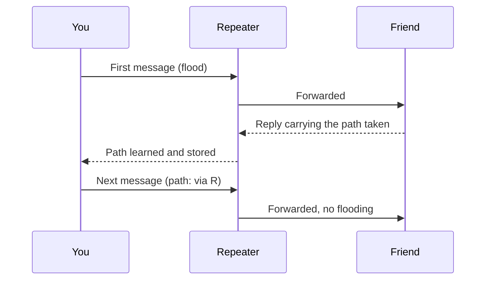

{:class="cover"}

---

By the end of this lesson you will be able to name the MeshCore roles, say what each one does, and explain why a companion node does not extend your range.

MeshCore is a lightweight, open source (MIT licence) mesh routing library and firmware for LoRa and other packet radios. In plain English, it turns a cheap LoRa board into a node on a self-organising, encrypted text messaging network.

---

## What problem does it solve?

Mobile phones are wonderful right up until there is no signal. Hills, festivals, remote workshops, hiking trips, power cuts and boats all have the same problem: the infrastructure is somewhere else.

A LoRa mesh moves the infrastructure to you. Nodes talk directly to other nodes in radio range, and repeaters extend that range by forwarding packets onward. There is no central server, no SIM card and no subscription.

{:class="img-fluid w-100"}

---

## The roles

When you flash MeshCore you choose what the board will be. This is the most important decision in the course, so let's take the roles one at a time.

### Companion (the client)

**What it does:** connects to your phone or computer over Bluetooth LE or USB serial. This is the node you talk through.

**Why this matters:** a companion does **not** repeat other people's traffic. If you flash two boards as companions you have two messengers, but no range extension at all.

### Repeater

**What it does:** forwards packets for other nodes. It has no phone attached and normally sits somewhere high with a power supply.

**Why this matters:** this is what turns radios into a *network*. A MeshCore repeater does not blindly rebroadcast everything it hears. It decides whether a packet needs forwarding, which keeps the mesh quiet as it grows.

### Room Server

**What it does:** a simple bulletin-board server that stores posts and hands them to users when they come back into range, a bit like a tiny email server. According to the MeshCore FAQ, a client logging in receives the previous 32 unseen messages.

### Sensor

**What it does:** reports telemetry, such as temperature or battery voltage, into the mesh rather than carrying conversations.

Room servers and sensors are built in the follow-on course [MeshCore Room Servers and Sensors](/learn/meshcore_rooms_sensors/). In this course we build one **Repeater** and one **Companion**.

---

## How routing differs from flooding-only meshes

MeshCore uses hybrid routing. The first message to a new contact **floods** through the repeaters to find them. The reply carries back the route it took, and later messages follow that stored path, so only the repeaters named in the path forward them.

Why this matters: airtime is the scarce resource in LoRa. Flooding costs airtime in proportion to the number of repeaters; path routing costs it in proportion to the number of hops. The next few lessons show you why.

MeshCore's own README describes it as similar in spirit to projects such as Meshtastic and Reticulum, with a focus on lightweight multi-hop routing and fixed roles. It is a different protocol: a MeshCore node and a Meshtastic node cannot talk to each other, even on identical hardware. I will not compare feature by feature here, because both projects move quickly. Check each project's own documentation before you choose.

---

## What MeshCore is not

- **Not LoRaWAN.** LoRaWAN needs gateways and a network server and is aimed at sensors reporting to the cloud. MeshCore is peer to peer.
- **Not fast.** You send short text messages at a few hundred to a few thousand bits per second. There is no voice, no images and no web browsing.
- **Not anonymous.** Direct messages are encrypted, but adverts announce your node's name and public key to anyone listening.

---

## Try it Yourself

1. Open [map.meshcore.io](https://map.meshcore.io) and find the MeshCore repeater nearest to you. How far away is it?
2. Look for a local MeshCore community for your region. In the UK, [localmesh.co.uk](https://localmesh.co.uk) is one place to start.
3. Challenge: sketch your street or village and mark the highest point you could reach with a power socket. That is where your repeater wants to live.

---

## Common Issues

- **Problem**: I flashed both boards as companions and my range has not improved.
- **Solution**: Reflash one board with repeater firmware.
- **Why**: Companion nodes never forward traffic for others, so without a repeater your range is whatever the two radios manage line of sight.

- **Problem**: My friend runs Meshtastic. Can we message each other?
- **Solution**: No, you both need to run the same firmware.
- **Why**: The protocols, packet formats and encryption are different, even on the same board.

> **Teachers**: MeshCore adverts broadcast a node's name to anyone in range. Have learners choose a nickname, never a full name or address, for every node.

## Check your understanding


? Which role forwards other people's packets to extend the network's range?
- [ ] Companion
- [x] Repeater
- [ ] Sensor
> A repeater forwards packets. A companion never repeats, so two companions alone give you no extra range.

? What happens to the first message you send to a brand new contact?
- [ ] It follows a path that every node already knows
- [x] It floods through the repeaters, and the reply brings back the path for later messages
- [ ] It is sent over the internet
> The first message floods to find the contact; the reply carries the route, and later messages use that stored path.

? Which statement about MeshCore is true?
- [ ] It is the same protocol as LoRaWAN
- [ ] It needs a monthly subscription
- [x] It is peer to peer and needs no central server
> MeshCore nodes talk to each other directly or through repeaters, with no gateway or network server.


---
