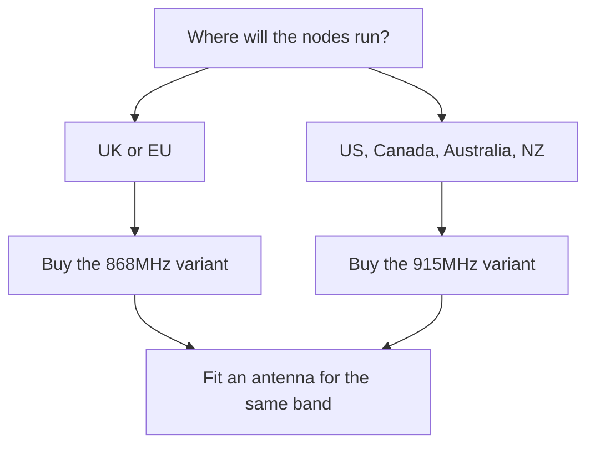

{:class="cover"}

---

By the end of this lesson you will be able to choose the right board variant for your country and list everything else you need before you flash.

LoRa mesh is one of the cheapest useful radio projects you can build, but one wrong order, the wrong frequency variant, is the classic expensive mistake.

---

## The recommendation: Heltec WiFi LoRa 32 V3

{:class="img-fluid w-100"}

The **Heltec WiFi LoRa 32 V3** is the board this course is built around. The MeshCore FAQ lists the Heltec V3 among its supported devices, and it is widely used. Always check the official flasher at [flasher.meshcore.io](https://flasher.meshcore.io) for the current supported list before you buy.

| Part | Spec (from Heltec's published details) |
|---|---|
| MCU | ESP32-S3, dual core, up to 240MHz |
| LoRa radio | Semtech SX1262, around +21dBm transmit |
| Display | 0.96 inch, 128x64 OLED, built in |
| USB | USB-C, with a serial converter on board |
| LoRa antenna | IPEX / U.FL connector |
| Battery | 2-pin SH1.25 connector with onboard charging |
{:class="table table-single"}

The onboard OLED is useful: a repeater with a screen shows its name and status without plugging anything in.

---

## Buy the right frequency

**This is the one thing to get right.** The Heltec V3 is sold in frequency variants, and they are not interchangeable.

- **868MHz / 915MHz (863-928MHz class)** is the one for the UK, Europe, and the Americas, Australia and New Zealand. Choose 868 in the UK and EU, and 915 in the US, Canada, Australia and New Zealand
- **433MHz** is a different variant for a different band, and MeshCore also supports it, but this course assumes 868 or 915

The radio front end is tuned for its band. A board built for 433MHz will not transmit well at 868MHz, and you cannot fix it in software. Read the listing's variant selector and the sticker on the board before you flash, and match your region's preset in lesson 6.

---

## The rest of the shopping list

### Antennas (2 needed)

Your board may ship with a short stubby antenna. It works, but it is the weakest part of the system. Lesson 4 covers what to look for. **Check the connector**: the V3's LoRa socket is a tiny snap-on U.FL / IPEX, not a screw-on SMA. A U.FL to SMA pigtail lets you fit a normal SMA antenna.

### USB-C data cable

Many cables bundled with power banks are charge-only. If your computer does not see the board, suspect the cable first.

### Optional: a battery

A single-cell 3.7V LiPo with the right 2-pin connector can plug into the board. **Check the polarity before you plug in.** Suppliers wire the same-looking connector in opposite ways, and reversed polarity can destroy the board and cause a hot battery. Only use cells from a reputable supplier, never charge a swollen or damaged cell, and do not leave a charging LiPo unattended.

### Optional: an enclosure

If the repeater goes outside, it needs a weatherproof box. We cover that in lesson 8.

---

## Other boards worth knowing

MeshCore also runs on other devices, according to its FAQ, including the Heltec T114, RAK WisBlock RAK4631 boards, the Lilygo T-Deck and various Seeed Studio devices. For a first build, two Heltec V3 boards keep things simple, because the course steps match the board.

---

## Try it Yourself

1. Find the exact frequency variant of a board you plan to buy, or read the sticker on one you already have. Does it match your country?
2. Check what connector your antenna uses, U.FL or SMA, and work out whether you need a pigtail.
3. Challenge: work out where in your home a repeater could go, and whether a power socket is within reach.

---

## Common Issues

- **Problem**: My board arrived and the computer will not see it.
- **Solution**: Try a different USB-C cable and a different port, then check your device list for a serial device.
- **Why**: Charge-only cables have no data lines, which is the number one cause of "dead" boards.

- **Problem**: I ordered the wrong frequency variant.
- **Solution**: Return or exchange it if you can. Otherwise keep it for a project in the right band.
- **Why**: The radio matching network is tuned for one band, so transmitting far outside it wastes power and can damage the output stage.

> **Teachers**: order boards for one region only, and write the frequency on each board with a marker so 433MHz and 868MHz units never get mixed in a class set. Keep LiPo batteries out of the first session. USB power is enough for every lesson, and a battery adds a fire and short-circuit risk that needs supervision.

## Check your understanding


? Which Heltec V3 variant should you buy for the UK?
- [ ] 433MHz
- [x] The 868MHz variant
- [ ] Any variant, you fix it in software
> The 868MHz variant matches the UK and EU band. The frequency variant is hardware and cannot be fixed in software.

? What connector does the Heltec V3's LoRa antenna socket use?
- [ ] SMA screw-on
- [x] U.FL / IPEX snap-on
- [ ] BNC
> The V3 has a tiny U.FL socket, so you may need a U.FL to SMA pigtail for a normal antenna.

? What should you check before plugging a LiPo into the board?
- [x] The polarity of the connector
- [ ] The colour of the cable
- [ ] The antenna gain
> Reversed polarity can destroy the board, and supplier wiring varies.


---
