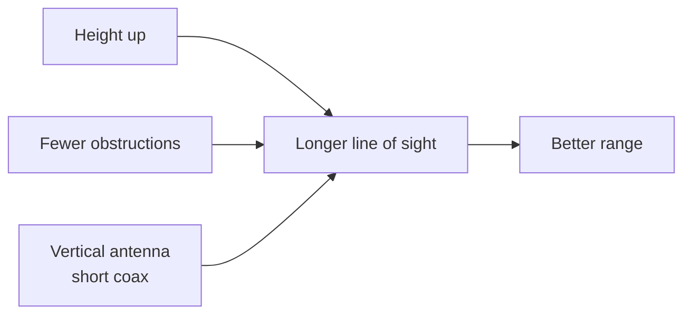

{:class="cover"}

---

By the end of this lesson you will be able to estimate a repeater's radio horizon, choose a good location and power source, and weatherproof it safely.

A repeater is only as good as its view of the world. This lesson is about the unglamorous physical stuff that decides whether your mesh covers a street or a county.

---

## Height is everything

At these frequencies you are close to line of sight. The biggest thing you control is how high the antenna is. A rough rule for the radio horizon:

> distance in km is about 4.12 x (square root of height 1 + square root of height 2), with heights in metres

| Repeater height | Client at 1.5m | Approx. radio horizon |
|---|---|---|
| 2m (desk) | 1.5m | ~11 km |
| 6m (roof gutter) | 1.5m | ~15 km |
| 15m (chimney or mast) | 1.5m | ~21 km |
| 100m (hilltop) | 1.5m | ~46 km |
{:class="table table-single"}

Real results are a lot less: buildings, trees and terrain take their cut. But the *shape* of the table is right, and height buys more than power does.



---

## Ranking the locations

- **Best:** an external pole above the roofline, antenna vertical, clear of the building
- **Very good:** a loft, though foil-backed insulation or a metal-covered roof blocks radio badly
- **Good:** an upstairs window with the antenna near the glass
- **Poor:** a shelf downstairs next to other electronics
- **Worst:** inside a metal box, next to a router, or behind a fridge: you have built a Faraday cage

---

## Powering it

A repeater runs all the time and draws little, but exact current depends on your board and settings, so measure it if you need to size a battery.

- **Mains USB:** a plain 5V phone charger is the cheapest and most reliable
- **USB power bank:** fine for temporary use, but many banks switch off when the load is very small, which is what an idle repeater is
- **LiPo battery:** a single cell on the board's battery connector. Fit a cell only if you can check the polarity, never leave it charging unattended, and keep it out of direct sun and sealed hot boxes
- **Solar:** possible, but an ESP32-S3 board is not the most frugal choice. The MeshCore FAQ lists boards such as the Heltec T114 that suit low-power builds

The repeater firmware has `powersaving on` (repeater only, per the docs) for battery nodes.

---

## Weatherproofing

If it goes outside, it needs to survive outside.

- Use a **weatherproof junction box**, with a hole for an antenna connector and a cable gland
- Put the board in the box and the antenna outside it, through a bulkhead connector. An antenna inside a sealed plastic box is a recipe for lost range
- Add a **silica gel sachet**, because condensation kills more outdoor electronics than rain
- Point the gland **downwards** and leave a drip loop in the cable
- Use a UV-stable box, as cheap plastic goes brittle in sun
- Keep mains power and cables safe and dry, and ask an adult or electrician for anything beyond a USB charger indoors
- Work at height with someone holding the ladder, and never climb for a node in bad weather

---

## Settings for a fixed repeater

```text
set advert.interval 60
set flood.advert.interval 12
set flood.max 3
```

For a battery-powered repeater, also consider:

```text
powersaving on
```

---

## Being a good mesh citizen

- **Do not run a repeater in a vehicle or anything that moves.** Paths break constantly and force the network back to flooding
- **Keep flood adverts rare.** Every one is rebroadcast by repeaters in the region
- **Tell your local community** the node exists and who looks after it
- **Set contact info** so someone can find you if your node misbehaves:

```text
set owner.info Kev - kevsrobots.com
```

---

## Try it Yourself

1. Walk your client away from the repeater until messages fail and note the distance. Move the repeater up a floor and try again.
2. Run `stats-radio` on the repeater before and after moving it. Did the noise floor change?
3. Challenge: use the formula to work out the radio horizon from the highest spot you can reach.

---

## Common Issues

- **Problem**: My repeater keeps dropping off overnight.
- **Solution**: Suspect the power supply, especially a power bank.
- **Why**: Many power banks switch off when the current is very low, and an idle repeater draws very little.

- **Problem**: Range got worse after I put it in a box outside.
- **Solution**: Move the antenna outside the box and keep the coax short.
- **Why**: Enclosures, especially damp ones, absorb signal, and thin coax is lossy.

- **Problem**: The loft install is poor.
- **Solution**: Check for foil-backed insulation or metal sheeting.
- **Why**: Foil acts like a mirror to radio waves and blocks them almost completely.

> **Teachers**: put classroom repeaters on a desk or window, not outside, and use USB power rather than a LiPo. Anything mounted outdoors or at height should be done by an adult with permission from whoever owns the building. Obtain consent before fixing anything to a school building.

## Check your understanding


? What is the single biggest thing you control for repeater range?
- [ ] The node name
- [x] The antenna height
- [ ] The advert colour
> Height extends line of sight, and the lesson's table shows range growing with height.

? Why is a metal box a bad place for the antenna?
- [x] It blocks and absorbs the radio signal
- [ ] It makes the board too cold
- [ ] It changes the frequency
> The lesson calls a metal enclosure a Faraday cage.

? Why might a repeater on a power bank drop off overnight?
- [ ] Power banks have no USB
- [x] Many banks switch off when the load is very small
- [ ] The repeater changes channel
> An idle repeater draws little current, so some power banks shut down.


---
