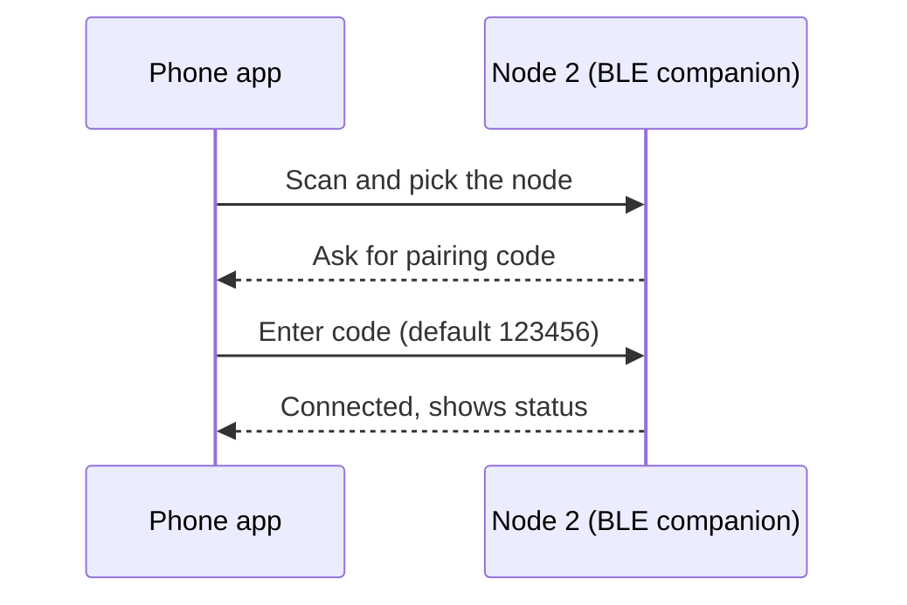

{:class="cover"}

---

By the end of this lesson you will be able to pair the companion board with the app, match its radio settings, and send an advert.

Node 2 has companion firmware. It has no keyboard, so your phone does the typing. Let's pair them.

---

## Getting the app

The MeshCore README lists the official clients: the **MeshCore app for Android and iOS** (find it in your app store, or follow the links on [meshcore.io](https://meshcore.io)) and the **web client** at [app.meshcore.nz](https://app.meshcore.nz). The apps are made by Liam Cottle.

According to the MeshCore FAQ, the apps are free to use, with an optional purchase that removes the wait timer on remote repeater management. You do not need it yet.

**No phone?** If you flashed Companion (USB Serial), plug the board into a computer and open the web client in Chrome or Edge.

---

## Pairing over Bluetooth

1. Power up node 2 with its antenna fitted
2. Open the app and choose to add or connect a device
3. Pick your node from the Bluetooth list; it has a generic name to begin with
4. Enter the pairing code if asked. The MeshCore FAQ gives the default as `123456`
5. The app connects and shows the node's status

**A note on Bluetooth range:** BLE only works over a few metres. The FAQ notes that the Heltec V3's built-in Bluetooth antenna is very small and short range, so keep the board near the phone. The long range part happens on the LoRa side.

---

## Naming your node

In the app's settings, set a node name. Other people in the mesh see it, so pick something you are happy being public, such as `Kev-Handheld`, never your full name and postcode.

---

## Matching the radio settings

This step decides whether the project works.

1. Open the app's settings for the connected node
2. Find the radio or frequency section
3. Choose your region's preset (for the UK, EU/UK (Narrow)), or enter the values by hand
4. Apply and confirm

Verify against what the repeater reported from `get radio` in lesson 7. For the UK preset they are:

| Setting | Expected (UK preset) |
|---|---|
| Frequency | 869.618 MHz |
| Bandwidth | 62.5 kHz |
| Spreading Factor | 8 |
| Coding Rate | 8 |
{:class="table table-single"}

If these do not match the repeater, nothing that follows will work. Menu names and layouts vary between app versions, so look for the preset option rather than a specific icon.

---

## Send an advert

Tell the mesh you exist. In the app look for an option to **advertise** or **send advert**.

- **Zero-hop advert:** heard by anything in direct range, including your repeater
- **Flood advert:** passed on by repeaters across the mesh

Start with zero-hop. The MeshCore FAQ says clients only advertise when you tell them to. Nobody knows you are there until you do.

---

## Battery and power

The companion is the node you carry:

- USB-C from a power bank is simplest
- A LiPo battery makes it portable. Check polarity before connecting, do not charge unattended, and stop using a cell that is hot or swollen
- The OLED uses power, so dimming it can help

---

## Try it Yourself

1. Pair the app, rename the node, and confirm the new name appears in the app.
2. Send a zero-hop advert, walk 20 metres away and send another. Does the repeater still hear you?
3. Challenge: forget the device in your phone's Bluetooth settings, then pair again, so it is no surprise later.

---

## Common Issues

- **Problem**: The node does not appear in the Bluetooth list.
- **Solution**: Confirm you flashed the Bluetooth companion and not USB Serial or Repeater.
- **Why**: Only the Bluetooth companion firmware advertises over Bluetooth, as the FAQ says.

- **Problem**: The app connects then disconnects, or will not reconnect.
- **Solution**: Remove the old pairing in your phone's Bluetooth settings, then pair again from the app.
- **Why**: A stale pairing confuses the connection state, and the FAQ recommends removing it before pairing again.

- **Problem**: Everything looks fine but my contact list is empty.
- **Solution**: Send an advert, and get the repeater to send one too.
- **Why**: Contacts are learned from adverts, and a silent mesh looks like a broken one.

> **Teachers**: phones are not always allowed in lessons, and an app store account may be needed. If phones are a problem, flash the USB Serial companion and use the web client on a school laptop. Make sure each pair pairs only with its own board: with a whole class advertising at once, the Bluetooth list will be long, so name the boards clearly.

## Check your understanding


? Which firmware lets the phone app connect over Bluetooth?
- [ ] Repeater
- [x] Companion (Bluetooth)
- [ ] Room Server
> Only the Bluetooth companion build advertises over Bluetooth.

? Why must the client's radio settings match the repeater's?
- [x] Nodes with different frequency, bandwidth or SF cannot hear each other
- [ ] The phone will not allow it
- [ ] The battery would drain
> Mismatched settings mean the nodes never hear each other.

? Does a client advert automatically on a timer?
- [ ] Yes, every minute
- [x] No, you send an advert yourself
> The FAQ says clients only advertise when the user does it.


---
