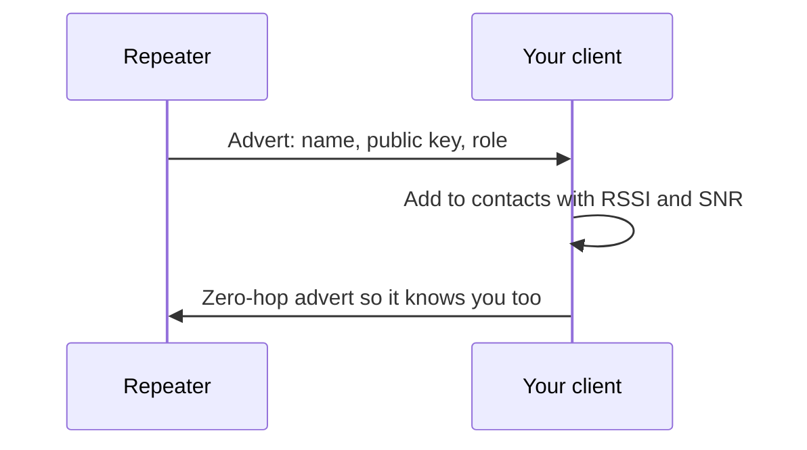

{:class="cover"}

---

By the end of this lesson you will be able to see your repeater in the contact list, read its RSSI and SNR, and tell direct messages from channel messages.

Two boards, two roles, matching settings. This is where it becomes a network.

---

## The moment of truth

Put the repeater at one end of the house and take the client with you, both powered, both with antennas. Look at the **contacts** list in the app. Within a minute or two of the repeater's next advert, or straight away if you press `advert` on its console, your repeater should appear by name.

**That is your mesh working.**

---

## What just happened

{:class="img-fluid w-100"}

The repeater sent an **advert**, a small signed packet with its name, public key and role. Your client heard it, added it to your contacts and recorded the signal quality. There is no pairing handshake or registration. In a mesh, being heard is joining.

---

## Reading the signal

Open the repeater in your contacts and you will see signal figures. These are the two to know:

- **RSSI** in dBm, always negative. Closer to zero is stronger. About -60 is a strong local signal; -110 or lower is the edge
- **SNR** in dB, how far the signal is above the noise. LoRa can decode with a *negative* SNR, which is what makes it remarkable

How to read them together: RSSI says how loud the signal arrived. SNR says how loud it was compared with the noise. A strong RSSI with a poor SNR points to local interference. A weak RSSI with a decent SNR just means you are far away.

---

## Sending a message

MeshCore has two ways to say something:

### Direct messages

Tap a contact and type. The message is encrypted to that node's public key, so only the recipient can read it, not the repeaters in between.

### Channel messages

Channels are group chat: everyone with the same channel key sees them. Lesson 11 covers them.

---

## Your first message

With two boards you have one human. A repeater is not much of a conversation partner, so here are three ways to get a real message through:

1. **Message a local community node.** If someone else is in range, they appear in your contacts and you can message them. Check [map.meshcore.io](https://map.meshcore.io) to see who is on air near you
2. **Add a third board** flashed as a companion and message between them
3. **Log in to the repeater** from the app, which we do in lesson 13

---

## Adverts in detail

| Type | Who hears it | When to use it |
|---|---|---|
| **Zero-hop** | Only nodes in direct radio range | Normal use, cheap and polite |
| **Flood** | Every node reachable through repeaters | When you first join, or after changing your name |
{:class="table table-single"}

Clients only advertise when you tell them to. Repeaters advertise on their timers. If you change your node's name and nobody sees it, send a flood advert.

---

## Storing contacts

Contacts persist in the app, with each node's public key and the last known path to reach it. If a repeater has moved and a contact stops working, **reset the path** and let the mesh rediscover it (lesson 12).

---

## Try it Yourself

1. Walk to the far corner of your property with the client and watch the RSSI change. Where does it start to struggle?
2. Send a flood advert from the client and see whether any nodes you did not know appear.
3. Challenge: put the repeater upstairs by a window, take the client for a walk, and note where you lose it. That is your coverage footprint.

---

## Common Issues

- **Problem**: The repeater never shows up in my contacts.
- **Solution**: Check the radio settings match exactly, then run `advert` on the repeater while watching the app.
- **Why**: Mismatched frequency, bandwidth or spreading factor is the most common cause.

- **Problem**: RSSI is very strong, around -30, and messages still fail.
- **Solution**: Move the two nodes a few metres apart.
- **Why**: A very strong nearby transmitter can overload the receiver, so two boards touching is a poor test.

- **Problem**: I can see the repeater but have nobody to message.
- **Solution**: Find a local community node, or add a third board.
- **Why**: A two node mesh with one repeater has one human on it. That is a limit of the network, not a fault.

> **Teachers**: with a whole class advertising at once, contact lists fill up fast. Give each pair a unique node name and, if it helps, keep pairs on a different table so signal strengths tell a clear story. Remind learners that adverts reveal names publicly, so nicknames only.

## Check your understanding


? What is an advert?
- [x] A small signed packet announcing a node's name, public key and role
- [ ] A text message to everyone
- [ ] A firmware update
> Adverts are how nodes become contacts: no handshake, just being heard.

? A strong RSSI but a poor SNR most likely means what?
- [ ] You are very far away
- [x] There is local interference or noise
- [ ] The antenna is perfect
> RSSI is loudness, SNR is loudness compared with noise, so local noise gives that combination.

? Why are direct messages private from repeaters?
- [ ] Repeaters are switched off
- [x] They are encrypted to the destination's public key
- [ ] They only travel by Bluetooth
> Only the destination can read a direct message.


---
