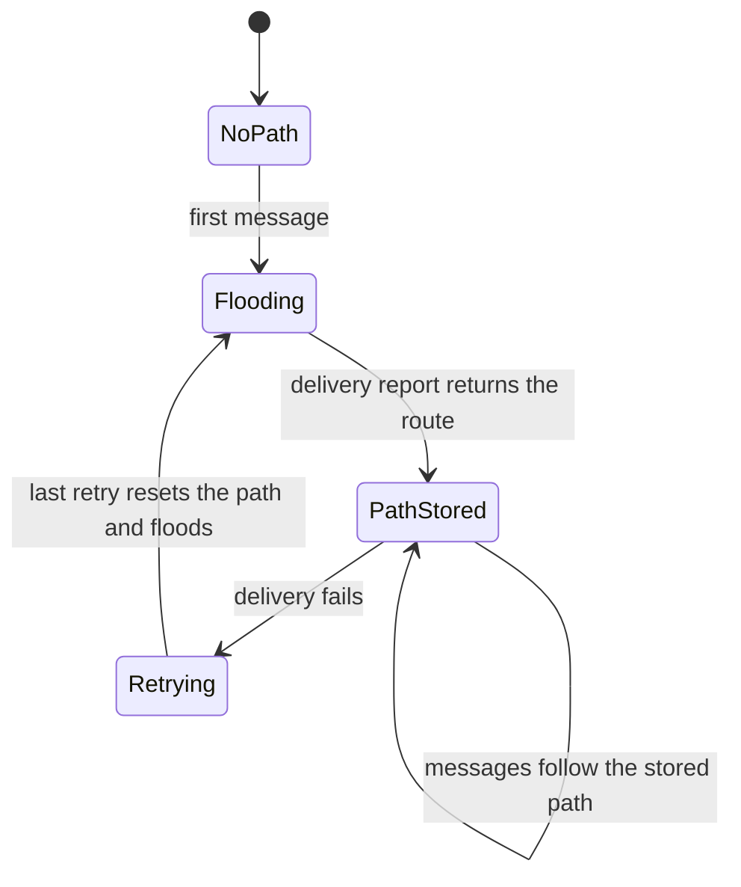

{:class="cover"}

---

By the end of this lesson you will be able to explain flood and path routing, count hops, and recover a contact whose stored path has broken.

This lesson explains why MeshCore behaves the way it does. Once routing clicks, why clients do not repeat and why adverts matter fall into place.

---

## Two ways to deliver a message

{:class="img-fluid w-100"}

### Flooding

Every repeater that hears a packet rebroadcasts it, up to a hop limit. It will find the destination if any route exists. **The cost:** airtime grows with the number of repeaters, not the distance. Twenty repeaters means twenty transmissions for one message.

### Path routing

The message carries an explicit list of the repeaters it should pass through. Only those repeaters forward it; everyone else hears it and ignores it. **The cost:** you have to know the path first.

---

## The hybrid

The MeshCore FAQ describes the sequence:

1. You send your first message to a new contact. There is no path, so it **floods**
2. The destination sends back a delivery report listing the repeaters the message passed through
3. Your node stores that path against the contact
4. Later messages carry the path, and only the named repeaters retransmit

This is why the first message can feel slow and later ones are quick. The network really did more work the first time.

---

## Hops

A **hop** is one repeater forwarding your packet. A path of `You to A to B to friend` has two repeater hops.

Fewer hops is better, because each hop costs airtime, adds delay and is another chance for loss. The firmware's hop limit is 64 with the default one-byte repeater IDs, according to the FAQ. Firmware v1.14 and later can also use two or three byte IDs, which allow 32 or 21 hops, so repeaters with the same first ID byte are easier to tell apart.

---

## Tracing a path

Many clients offer a **trace** on a contact. It shows which repeaters a packet used and the signal quality at each step. The Python tool `meshcore-cli` listed in the MeshCore README has similar features, so check its own documentation for the commands. Tracing is your best diagnostic: if messages to someone slow down, trace them and see whether the path grew an extra hop or one hop has a terrible SNR.

---

## When paths break

Paths are stored, not negotiated. If a repeater on the path goes off, the stored path stops working. The FAQ says the client retries along the old path, then on the final retry resets the path and floods, which recovers by itself in most cases. You can also **reset the path** by hand on a contact.

A repeater in a car breaks every path through it constantly, which is why mobile repeaters are bad for a mesh.

---

## Why clients do not repeat

If every phone node forwarded traffic, paths would run through devices that walk out of range mid-conversation, batteries would drain, and flood traffic would multiply with the number of people instead of the number of repeaters. MeshCore keeps the roles separate on purpose.

---

## Repeaters are selective

A repeater does not rebroadcast everything. It forwards when:

- the packet is a flood within its hop limit that it has not already seen, or
- the packet carries a path and this repeater is named in it

Everything else is heard and dropped. That selectivity is why a MeshCore mesh scales.

---

## Try it Yourself

1. Send a first message to a new contact and time it. Send a second and time that.
2. Run a trace on a distant contact and count the hops.
3. Challenge: switch your repeater off mid-conversation with someone routed through it. Watch the message fail, then recover by flooding. Switch it back on.

---

## Common Issues

- **Problem**: Messages to one contact stopped working, but everyone else is fine.
- **Solution**: Reset the path for that contact.
- **Why**: A stored path through a repeater that is now offline keeps failing until a new route is found.

- **Problem**: The first message to someone takes ages.
- **Solution**: Nothing is wrong. It is flooding to find them.
- **Why**: Hybrid routing works this way, and later messages use the learned path.

- **Problem**: My repeater has high packet counts but nobody routes through it.
- **Solution**: Check `stats-packets` and `neighbors`, then consider moving it higher.
- **Why**: Repeaters hear everything in range, but being used needs being on a path a client discovered, which usually means good placement.

> **Teachers**: a quick unplugged activity works well with no hardware. Give each learner a card with a repeater name, have the class pass a note by "flooding" (everyone repeats), then by a written path, and count how many handovers each took.

## Check your understanding


? How does a repeater decide whether to forward a path-routed packet?
- [ ] It forwards everything
- [x] It forwards if it is named in the path
- [ ] It forwards only if the user presses a button
> Only repeaters named in the stored path retransmit.

? Why is the first message to a new contact slower?
- [x] It floods to find the contact, then the path is learned
- [ ] The phone is warming up
- [ ] Bluetooth is slow
> The first message has no path, so it floods and the reply brings the path back.

? What happens on the last retry if a stored path has broken?
- [ ] The message is deleted
- [x] The path is reset and the message floods
- [ ] The repeater reboots
> The FAQ says the app resets the path and sends as flood on the last retry by default.


---
