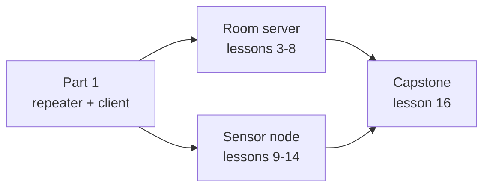

{:class="cover"}

---

By the end of this lesson you will be able to explain what a room server and a sensor node add to a plain MeshCore mesh, and decide which one solves a real problem for you.

A repeater and a client give you a working network. So why add anything else? Because a plain mesh has two blind spots, and each of these roles fixes one of them.

{:class="img-fluid w-100"}

---

## Blind spot one: the mesh has no memory

Here is the situation every mesh user runs into within a week.

You are out walking. Someone posts to the local channel that the footpath at the reservoir is flooded. You are three miles away, behind a hill, with no repeater between you. The message floods across the mesh, does not reach you, and is gone.

You come back into range an hour later. Nothing happens. There is no inbox, no queue, no retry. **The message did not fail to deliver - it simply never existed as far as your node is concerned.**

This is not a bug. A LoRa mesh is a broadcast medium: nodes hear what is in the air at the moment it is in the air. Nobody is holding anything for you.

**A room server holds it for you.** It is a small board that sits on the mesh, keeps recent posts in a buffer, and hands over what you missed the moment you log back in. It turns a live broadcast into something much closer to a message board.

---

## Blind spot two: the mesh only carries what a human types

Your mesh can tell you anything - as long as a person is standing there to type it.

That is a real limitation the moment you care about something unattended. Is the greenhouse below freezing? Is the water tank at the far end of the field getting low? Did the shed door get left open? Is the solar repeater on the hill actually charging, or has it been running down for a fortnight?

**A sensor node answers those questions.** It is a board with something measurable wired to it, sitting somewhere you are not, waiting to be asked.

---

## When is a room server worth it?

**Build one if:**

- You have a group of three or more people using the mesh regularly
- People move in and out of coverage - which is to say, people carry their nodes
- You want a persistent noticeboard rather than a live chat
- You are running a club, a village group, or a scattered family

**Do not bother if:**

- It is just you and one other person, both usually in range
- You want private one-to-one messaging - direct messages already do that better

**The honest test:** if your group regularly says "sorry, missed that, what did I miss?", build a room server.

---

## When is a sensor node worth it?

**Build one if:**

- You need a reading from somewhere with no WiFi and no mains
- The thing you are measuring changes slowly - hourly is fine
- You already have mesh coverage over the spot, or a repeater that reaches it

**Do not bother if:**

- The location has WiFi. An ESP32 posting to Home Assistant over WiFi is simpler, faster and gives you far more data
- You need readings every few seconds. LoRa airtime does not support that, and your neighbours will not thank you
- You need to *control* something remotely. MeshCore sensors report; they are not actuators

**The honest test:** if the spot has WiFi, use WiFi. LoRa is for the places WiFi cannot reach.

---

## How they differ from what you have built

| | Companion | Repeater | Room Server | Sensor |
|---|---|---|---|---|
| Attached to a phone | Yes | No | No | No |
| Forwards other traffic | No | Yes | Optional | Off by default |
| Stores messages | No | No | Yes | No |
| Answers telemetry requests | - | Yes | Yes | Yes |
| Typical power source | Battery / pocket | Mains, 24/7 | Mains, 24/7 | Battery or solar |
| Needs to be high up | Helps | Critical | Helps | Not really |
{:class="table table-single"}

Two things in that table are worth pausing on.

**A room server can also repeat** on some firmware versions, using `set repeat on`. The official FAQ says this is not recommended or encouraged, and recent builds may reject the command altogether. Lesson 8 covers why, and what to do instead.

**A sensor is a leaf by default.** Sensor firmware ships with forwarding disabled, because sensors are usually the most power-constrained thing on the mesh and forwarding other people's traffic is the fastest way to flatten a battery. The CLI has a `set repeat` setting, but you almost certainly should not turn it on for a battery node.

---

## What we are building

Over the rest of this course:

**Lessons 3 to 8** build a room server - flashed, named, passworded, joined from a phone, with permissions set up so your group can post but strangers cannot reconfigure it.

**Lessons 9 to 14** build a sensor node - flashed, wired to a BME280, reporting temperature, humidity, pressure and battery voltage back to your phone on request.

You can do either half on its own. If you only have one spare board, read both and pick the one that solves a problem you actually have.

---

> **Teachers**: Before anyone transmits, agree the local rules. LoRa uses licence-free bands, but the legal frequency, transmit power and duty cycle differ by country: 868MHz in the UK and EU, 915MHz in the US. Decide as a class who owns the radios and who holds the admin passwords, because a room server is shared infrastructure that outlives the lesson.

---

## Try it Yourself

1. Look at your own mesh use over the last week. How many times did someone miss a message? That number is your case for a room server.
2. Walk around your property and list every spot where you would like a reading but have no WiFi. That is your sensor shortlist.
3. Challenge: work out which single board would give you the most value - a second repeater, a room server, or a sensor. There is no universal right answer, and thinking it through is the useful part.

---

## Common Issues

- **Problem**: I built a room server and nobody uses it.
- **Solution**: Check that people actually know the guest password and how to join, and that the room appears in their contact list.
- **Why**: A room server is invisible until someone logs in. It is not like a channel that just appears - joining is a deliberate step, covered in lesson 6.

- **Problem**: My sensor never sends me anything.
- **Solution**: That is normal. MeshCore telemetry is pull-based - you have to ask.
- **Why**: The node reads its sensors locally on a timer, but it only transmits when a client requests telemetry. Silence is the correct, power-saving state. See lesson 9.

---

## Check your understanding


? What is the main gap a room server fills?
- [x] A plain mesh has no memory, so out-of-range people miss messages
- [ ] A plain mesh cannot send direct messages
- [ ] A plain mesh needs the internet
> Nodes only hear what is on air at the moment, so nothing holds a message for someone who was away.

? When should you choose WiFi over a LoRa sensor?
- [x] When the spot already has WiFi
- [ ] When you need readings every few seconds over kilometres
- [ ] When the sensor has no power
> WiFi is simpler and faster where it reaches; LoRa is for the places it does not.

? Which role is a leaf node by default, with forwarding off?
- [x] Sensor
- [ ] Companion with a phone
- [ ] Repeater
> Sensor firmware ships with forwarding disabled to protect the battery.


