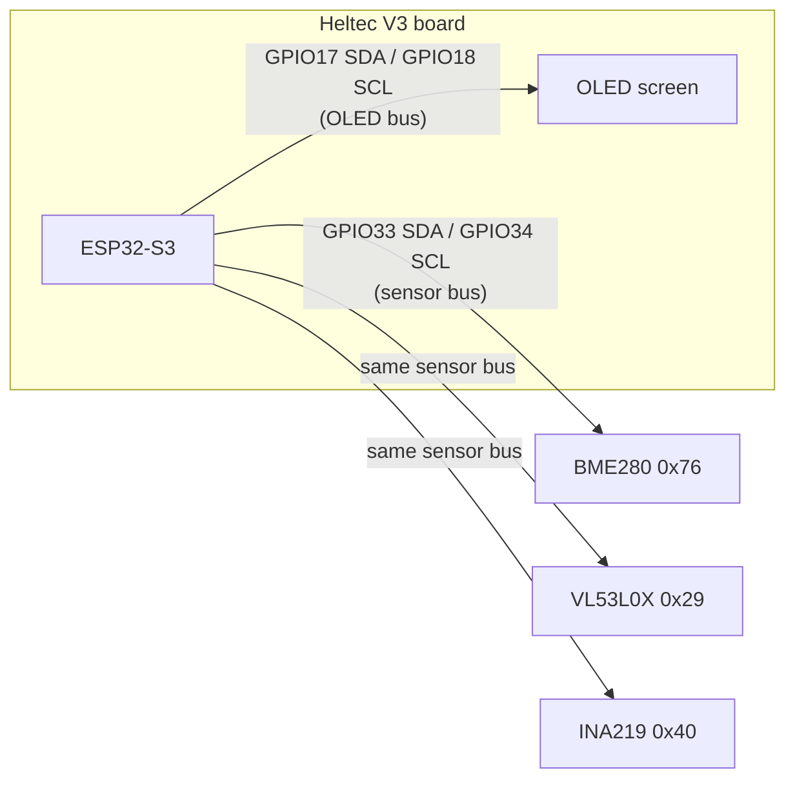

{:class="cover"}

---

By the end of this lesson you will be able to choose the right board and I2C sensors for a room server or sensor node, and say which pins the sensor bus uses.

Good news first: you already know the board. Both builds in this course run on the same Heltec WiFi LoRa 32 V3 you used in part one. The new spending is on sensors, and it is small.

---

## The boards

**Room server:** one Heltec WiFi LoRa 32 V3, 868MHz version (915MHz in the US). It behaves much like the repeater you already built - fixed location, mains power, no phone attached.

**Sensor node:** one Heltec WiFi LoRa 32 V3 in the same frequency version, plus whatever you are measuring.

The same warning applies as in part one: **check the frequency variant**. Buy the version that matches your country's band (868MHz in the UK and EU, 915MHz in the US). A 433MHz board is the wrong hardware and cannot be fixed in software.

---

## A word on sensor hardware choice

The Heltec V3 is a fine board to *learn* on, and that is why this course uses it. For a sensor node you leave outdoors for months, it is not the best choice - the ESP32-S3 is thirsty compared to the alternatives.

| Board | Why you would pick it |
|---|---|
| Heltec V3 | Cheap, you already have one, has a screen for debugging |
| Heltec T114 | nRF52840 - dramatically lower idle current, the right answer for solar |
| RAK WisBlock | Modular sensor slots and industrial enclosures |
| Seeed Xiao variants | Tiny, low power, good for tucking into small places |
| Seeed T1000-E | A sealed card-sized tracker with sensors built in |
{:class="table table-single"}

**Build it on a V3 first.** Get it working on the desk where you can see the screen and reach the USB port. Move it to a T114 once you know what you are doing and where it is going.

---

## Which sensors does MeshCore support?

This is the part worth reading carefully, because it saves you buying the wrong thing.

MeshCore's sensor firmware **scans the I2C bus at boot and auto-detects** what is connected. There is no configuration file, no pin mapping to edit, no sensor to declare. You wire it up, you power on, it appears.

The catch is that it detects a *specific list* of parts, and each driver is switched on by a build flag (`ENV_INCLUDE_BME280` and friends in the firmware source) when the firmware is compiled. Parts the source supports include:

| Sensor | Measures | Notes |
|---|---|---|
| **BME280** | Temperature, humidity, pressure | The recommended all-rounder; address 0x76 or 0x77 |
| BME680 | The above plus air quality / IAQ | More expensive, needs the BSEC library |
| BMP280 / BMP085 | Temperature, pressure | No humidity |
| AHT10 / AHT20 | Temperature, humidity | Cheap and cheerful |
| SHTC3 / SHT4x | Temperature, humidity | Better accuracy than AHT |
| LPS22HB | Temperature, pressure | Fixed address 0x5C |
| **INA219 / INA226 / INA260 / INA3221** | Voltage, current, power | Battery and solar monitoring |
| MLX90614 | Non-contact infrared temperature | Point it at a thing |
| **VL53L0X** | Distance (time of flight) | Tank levels, door open or shut |
| RAK12035 | Soil moisture and temperature | For growing things |
| RAK12500 / NMEA | GPS position | Location reporting |
{:class="table table-single"}

**If a sensor is not on that list, it will not just work.** A random DHT22 or a one-wire DS18B20 is not I2C and is not auto-detected. That does not make them useless - lesson 13 covers the custom firmware route - but it does mean they are not a five minute job.

> ## Check your board's build
>
> Sensor support is compiled per board. Before you buy, open the flasher at [flasher.meshcore.io](https://flasher.meshcore.io), select your board, and look at which firmware variants are offered. The MeshCore README names Companion, Repeater and Room Server as the flasher's firmware types, so a prebuilt Sensor image may not be offered for your board. The repository does contain sensor build environments (for example one for the Heltec V3), and whether a given driver such as the BME280 is included depends on the build flags. If the flasher has no sensor build that detects your part, you will be building firmware yourself, which lesson 13 explains.

---

## The parts list

### For the room server

- Heltec V3 (868MHz or 915MHz version to suit your country)
- A matching antenna
- A 5V USB mains charger
- Optional: a protected single-cell LiPo for backup (lesson 8)

### For the environment sensor

- Heltec V3, same frequency version, and a matching antenna
- A BME280 breakout, I2C version
- Four female-to-female Dupont jumper wires
- A protected single-cell LiPo with a connector that matches the board

Add an INA219 if you want battery and solar current, or a VL53L0X for tank level.

---

## Supply voltage and I2C address at a glance

Check these against each part's datasheet before you wire anything.

| Part | Chip supply (datasheet) | Default I2C address | Note |
|---|---|---|---|
| BME280 (Bosch) | 1.71 to 3.6V | 0x76 (SDO low) or 0x77 (SDO high) | Power the breakout from 3V3 |
| INA219 | 3 to 5.5V | 0x40 | Measured bus can be up to 26V |
| VL53L0X (ST) | 2.6 to 3.5V | 0x29 | Many breakouts add a regulator; use 3V3 anyway |
{:class="table table-single"}

Sensor addresses used by the MeshCore driver code are 0x76 then 0x77 for the BME280, 0x40 for the INA219 and 0x29 for the VL53L0X, which match the table.

---

## Buying BME280 breakouts - one gotcha

BME280 breakouts are sold everywhere for a couple of pounds, and a meaningful number of the cheapest ones are actually **BMP280** - the version without a humidity sensor. The silkscreen sometimes says BME280 even when the chip is a BMP280.

**How to tell:** both chips have a hole in the metal lid, so presence of a hole proves nothing. The tells are **shape and position** - a BME280 is a 2.5 x 2.5 mm square package with the hole roughly **centred**; a BMP280 is a 2.0 x 2.5 mm rectangle with the hole in a **corner**. If the listing price looks too good, you are probably buying a BMP280.

**The certain test:** wire it up and see whether humidity appears. The chip IDs differ (0x60 for BME280, 0x58 for BMP280) and the firmware reports what it finds.

**Does it matter?** If you only care about temperature and pressure, no. If you wanted humidity in the greenhouse, yes.

Also check the breakout is the **I2C** version - some boards break out SPI only, or need a solder jumper moved to select I2C.

---

## The Heltec V3 pins you need

This is the detail that trips people up, so it is worth getting right before you wire anything.

The Heltec V3 has **two separate I2C buses** in the MeshCore sensor build. The onboard OLED sits on one; your sensor goes on the other.

| Function | Pin |
|---|---|
| **Sensor bus SDA** | **GPIO33** |
| **Sensor bus SCL** | **GPIO34** |
| OLED bus SDA (not for your sensor) | GPIO17 |
| OLED bus SCL (not for your sensor) | GPIO18 |
| OLED reset | GPIO21 |
| Vext control (switches the external 3V3 rail) | GPIO36 |
| Battery voltage ADC | GPIO1 |
{:class="table table-single"}

**Why this matters:** wire your BME280 to GPIO17 and GPIO18 - the pins most tutorials mention, because they are the OLED's - and the sensor firmware will not find it. It is scanning the other bus.

> ## Confirm against your own firmware
>
> GPIO33 and GPIO34 are the sensor-bus pins set by `ENV_PIN_SDA` and `ENV_PIN_SCL` in the Heltec V3 sensor environment of the MeshCore repository, and GPIO17 and GPIO18 are the OLED pins set by `PIN_BOARD_SDA` and `PIN_BOARD_SCL`. Battery voltage is read on GPIO1 in the board code. The Vext pin is from Heltec's own V3 pinout, so check that against their documentation. Different boards use different pins, and builds do change. If `sensor list` comes up empty on correct wiring, check the variant configuration in [the MeshCore repository](https://github.com/meshcore-dev/MeshCore) for your board.

---

## How the two I2C buses are laid out

> **Teachers**: Parts bought on the cheap often turn out to be the wrong chip (a BMP280 sold as a BME280) or the wrong frequency. Order one spare breakout per group, and have learners check the board's frequency label before it is plugged in. Never power a radio board without its antenna.

---

## Try it Yourself

1. Open the flasher, select Heltec V3, and note down every firmware variant offered. Is there a sensor build?
2. Look at your BME280 breakout under a magnifier or phone camera. Can you see the vent hole in the metal lid?
3. Challenge: look up the idle current of a Heltec T114 and a Heltec V3 in their datasheets. How many times longer would the same battery last on the lower one?

---

## Common Issues

- **Problem**: I bought a sensor and MeshCore does not see it.
- **Solution**: Confirm it is on the supported list, that it is the I2C version, and that it is wired to the right pins.
- **Why**: The firmware only detects the specific parts compiled into that build. Anything else is invisible to it, no matter how well wired.

- **Problem**: My BME280 reports temperature and pressure but no humidity.
- **Solution**: You have a BMP280.
- **Why**: The two chips share a bus address and a footprint. The BMP280 simply has no humidity element, and the firmware reports what the chip offers.

---

## Check your understanding


? Which GPIO pins does the MeshCore sensor build scan for sensors on the Heltec V3?
- [x] GPIO33 (SDA) and GPIO34 (SCL)
- [ ] GPIO17 and GPIO18
- [ ] GPIO1 and GPIO36
> GPIO17 and GPIO18 belong to the OLED bus; the sensor bus is separate.

? A breakout labelled BME280 reports temperature and pressure but no humidity. What is the likely cause?
- [x] It is really a BMP280
- [ ] The antenna is missing
- [ ] The sensor is on 5V
> The BMP280 has no humidity element, so the firmware has nothing to report.

? Why should you wire the BME280 to 3V3 rather than 5V?
- [x] The ESP32-S3 uses 3.3V logic and the chip supply tops out at 3.6V
- [ ] 5V makes the radio transmit louder
- [ ] MeshCore refuses to scan on 5V
> The BME280 datasheet limits its supply to 3.6V, and a 5V-referenced bus can damage the microcontroller.


