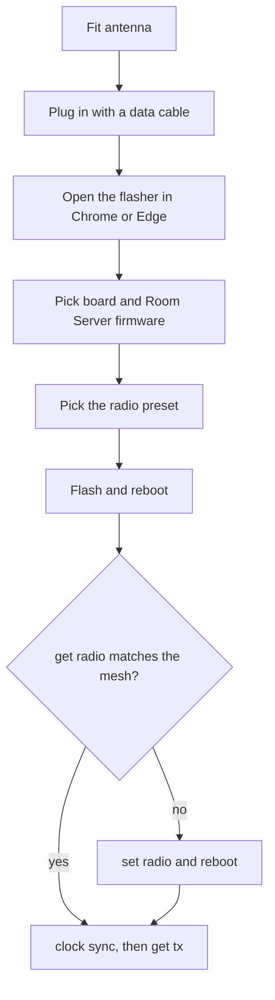

{:class="cover"}

---

By the end of this lesson you will be able to flash room server firmware, check the radio settings match your mesh, and set the clock.

This will feel familiar - it is the same flasher and the same process you used in part one, with a different firmware variant selected.

---

## Before you start

- **Fit the antenna.** Same rule as always, and it still matters
- Use **Chrome or Edge** - WebUSB and Web Serial do not exist in Firefox or Safari
- Have your **USB-C data cable** ready, not a charge-only one
- Label this board `ROOM` before you start. In an hour you will have three near-identical green boards on the desk

---

## Flashing

1. Fit the antenna, then plug the board into your computer
2. Open [flasher.meshcore.io](https://flasher.meshcore.io)
3. Select your board: **Heltec V3**
4. Select the firmware variant: **Room Server**
5. Select the region preset your part one mesh uses (for the UK that was **EU/UK (Narrow)**; wording may differ between flasher versions)
6. Click **Flash** and choose the serial port
7. Wait for the reboot

If the port list is empty, it is almost certainly the cable. That was true in part one and it is still true now.

---

## Confirm the radio settings

Connect the console - either the console feature on the flasher page, [config.meshcore.io](https://config.meshcore.io), or a serial terminal at **115200 baud**.

```text
ver
get role
get radio
```

You should see a firmware version, a role of room server, and your radio parameters. Check them against the rest of your mesh. These are the UK values from part one; if your mesh uses different numbers, match your mesh instead:

| Setting | Expected |
|---|---|
| Frequency | 869.618 MHz |
| Bandwidth | 62.5 kHz |
| Spreading Factor | 8 |
| Coding Rate | 8 |
{:class="table table-single"}

If anything is off:

```text
set radio 869.618,62.5,8,8
reboot
```

**Why this matters:** a room server on the wrong settings is not a broken room server, it is an invisible one. It will sit there working perfectly, heard by nobody. This is the number one cause of "my new node does not show up".

---

## Set the clock

```text
clock sync
```

Or from a plain terminal with no sync button:

```text
time <unix-epoch-seconds>
```

**Why this matters more here than on a repeater:** a room server uses timestamps for sync points. Each client records where it got to, and the server works out what to send based on that. A room server with a badly wrong clock will deliver the wrong set of posts, or none at all, in a way that is genuinely confusing to debug.

The server also rejects logins whose timestamp is not newer than the last one it recorded from that client - a replay protection measure. A clock that jumps backwards can lock a client out until it catches up.

Set the clock. It takes five seconds and saves an evening.

---

## Check the transmit power

```text
get tx
```

A room server is fixed and mains powered, so power use is not a worry, but stay within your legal limit. For a room that only serves a village, a moderate value is plenty:

```text
set tx 20
```

The setting accepts 1 to 22 dBm, and the board's real output may be a little lower at the top end. Your country sets the legal limit (in the UK and EU the 868MHz sub-band you use has its own power and duty-cycle limits), so check the rules before you go to full power, and use less if it is not needed.

---

## What the screen shows

The OLED on a room server will show its name, uptime, and packet counters, much like the repeater. It will not show posts - the room's contents live in memory and are served over the radio, not displayed.

If the screen is blank but the board is warm, the flash probably failed partway. Flash it again; nothing is harmed by reflashing.

---

## The flashing flow



> **Teachers**: Flashing needs Chrome or Edge on a computer where learners may use WebUSB or Web Serial, which some school-managed machines block. Test one machine first. Label each board before flashing, and keep the antenna fitted whenever a board is powered.

---

## Try it Yourself

1. Run `ver`, `board` and `get role` and note what each returns. Compare `get role` against your repeater.
2. Run `get radio` on the room server and on the repeater. Do the four numbers match exactly?
3. Challenge: reflash this board as a repeater, confirm `get role` changes, then flash it back to room server. Reflashing is cheap and being comfortable with it removes a lot of fear later.

---

## Common Issues

- **Problem**: There is no Room Server variant listed for my board.
- **Solution**: Check you selected the right board, and check the firmware version. If your hardware genuinely has no room server build, you will need to build it yourself from the MeshCore repository.
- **Why**: Firmware variants are compiled per board. Not every supported board gets every role in the prebuilt list.

- **Problem**: The console connects but every command returns nothing.
- **Solution**: Check the baud rate is 115200, and press enter on a blank line first.
- **Why**: Some terminals need a newline to wake the prompt, and any other baud rate turns the reply into noise.

- **Problem**: The board gets hot or the radio seems dead after power-up.
- **Solution**: Unplug it, fit the antenna, and check the antenna connector is seated.
- **Why**: A LoRa radio transmitting with no antenna can be damaged, so the antenna always goes on first.

- **Problem**: `set freq` is rejected over the air.
- **Solution**: Set frequency from the USB serial console instead.
- **Why**: Frequency is serial-only for setting on some builds - deliberately, because changing it remotely instantly disconnects you from the node you are configuring.

---

## Check your understanding


? Why must the room server's radio settings match the rest of your mesh?
- [x] Otherwise it is invisible to the other nodes
- [ ] Otherwise the OLED turns off
- [ ] Otherwise it uses more power
> Mismatched frequency, bandwidth or spreading factor means nobody hears it.

? Why does the clock matter more on a room server than a repeater?
- [x] Sync points for catching up are based on timestamps
- [ ] The OLED shows the time
- [ ] Passwords expire
> A badly wrong clock delivers the wrong posts, or none.

? Which console command sets the transmit power in dBm?
- [x] set tx
- [ ] set power
- [ ] set radio.tx
> `get tx` and `set tx` accept 1 to 22 dBm, within your legal limit.


