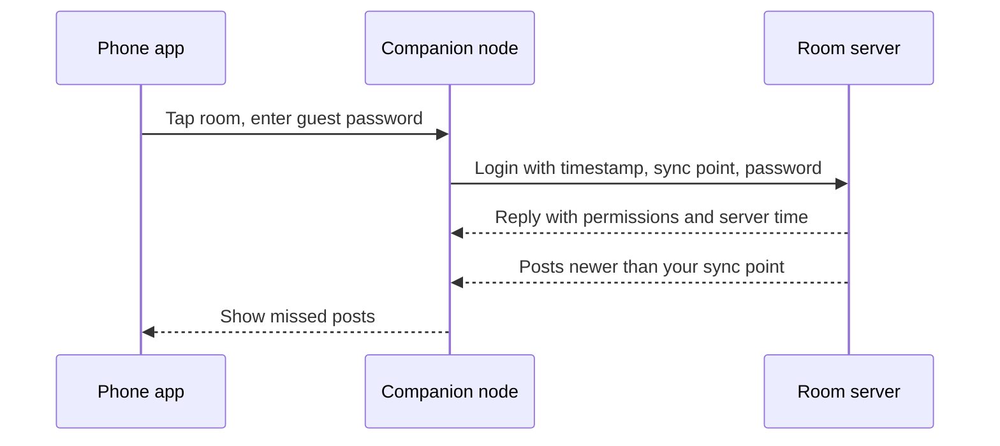

{:class="cover"}

---

By the end of this lesson you will be able to find a room server in the app, log in with the right password, post, and catch up on posts you missed.

The server is configured. Now let's use it - from the companion client you built in part one.

---

## Finding the room

1. Power up the room server and your client node, both with antennas fitted
2. Open the MeshCore app (the official app is called MeshCore on iOS and Android) and connect to your client over Bluetooth; screen names can differ between app versions
3. Wait for the room server to advert - or hurry it along by running `advert` on the server's console
4. The room appears in your **contacts list** by name

Give it a minute or three. Adverts are not instant, and a room server on a sensible advert interval is not shouting constantly.

**If it never appears**, the cause is almost always mismatched radio settings. Run `get radio` on the server and compare all four numbers against your client's settings screen.

---

## Logging in

Tap the room in your contacts. The app offers to join or log in, and asks for a password.

| What you type | What you get |
|---|---|
| Nothing, if read-only is enabled | Read the posts, cannot write |
| The **guest** password | Read and post |
| The **admin** password | Read, post, and administer the node |
{:class="table table-single"}

For normal group members, the guest password is the right answer. Save the admin password for yourself.

Behind the scenes the login carries your node's timestamp, your last sync point, and the password. The server replies with its own timestamp - which also nudges your client's clock into line - along with what permissions you have been granted.

---

## The catch-up

This is the moment the whole exercise is for.

When you log in, the server compares your **sync point** against its buffer of recent posts and sends you everything newer that you have not seen. Posts you wrote yourself are skipped, so you do not get an echo of your own messages.

**What that looks like in practice:** you walk back into range after a day away, open the app, tap the room, and a day's worth of posts arrives. No action needed beyond logging in.

**What it does not do:** it will not give you posts older than the buffer. The server holds a fixed number of recent posts (the FAQ says a login receives the previous 32 unseen messages) and overwrites the oldest as new ones come in. Two weeks away on a busy room and you will have missed some of it permanently.

---

## Posting

Once logged in with guest or admin permissions, posting is exactly like sending a message - type it and send.

Your post travels to the room server as a point to point message, gets written into the buffer, and is relayed on to everyone currently logged in and reachable. Everyone else picks it up on their next login.

**Keep posts short.** The same airtime economics from part one apply. A room is cheaper than a channel because it is addressed to one node rather than flooded, but it is still LoRa, and it is still a shared medium.

---

## What good room etiquette looks like

- **Say who you are** if your node name is not obviously you
- **One post, not five.** Each one is a separate transmission
- **Do not use the room for testing.** Test with a direct message to your own second node
- **Remember the buffer.** If something matters, say it again later rather than assuming everyone saw it
- **Remember posts vanish on reboot.** Anything critical should not live only in the room

---

## Multiple rooms

Nothing stops you running more than one room server, and nothing stops a client joining several. A club might reasonably run one general room and one for event-day coordination.

Each room is a separate node, with its own name, its own passwords, and its own buffer. There is no linking between them - a post to one does not appear in the other.

**The cost of a second room is another board and a wall socket.** That is often simpler than trying to make one room serve two purposes.

---

## What happens when you log in

> **Teachers**: Joining needs a phone with Bluetooth and the MeshCore app installed. Check your school's device and app policy first, because many schools restrict app installs. If phones are not allowed, a teacher-held phone can act as the class client, or learners can read the lesson and walk through the diagram instead. Agree the room's purpose and etiquette before sharing the guest password.

---

## Try it Yourself

1. Log into the room, post a message, then log out and post from a different node. Log back in and confirm the catch-up works.
2. Post more than 32 messages, then log in from a node that has been away. Watch the oldest ones be gone.
3. Challenge: with `allow.read.only on`, join from a node using no password at all, and confirm you can read but not post. That is exactly what a stranger will experience.

---

## Common Issues

- **Problem**: The room never appears in my contacts.
- **Solution**: Compare `get radio` on the server against the client's radio settings, then run `advert` on the server.
- **Why**: Mismatched frequency, bandwidth or spreading factor is the cause the overwhelming majority of the time. Everything else is a distant second.

- **Problem**: I log in and get no history at all.
- **Solution**: Check the server's clock with `clock`, and sync it if it is wrong.
- **Why**: Catch-up is driven by timestamps. A server with a wildly wrong clock cannot work out which posts you have already seen.

- **Problem**: My login is rejected even with the right password.
- **Solution**: Check your client's clock, and try again in a minute.
- **Why**: The server rejects logins whose timestamp is not newer than the last one it recorded from your node. A client clock that has jumped backwards will be refused until it catches up.

- **Problem**: I can read but every post I send fails.
- **Solution**: Log out and log back in with the guest password.
- **Why**: You joined as a read-only guest. Read-only access looks like a successful join until the first time you try to write.

---

## Check your understanding


? What does the room server compare to decide which posts to send you?
- [x] Your sync point against its buffer of recent posts
- [ ] Your phone's battery level
- [ ] The signal strength
> On login it sends posts newer than your last sync point, skipping your own.

? You can read the room but every post fails. Why?
- [x] You joined with no password, as a read-only guest
- [ ] The antenna is too long
- [ ] The room is full
> Read-only access looks like a join until you try to write.

? Why might a login be refused even with the right password?
- [x] Your clock is behind the last timestamp the server recorded for you
- [ ] The room has too many posts
- [ ] The guest password expired
> The server rejects logins whose timestamp is not newer, a replay protection measure.


