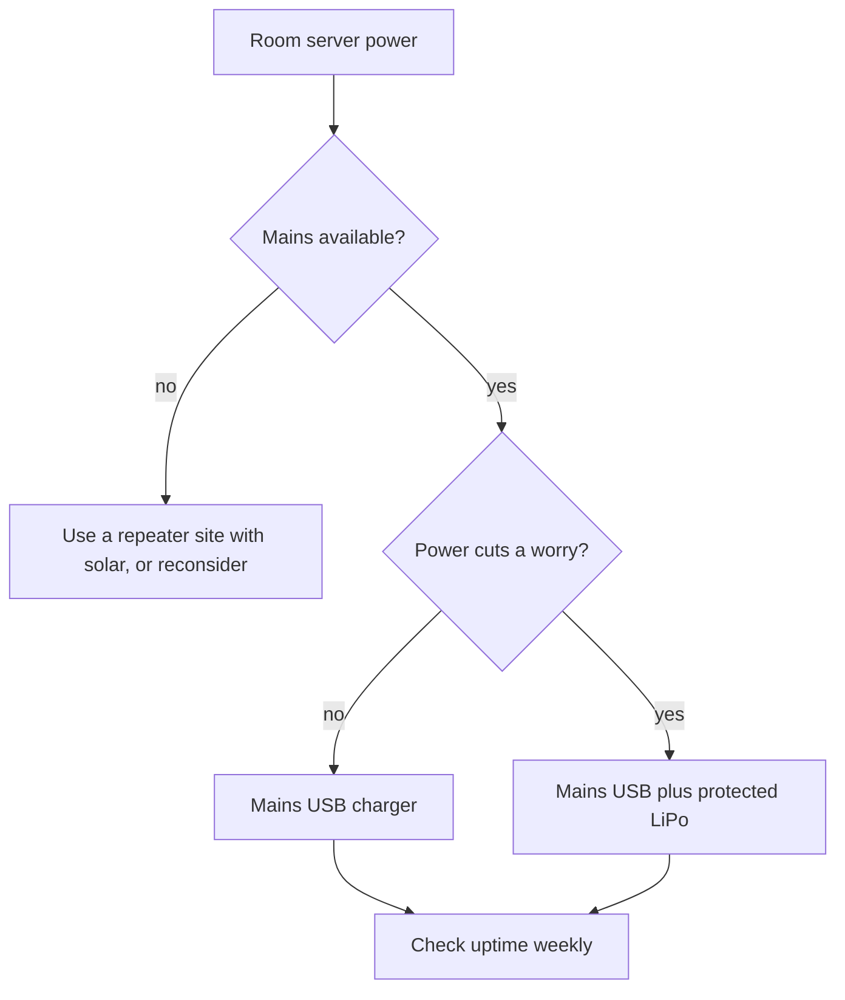

{:class="cover"}

---

By the end of this lesson you will be able to power and place a room server so it keeps its posts, and monitor its uptime.

A room server is infrastructure. Once your group depends on it, the interesting problems stop being about firmware and start being about electricity.

---

## The power problem

Say it once more, because it governs everything else:

> **Posts live in RAM. Lose power, lose the posts.**

A repeater that reboots comes back in seconds and nobody notices. A room server that reboots comes back empty, and the first person to log in sees an empty noticeboard with no explanation.

### Ranking the power options

**Best: mains USB with a battery backup.** A 5V mains charger for normal running, plus a LiPo on the board's battery connector as a fallback. **Check the connector polarity against the markings on the board before you plug a cell in**: matching plugs from different suppliers can be wired the opposite way round, which can destroy the board and the cell. Use only a single-cell LiPo with a built-in protection circuit, never puncture or crush it, and do not leave it charging unattended or in a sealed hot box. The board runs from USB, charges the cell, and rides through a cut without dropping.

**Good: mains USB alone.** Simple and reliable, right up until the power goes off.

**Poor: USB power bank.** Many power banks shut down when the load drops below a threshold, and an idle room server draws very little. If you use one, get a model with a low-current or always-on mode and test it for a week before trusting it.

**Bad: battery only, no charging.** It will die at an unpredictable moment and take the room's contents with it.

### Sizing a backup cell

A Heltec V3 is not a low-power board: its ESP32-S3 and radio draw tens to hundreds of milliamps (see Heltec's datasheet for exact figures). Divide the cell's capacity by the average current to estimate the runtime. At an average of 100mA, a 2000mAh LiPo gives you roughly 20 hours, which is enough for a typical power cut but not a long outage. Measure your own board rather than trusting this sum.

If you need days rather than hours, the answer is different hardware: a Heltec T114 on nRF52840 draws a fraction of this.

---

## Where to put it

A room server has an easier life than a repeater, because it does not need to reach the horizon - it only needs to reach the people who use it.

**Good enough:** a shelf indoors, upstairs, antenna vertical, near enough to a socket. If your group is in one village, that will very likely do.

**Better:** the same place your repeater lives. Everyone who can reach the repeater can reach the room.

**Do not:** put it in a metal cabinet, behind a fridge, or wedged next to a WiFi router. And keep the antenna vertical - horizontal costs you range for free.

**A useful trick:** if you already have a repeater at a good site, put the room server next to it on the same power supply. The two boards use one socket and give you a room that reaches everyone the repeater reaches.

---

## The repeat question

On some firmware versions a room server can also forward packets. The CLI has:

```text
get repeat
set repeat off
```

The room server source sets forwarding off by default, and recent builds may answer `set repeat on` with an error saying it is deprecated, so a fresh room server is usually not repeating. Check anyway, because versions differ.

**The case for leaving repeat on:** one board, one socket, two jobs. Tempting when you have one good site.

**The case against - and it is the stronger one:**

- The official FAQ says room server repeating is not recommended or encouraged, and advises running a repeater and a room server on separate devices
- Two jobs on one board means one failure takes out both
- A room server's RAM is holding your posts. Anything that increases the chance of a reset is working against you
- Repeating adds transmit load, which adds heat and current draw

**The recommendation:** if the room matters, keep repeat off and add a dedicated repeater board. If you are experimenting, leave it on and see how you get on.

---

## Monitoring it

Connect over USB serial occasionally and run the statistics commands (the CLI reference lists `stats-core`, `stats-radio` and `stats-packets` as serial only):

```text
stats-core
stats-radio
```

**What to look for:**

**Uptime** is the important one. If uptime keeps resetting, you have a power problem - and every reset emptied the room. Track it over a week.

**Queue depth** in `stats-core` should sit near zero. A persistently non-zero queue means the node is receiving faster than it can transmit.

**Noise floor** in `stats-radio` tells you whether new interference has appeared nearby. A rising noise floor quietly eats your range.

---

## A maintenance rhythm

Room servers are low maintenance, but not zero:

**Monthly:** check uptime. Anything under a month suggests unplanned resets.

**Quarterly:** check for firmware updates, and confirm your group can still get in.

**Annually:** rotate the guest password, and re-read your own `owner.info` to check it is still accurate.

**Before any event:** reboot it deliberately at a quiet moment, so the buffer is clear and you know it is starting healthy.

---

## Telling your group the truth

The single best operational habit is setting expectations honestly. Something like:

> The room keeps roughly the last 30 posts. If you have been away a long time you will not get all of it. If the power goes off, everything in the room is lost. Anything important, say twice.

People are entirely fine with limitations they know about. What annoys them is a system they thought was reliable quietly not being.

---

## Choosing a power setup



> **Teachers**: Charged LiPo cells are a fire risk if damaged or short-circuited. Store them in a metal tin or fireproof bag, never charge unattended, and inspect them for swelling before each lesson. Do not leave a room server on a school socket without the site manager agreeing, and note that an unattended mains device may need a PAT-tested charger.

---

## Try it Yourself

1. Run `stats-core` and note the uptime. Check again in a week - has it kept counting?
2. Deliberately pull the power for ten seconds, then log back in. Confirm the buffer is empty. Now you know exactly what a power cut looks like.
3. Challenge: set up mains power with a LiPo backup, then pull the mains and confirm the room keeps running and keeps its posts.

---

## Common Issues

- **Problem**: The room empties itself every few days.
- **Solution**: Check `stats-core` uptime, then suspect the power supply - especially if it is a USB power bank.
- **Why**: Many power banks auto-shutdown below a current threshold, and an idle room server draws very little. The board reboots, RAM clears, posts are gone.

- **Problem**: My room server is also repeating and I want to stop it.
- **Solution**: `set repeat off`, then confirm with `get repeat`.
- **Why**: Forwarding is normally off on room server firmware, so if it is repeating, a different build or a setting change turned it on.

- **Problem**: The battery is hot, swollen or the board smells of burning.
- **Solution**: Unplug everything, move it somewhere non-flammable such as outside on stone, and do not use that cell again.
- **Why**: A damaged or reverse-connected LiPo can overheat and catch fire.

- **Problem**: People near the repeater can use the room but people at the edge cannot.
- **Solution**: Move the room server to the repeater's site, or add a repeater between the room and the people who cannot reach it.
- **Why**: Room traffic is point to point, so a client needs a working path to the server specifically. Being able to hear a repeater is not the same as being able to reach the room through it.

---

## Check your understanding


? Why can a USB power bank cause a room server to lose its posts?
- [x] It can shut off when the load is low, rebooting the board and clearing RAM
- [ ] It makes the radio transmit too loudly
- [ ] It changes the radio frequency
> An idle room server draws little, so some power banks switch off.

? What should you check before plugging a LiPo into the board connector?
- [x] The polarity against the board's markings
- [ ] The colour of the wires only
- [ ] The cell's price
> Connectors that look identical can be wired in reverse.

? Which command do you use to read uptime, and over which connection?
- [x] stats-core over USB serial
- [ ] get uptime over the air
- [ ] advert
> The CLI reference marks stats-core as serial only.


