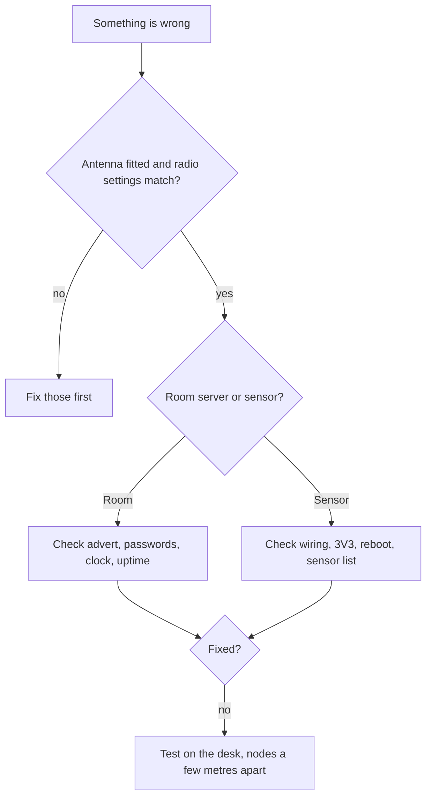

{:class="cover"}

---

By the end of this lesson you will be able to work through a checklist to diagnose room server and sensor problems, and know when to erase and start again.

Work down this list in order. As in part one, most problems are in the first few items, and most of those are radio settings or wiring.

---

## The two minute checklist

Before anything clever:

1. **Antennas fitted?** Still the first question, still catches people
2. **Radio settings identical across all nodes?** `get radio` on each - the same four numbers everywhere (869.618, 62.5, 8, 8 in the UK setup from part one)
3. **Has the node adverted?** Nothing knows it exists until it does
4. **Right firmware variant?** `get role` tells you what you actually flashed
5. **Clock set?** Especially critical on a room server

---

## Room server problems

### Nobody can find the room

1. `get radio` on the server. Compare all four numbers against a working client
2. `get role` - confirm it really is running room server firmware
3. Run `advert` on the console while someone watches their contacts list
4. Move the client and server a few metres apart - too close overloads the receiver

### People find it but cannot log in

1. `get guest.password` - is it what you told them?
2. `clock` - is the server's time right? Sync it
3. Have them wait a minute and try again - a client whose clock has jumped backwards is refused until it catches up
4. `get allow.read.only` - if on, they may be joining read-only without realising

### The room keeps emptying

1. `stats-core` - what is the uptime? If it keeps resetting, it is a power problem
2. Suspect the USB power bank first. Idle draw is often below its auto-shutdown threshold
3. Check for a loose USB connector - the classic slow-motion failure
4. Add a LiPo on the SH1.25 connector as backup

### People can read but not post

`set guest.password` and give them the password. Read-only access looks like a successful join until the first post fails.

### Posts arrive for some people and not others

1. Check the ones who miss out have actually logged in, not just come into range
2. `stats-core` on the server - is the queue backing up?
3. Consider whether those users have a working path to the server specifically, rather than just hearing a repeater

---

## Sensor node problems

### `sensor list` shows nothing but battery

In order:

1. **Check all four wires.** VCC, GND, SDA, SCL
2. **Confirm 3V3, not 5V**
3. **`reboot`.** Detection runs at boot only - this is the single most common cause
4. **Confirm the part is supported.** A DHT22 or DS18B20 will never appear
5. **Check for an address clash** if you have two sensors on the bus
6. **Confirm the firmware has sensors compiled in** - if `sensor list` is not a recognised command, it does not

### The board reset or went dead when I wired the sensor

You probably have a short. Unplug USB at once and check 3V3 against GND, and SDA against SCL. The screen is on a separate bus (GPIO17 and GPIO18), so a working screen tells you nothing about the sensor bus, but a dead one after wiring points to a supply short or a reversed connection.

### Telemetry requests time out

1. Can you message the node normally? If not, fix that first - telemetry rides on messaging
2. Is the node powered? Check battery voltage if you can reach it
3. How many hops away is it? Trace the path
4. Has it adverted recently?

### Readings look wrong

| Symptom | Likely cause | Fix |
|---|---|---|
| Temperature 1-2°C high | Self-heating from the board | Move sensor onto a short lead in free air |
| Temperature wildly high | Direct sunlight | Shade it |
| Humidity stuck at 100% | Condensation on the element | Dry it out somewhere warm |
| No humidity at all | It is a BMP280, not a BME280 | Check the package shape (lesson 2) |
| Pressure a few hPa off | Normal absolute accuracy | Use the trend, not the value |
| Battery voltage wrong | ADC multiplier needs calibrating | `set adc.multiplier` |
| Distance jumping around | Dirty lens or awkward target | Clean it, aim square at the surface |
{:class="table table-single"}

### The node dies overnight

1. Check voltage **under load**, not idle
2. Suspect cell capacity rather than cell voltage - an aged LiPo reads fine and collapses under current
3. Check the Vext rail if the sensor works on USB but not battery
4. Reduce `set tx` and lengthen advert intervals

---

## Diagnosing across both roles

These commands are your instrument panel:

| Command | Tells you |
|---|---|
| `ver` / `board` | Firmware and hardware - start here |
| `get role` | What this node actually is |
| `get radio` / `get freq` | Whether it can talk to anything |
| `stats-core` | Uptime, battery, queue depth (serial only) |
| `stats-radio` | RSSI, SNR, noise floor (serial only) |
| `stats-packets` | Whether it is hearing anything at all (serial only) |
| `sensor list` | What sensors were detected at boot |
| `clock` | Time - critical for room servers |
| `get acl` | Who has what permission (serial only) |
{:class="table table-single"}

**A useful habit:** run `stats-radio` when everything is working and write down the noise floor. When something degrades in six months, you will have a baseline to compare against, and that turns guesswork into diagnosis.

---

## When to start over

Sometimes the fastest fix is a clean slate:

```text
erase
reboot
```

Then reflash and reconfigure. Ten minutes, and it eliminates every accumulated mistake at once.

**Note what you are losing:** `erase` is serial only and is a destructive factory reset, so it clears the configuration and the buffer. Tell your group first.

---

## Where to start



> **Teachers**: Troubleshooting is the best bit to do in pairs, with one learner breaking something (pulling a wire, setting a wrong frequency) for the other to find. Check the rules for where you transmit: if a node is not heard, resist raising power beyond your country's legal limit. Keep antennas fitted while powered.

---

## Try it Yourself

1. Deliberately break something - unplug the sensor's SDA wire - and work down the checklist until you find it.
2. Record `stats-radio` output from every node in your mesh. That set of baselines is your future self's best diagnostic tool.
3. Challenge: write a one-page card for your own setup listing each node's name, role, radio settings, passwords and normal readings. Tape it inside the enclosure lid.

---

## Common Issues

- **Problem**: Everything worked on the desk and nothing works once deployed.
- **Solution**: The problem is physical - range, obstruction, antenna orientation, or power.
- **Why**: Settings problems are all-or-nothing and would have failed on the desk too. Gradual, position-dependent failures are always physical.

- **Problem**: My range is worse than a friend's, and I am tempted to raise the power.
- **Solution**: Improve the antenna height and position first, and stay within the legal transmit power and duty cycle for your country.
- **Why**: Limits on power and airtime differ by country (868MHz in the UK and EU, 915MHz in the US), and a good antenna position gains more than a few extra dB anyway.

- **Problem**: I have tried everything and it still will not work.
- **Solution**: `erase`, reflash, and rebuild the configuration on the desk with all nodes a few metres apart.
- **Why**: Debugging two unknowns at once is much harder than starting from a known good state and adding one variable at a time.

---

## Check your understanding


? Why is a working OLED not proof your sensor wiring is right?
- [x] The screen is on a different I2C bus (GPIO17 and GPIO18)
- [ ] The OLED does not use I2C
- [ ] The OLED switches off the sensor
> The sensor scan uses GPIO33 and GPIO34.

? Which commands are serial only according to the CLI reference?
- [x] stats-core, stats-radio, stats-packets and erase
- [ ] ver and board
- [ ] get role
> Use USB for those.

? Everything worked on the desk but not once deployed. What kind of problem is it?
- [x] A physical one: range, obstruction, antenna or power
- [ ] A password problem
- [ ] A firmware version problem only
> Settings problems are all or nothing and would have failed on the desk too.


