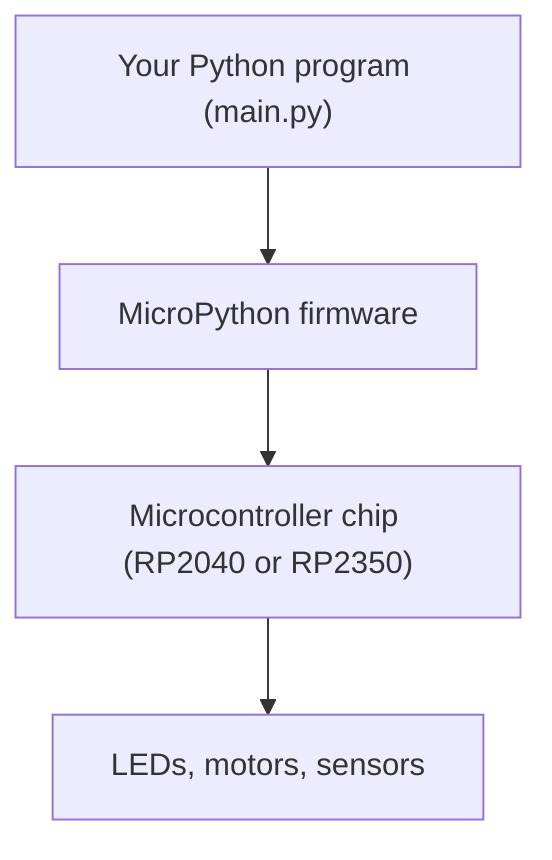

{:class="cover"}

---

By the end of this lesson you will be able to explain what MicroPython is, where its name comes from, and why it can run on a tiny board like the Raspberry Pi Pico.

## What's in a name?

`MicroPython` is a version of the programming language `Python`, designed for use with microcontrollers: `Micro` + `Python`.

A **microcontroller** is a tiny computer on a single chip. It is the brain inside a robot, a washing machine or a smart light bulb. The Raspberry Pi Pico is a board built around one.

`Python` gets its name from a TV show...

> *"When he began implementing Python, Guido van Rossum was also reading the published scripts from 'Monty*
> *Python's Flying Circus', a BBC comedy series from the 1970s. Van Rossum thought he needed a name that was*
> *short, unique, and slightly mysterious, so he decided to call the language Python"*
>
> docs.python.org

So no snakes, only comedians. (Python's logo does have snakes in it, which doesn't help.)

## MicroPython background

MicroPython was created by Damien George, with the initial release launched on 3 May 2014. It is itself a program, written in the C language, that runs on a microcontroller and reads your Python code.

That is the important idea, so let's draw it:

Your code sits on top. The **firmware** is MicroPython itself, which has been copied onto the board. It understands your code and talks to the chip's pins for you.

## Is it really Python?

Yes, with some differences. MicroPython is a complete rewrite that follows Python 3 closely, but it has been squeezed to fit on small chips. The MicroPython website says it needs as little as 256 KB of code space and 16 KB of RAM. A Pico has far more than that: 2 MB of flash storage, and 264 KB of RAM on the Pico, 520 KB on the Pico 2.

In return for being small, MicroPython leaves out some of the big standard Python libraries, and adds extra modules for hardware, such as `machine`, which lets you control pins. If you search the internet for Python help, most of it will work, but when a trick fails, remember that you are on a small board.

## Try it Yourself

1. Say out loud, to a friend, what `Micro` and `Python` each mean. Can they repeat it back?
2. Look up the specifications of your board. How much RAM does it have, and how does that compare with your phone?
3. Challenge: find the MicroPython website and read its "About" description. Which words from this lesson appear in it?

## Common Issues

- **Problem**: I searched for a Python answer and the code doesn't work on my Pico.
- **Solution**: Look for a MicroPython version of the answer, and check the module exists with `import` in the REPL.
- **Why**: MicroPython has a smaller set of libraries than the Python that runs on a laptop.

## Check your understanding


? What does the Micro in MicroPython refer to?
- [ ] It is a tiny snake
- [x] It is Python for microcontrollers, which are tiny computers on a chip
- [ ] It is a version of Python for children
> MicroPython is Python designed for use with microcontrollers: Micro + Python.

? Where does the name Python come from?
- [ ] A species of snake
- [x] The BBC comedy series Monty Python's Flying Circus
- [ ] A computer scientist called Python
> Guido van Rossum named the language after the TV show.

? What is the MicroPython firmware?
- [ ] Your finished program
- [x] A program, written in C, that runs on the board and reads your Python code
- [ ] A cable that connects the board to a computer
> The firmware is MicroPython itself, which sits between your code and the chip.

