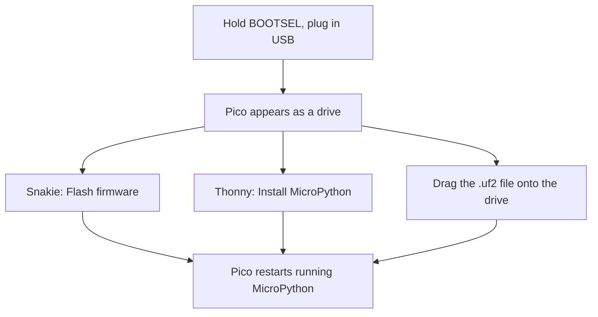
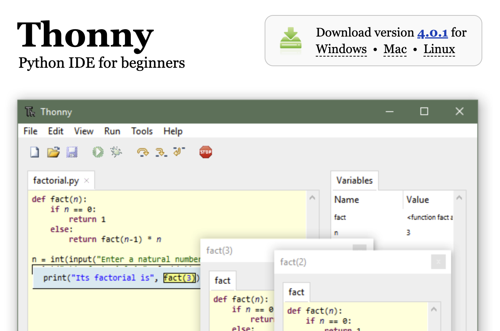
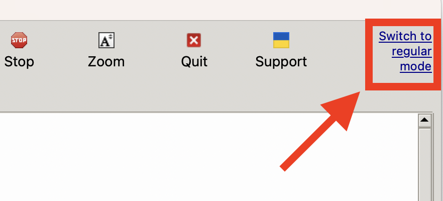
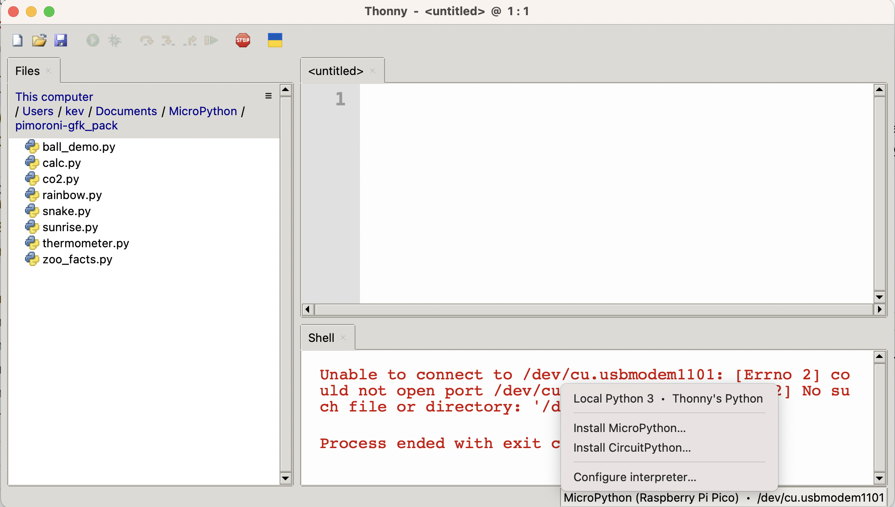
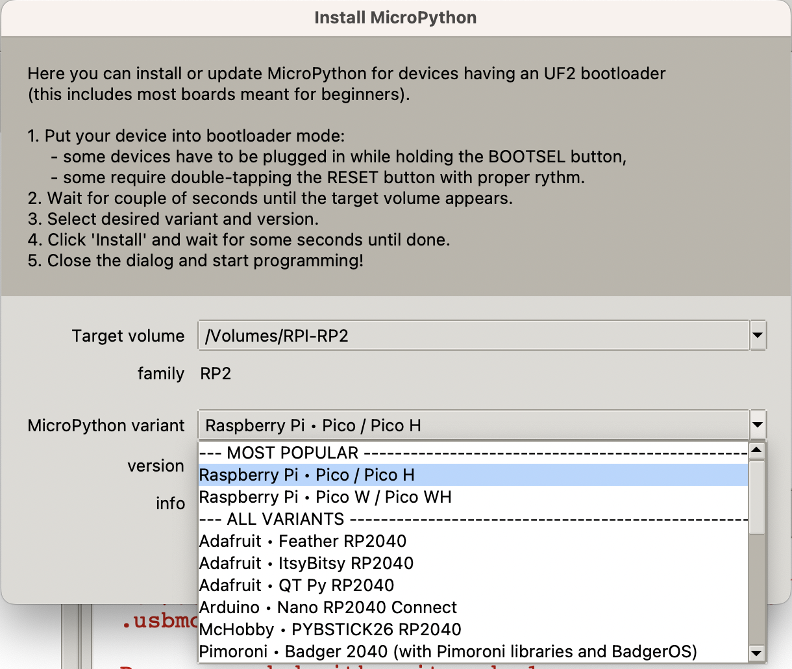

{:class="cover"}

---

By the end of this lesson you will be able to put MicroPython firmware onto a Raspberry Pi Pico using Snakie, Thonny, or a simple drag and drop.

There are three ways to do it. They all end in the same place, so pick whichever suits you.

> **Teachers**: installing software needs administrator rights on many school computers. Check before the lesson that learners can install Thonny or the Snakie desktop app, or use the Snakie web app, which needs nothing installed but works only in Chrome or Edge. Flashing firmware is a one-off job, so you may want to flash a whole set of boards yourself first. If USB drives are blocked on your network, test this lesson on one machine.

## Put the board in bootloader mode

A brand new Pico has no MicroPython on it yet. To copy it on, the board must appear as a USB drive:

1. Unplug the board.
2. Hold down the white **BOOTSEL** button.
3. Plug the USB cable into your computer while still holding the button, then let go.

The board shows up as a drive called `RPI-RP2` on a Pico or Pico W, and `RP2350` on a Pico 2 or Pico 2 W.

## Option 1: Snakie

[Snakie](/learn/snakie_getting_started/) is the editor we recommend for this course. Click **Flash firmware** in the status bar, choose your board, and click **Download & Flash**. Snakie downloads the right file and copies it across. The lesson [Flashing MicroPython](/learn/snakie_getting_started/07_flashing_micropython.html) in the Snakie course walks through each step.

## Option 2: Thonny

`Thonny` is a free editor for Python and MicroPython, and it can install the firmware too. Download it from <https://www.thonny.org> for `Windows`, `Mac` or `Linux`.

{:class="img-fluid w-50 shadow-lg"}

Screenshot of the Thonny download page
{:.caption}

Some versions of Thonny open in a simple mode that hides the install option. If you see a link to switch to `regular mode`, click it, then quit and restart Thonny.

{:class="img-fluid w-75 shadow-lg my-3"}

Screenshot of the standard mode link
{:.caption}

With the Pico in bootloader mode, click the interpreter name in the bottom right corner of the Thonny window and select `Install MicroPython...`.

{:class="img-fluid w-75 shadow-lg my-3"}

Screenshot of the Thonny Install dialog option
{:.caption}

{:class="img-fluid w-75 shadow-lg my-3"}

Screenshot of the Thonny Install dialog box
{:.caption}

Choose the **variant** that matches your board, such as `Raspberry Pi - Pico / Pico H`, and click `Install`. The screenshots above are from an older version of Thonny, so the wording in yours may be a little different. If your board isn't in the list, use option 3.

## Option 3: Drag and drop

This works without any special software:

1. Download the `.uf2` file for your board, as in the last lesson.
2. Put the board in bootloader mode.
3. Drag the `.uf2` file onto the `RPI-RP2` (or `RP2350`) drive.

The drive disappears after a moment. That is good news: the board has restarted and is now running MicroPython.

## Well done

Congratulations, you now have MicroPython installed on your board. In the next lessons we'll check it with our first program.

## Try it Yourself

1. Put your board in bootloader mode and find the drive on your computer.
2. Install MicroPython using one of the three options.
3. Challenge: install it a second way. Connect to the board and note the version line it prints, then compare it with the first time. Does it match?

## Common Issues

- **Problem**: No drive appears when I plug in the Pico.
- **Solution**: Hold BOOTSEL before you plug in the cable, and try a different USB cable.
- **Why**: Some cables only carry power. They have no data wires, so the computer never sees the board.

- **Problem**: Thonny does not offer `Install MicroPython...`.
- **Solution**: Switch to regular mode if offered, or flash with Snakie or drag and drop.
- **Why**: Simple mode hides some menu items to keep things uncluttered.

- **Problem**: My Pico W code can't connect to Wi-Fi.
- **Solution**: Reinstall using the Pico W firmware.
- **Why**: The plain Pico firmware has no wireless driver.

## Check your understanding


? How do you put a Raspberry Pi Pico into bootloader mode?
- [ ] Press the button twice after plugging it in
- [x] Hold BOOTSEL while plugging in the USB cable
- [ ] Plug it into a power bank
> Hold the button first, then plug in, and the board appears as a drive.

? The drive disappears after you copy the firmware. What does that mean?
- [ ] The install failed
- [x] The board has restarted and is running MicroPython
- [ ] The cable has broken
> The board reboots into the new firmware, so it stops being a drive.

? Which of these is NOT a way to install MicroPython on a Pico?
- [ ] Drag the `.uf2` file onto the drive
- [ ] Use the Snakie flasher
- [x] Type `print("install")` into Notepad
> The three ways are Snakie, Thonny and drag and drop.

