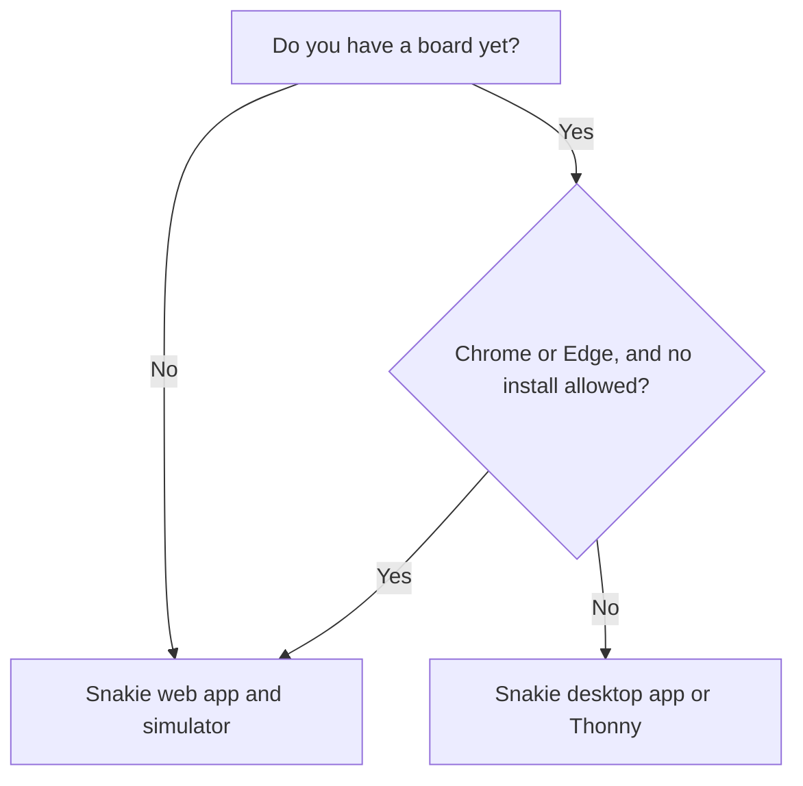

{:class="cover"}

---

By the end of this lesson you will be able to choose an editor for MicroPython and say why it is better than a plain text editor.

## Why not Notepad?

You could write MicroPython code in `Notepad` (on `Windows`) or `TextEdit` (on `macOS`), but it is much better to use a MicroPython editor, also known as a `development environment` or `IDE`.

A development environment helps you create faster, more accurate code, with features such as:

* **Syntax highlighting**: words change colour based on their meaning
* **Autocomplete and hints**: it suggests what you might be typing
* **Line numbers**: so error messages can point to the right line
* **A connection to your board**: you can run code on the Pico at the click of a button

## Snakie, our recommended editor

[Snakie](/learn/snakie_getting_started/) is Kev's own MicroPython editor, designed for robotics. It runs in your browser at [app.snakie.org](https://app.snakie.org/) with nothing to install, or as a desktop app. It opens already connected to a **simulated device**, so you can run every example in this course before your Pico arrives, and it can also flash firmware onto a real board. Many of the code boxes in this course are small Snakie editors, so you can run an example right on the page and then open it in the full app.

To use a real board from the web app you need Chrome or Edge. The [Getting Started with Snakie](/learn/snakie_getting_started/) course takes you through it step by step.

## Thonny, the classic

[Thonny](https://www.thonny.org) is a free, friendly editor made for beginners, and it works well with the Pico. This course keeps the Thonny steps alongside Snakie so you can use either.

## Other editors

* [`VS Code`](https://code.visualstudio.com) is a powerful general editor (Kev's personal favourite). With a MicroPython extension it can talk to your Pico
* [`PyCharm`](https://www.jetbrains.com/pycharm/) is another professional Python editor
* [`Mu`](https://codewith.mu) is a simple editor designed for learners
* [`Arduino Lab for MicroPython`](https://labs.arduino.cc/en/labs/micropython) is a small editor from Arduino for MicroPython boards

> **Teachers**: the Snakie web app needs no installation or account, so it suits locked-down school computers, as long as the browser is Chrome or Edge. Thonny must be installed, and some schools have to ask IT to allow it. Decide on one editor for the whole class so everyone sees the same screens.

## Try it Yourself

1. Open [app.snakie.org](https://app.snakie.org/) and type `print("hello")`. Run it and see what happens.
2. If you can install software, install Thonny too, and compare how the two look.
3. Challenge: write down three features of your editor that Notepad doesn't have.

## Common Issues

- **Problem**: Snakie can't find my board from the web app.
- **Solution**: Use Chrome or Edge, and check no other program (such as Thonny) is using the board.
- **Why**: The web app uses Web Serial, which only those browsers support, and only one program can talk to a board at a time.

- **Problem**: My editor says it can't connect to the Pico.
- **Solution**: Check that MicroPython is installed, and try another USB cable.
- **Why**: A board without MicroPython has no REPL for the editor to talk to, and a power-only cable has no data lines.

## Check your understanding


? What does syntax highlighting do?
- [ ] It runs your program faster
- [x] It changes the colour of words based on their meaning
- [ ] It saves your file automatically
> Highlighting makes code easier to read.

? Which editor in this lesson runs in a browser with nothing to install?
- [ ] Thonny
- [x] The Snakie web app
- [ ] PyCharm
> The Snakie web app works in Chrome or Edge with nothing installed.

? Why is an editor better than Notepad for MicroPython?
- [ ] It makes the Pico faster
- [x] It gives hints and a connection to your board
- [ ] It writes the program for you
> Editors provide features such as autocomplete and running code on the board.

