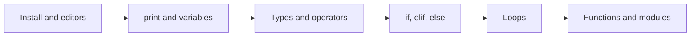

{:class="cover"}

---

{:.cover}

By the end of this lesson you will be able to combine variables, `if`, loops, functions and modules in one program, and know which course to take next.

## Summary of learning

Let's review the things you've learned in this course.

**Introduction.** You learned where MicroPython gets its name, how to download and install it, and why you might use it instead of other languages. You met the editors, wrote your first program and saved it with `main.py` in mind.

**Variables and reserved words.** You stored values in variables and constants, met the data types, used `input()` to get answers from a user, and learned which words are reserved.

**Controlling the flow.** You made programs decide with `if`, `elif` and `else`, repeated with `for` and `while`, and used the operators.

**Functions and modules.** You wrote your own functions, explored the board with the REPL, and imported modules.

## Put it all together

Here is a small program that uses nearly everything. A pretend robot reads a random distance each time, and a function decides what to do. Read it first, guess what it prints, then run it:


import random
import time

SAFE_DISTANCE = 30   # centimetres

def decide(distance):
    if distance < 10:
        return 'stop'
    elif distance < SAFE_DISTANCE:
        return 'slow'
    else:
        return 'go'

robot_name = 'Bolt'
print(robot_name, 'is on patrol')

for step in range(1, 6):
    distance = random.randint(1, 60)
    action = decide(distance)
    print('step', step, 'distance', distance, 'cm ->', action)
    if action == 'stop':
        print('obstacle, ending patrol')
        break
    time.sleep(0.5)



It uses a constant, variables, a function with `return`, `if`, `elif` and `else`, a `for` loop with `break`, and two modules. The program is a simulation, with a random number standing in for a distance sensor. In the next course you'll connect a real sensor.

## Next steps

First of all, congratulations on completing this introductory course. Now let's get building some more programs. Here is where to go next:

* [Getting Started with Snakie](/learn/snakie_getting_started/) to get to know the editor and the simulator
* [GPIO Mastery](/learn/micropython_gpio/) to control LEDs, buttons, motors and sensors with the Pico's pins
* [MicroPython Robotics Projects](/learn/micropython_robotics/) to build robots
* [Intermediate MicroPython](/learn/intermediate_micropython/) for classes, modules and packages
* [Python for beginners](/learn/python/) if you'd like to use Python on your computer as well

> **Teachers**: the "Put it all together" program makes a good end-of-unit assessment. Ask learners to change the thresholds, add a new action or turn the patrol into a function, and to explain each change. It runs in the Snakie simulator with no hardware.

## Try it Yourself

1. Change `SAFE_DISTANCE` and run the patrol program again. Does the robot behave differently?
2. Add a new action, `'reverse'`, for distances below 5.
3. Add a variable `patrols` that counts how many steps the robot took before stopping, and print it at the end.
4. Challenge: put the patrol loop inside its own function, `patrol(steps)`, and call it twice.

## Common Issues

- **Problem**: I'm not sure which lesson to look back at when I get an error.
- **Solution**: Read the error message for the line number and the error name, such as `NameError`, then check the Common Issues in the matching lesson.
- **Why**: Each lesson covers one idea, and the errors it causes.

- **Problem**: The patrol program ends straight away.
- **Solution**: That's right if a random distance is below 10. Run it again.
- **Why**: A distance below 10 gives `stop`, which hits `break`.

## Check your understanding


? In the patrol program, what does `decide(distance)` give back?
- [ ] A random number
- [x] The word stop, slow or go
- [ ] Nothing
> The function uses `return` to hand back an action word.

? Which statement ends the patrol early?
- [ ] `continue`
- [x] `break`
- [ ] `pass`
> `break` leaves the loop.

? Which module provides `randint`?
- [ ] `time`
- [x] `random`
- [ ] `math`
> `random.randint(1, 60)` gives a random whole number.

