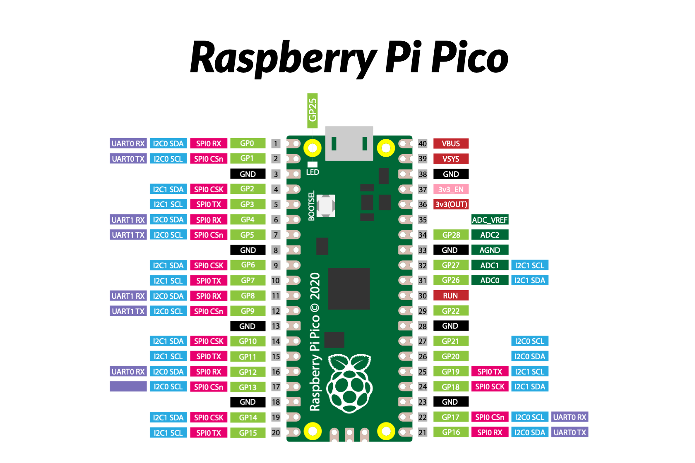

## Overview

The Pico has two numbering schemes, and mixing them up is the most common beginner mistake. In this lesson you'll learn the difference and how to find the pin you need.

---

## Physical pins and GP numbers

- **Physical pin numbers** (1 to 40) describe where a pin is on the board. Pin 1 is top left, next to the USB socket. Pins 1 to 20 run down the left edge, and pins 21 to 40 run back up the right edge.
- **GP numbers** (`GP0`, `GP1`...) are the names the RP2040 chip uses. **MicroPython uses GP numbers.**

So `Pin(15)` means `GP15`, which is physical pin 20, not physical pin 15.

---

## Identifying pins on the Raspberry Pi Pico

The pinout diagram shows the GP number and every alternative function of each pin:

{:class="img-fluid w-100"}

The underside of the board is also printed with the GP numbers, which is handy when the Pico is in a breadboard.

---

## Pinouts

| GP numbers | Physical pins | What they can do |
|------------|---------------|------------------|
| GP0 to GP22 | 1-2, 4-7, 9-12, 14-17, 19-22, 24-27, 29 | Digital I/O, PWM, plus UART, I2C or SPI depending on the pin |
| GP26, GP27, GP28 | 31, 32, 34 | Digital I/O, PWM, **and** ADC0, ADC1, ADC2 |
| GND | 3, 8, 13, 18, 23, 28, 33 (AGND), 38 | Ground |
| 3V3(OUT) | 36 | 3.3V output for sensors (up to about 300mA) |
| VSYS | 39 | Main power input, 1.8V to 5.5V |
| VBUS | 40 | 5V from USB, when USB is plugged in |
| RUN, 3V3_EN, ADC_VREF | 30, 37, 35 | Reset, regulator enable and ADC reference |
{:class="table table-striped"}

`GP23`, `GP24`, `GP25` and `GP29` are used inside the board (power supply control, USB sensing, the LED on the original Pico, and measuring VSYS), so they don't appear on the edge pins.

---

## Try it yourself

Using the pinout diagram, find the physical pin numbers for `GP0`, `GP15` and `GP28`. Which of these could you use to read a potentiometer?


? You wire an LED to physical pin 20. What do you write in MicroPython?
- [ ] `Pin(20, Pin.OUT)`
- [x] `Pin(15, Pin.OUT)`
- [ ] `Pin(25, Pin.OUT)`
> Physical pin 20 is GP15, and MicroPython uses GP numbers.

? Which pin gives you 5V while the Pico is plugged into USB?
- [ ] 3V3(OUT)
- [x] VBUS
- [ ] ADC_VREF
> VBUS (physical pin 40) is connected to the USB 5V supply.


---
