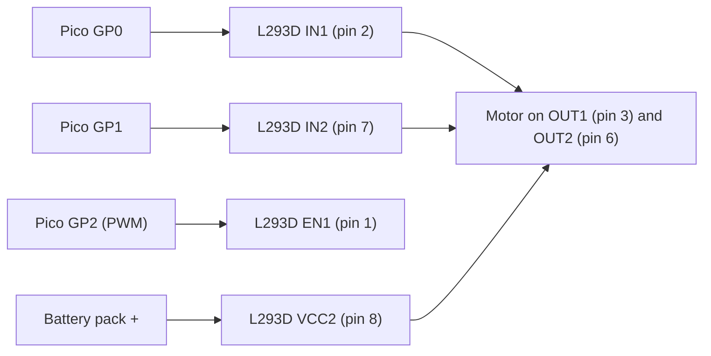

{:class="cover"}

---

By the end of this lesson you will be able to drive a small DC motor in both directions, at different speeds, through a motor driver.

## Overview

A motor needs far more current than a GPIO pin can supply, so we use a motor driver chip between the Pico and the motor. In this lesson you'll wire up an L293D driver and control a DC motor's direction and speed.

---

## What you'll need

* A Raspberry Pi Pico
* A small DC motor (3V to 6V)
* An L293D motor driver chip (other drivers, such as the DRV8833, use different pins, so follow their own wiring guide)
* A battery pack for the motor, such as 4 x AA
* A [breadboard](/resources/how_it_works/breadboards.html) and jumper wires

---

## Wiring the circuit

The L293D has two power pins: `VCC1` (pin 16) powers the logic, and `VCC2` (pin 8) powers the motor.

1. Connect the Pico's `VBUS` (5V from USB) to L293D `VCC1` (pin 16)
2. Connect the battery pack's `+` to L293D `VCC2` (pin 8)
3. Connect the battery `-`, the Pico `GND` and the L293D ground pins (4, 5, 12, 13) together. The grounds **must** be shared
4. Connect Pico `GP0` to L293D `IN1` (pin 2)
5. Connect Pico `GP1` to L293D `IN2` (pin 7)
6. Connect Pico `GP2` to L293D `EN1` (pin 1). This is the speed control
7. Connect the motor to L293D `OUT1` (pin 3) and `OUT2` (pin 6)

---

## Writing the code

```python
from machine import Pin, PWM
from time import sleep

in1 = Pin(0, Pin.OUT)
in2 = Pin(1, Pin.OUT)
speed = PWM(Pin(2))
speed.freq(1000)

def forward(percent):
    in1.value(1)
    in2.value(0)
    speed.duty_u16(int(percent * 65535 / 100))

def backward(percent):
    in1.value(0)
    in2.value(1)
    speed.duty_u16(int(percent * 65535 / 100))

def stop():
    in1.value(0)
    in2.value(0)
    speed.duty_u16(0)

forward(50)
sleep(2)
backward(100)
sleep(2)
stop()
```

- `IN1` and `IN2` set the **direction**: one high and one low makes the motor spin, and swapping them reverses it
- The PWM signal on `EN1` sets the **speed**
- `stop()` sets both inputs low and the speed to zero

> ## Low speeds
>
> Most small motors won't start turning below about 30% duty. That's normal: there isn't enough power to overcome friction.

---

---

## Wiring at a glance



---

## Try it Yourself

1. Run the program and confirm the motor goes forward, then backward, then stops.
2. Change `forward(50)` to `forward(30)` and then `forward(20)`. At what speed does your motor stall?
3. Write a `ramp_up()` function that takes the motor from 0% to 100% over two seconds.
4. Challenge: add a button on GP14 (lesson 4) that reverses the motor each press.

## Common Issues

- **Problem**: The motor does not turn, but the driver chip gets warm.
- **Solution**: Check both `VCC1` and `VCC2` are powered and that the grounds are shared.
- **Why**: The L293D needs logic power and motor power, and a missing ground means the Pico's signals have no reference.

- **Problem**: The motor only works one way.
- **Solution**: Check `IN1` and `IN2` are on separate GPIO pins and wired to chip pins 2 and 7.
- **Why**: Direction depends on one input being high and the other low.

> **Teachers**: Batteries and motors are the main classroom hazard in this course. Remove batteries at the end of each lesson, check polarity before connecting, and never run a stalled motor for long because the driver chip gets hot. Each group needs its own battery pack, so budget for AA cells.

## Check your understanding


? Which pins set the motor's direction on the L293D?
- [x] IN1 and IN2
- [ ] EN1
- [ ] VCC1 and VCC2
> IN1 and IN2 choose the direction. The PWM signal on EN1 sets the speed.

? Why must the battery ground be connected to the Pico's GND?
- [ ] It makes the motor spin faster
- [x] The signals from the Pico need a shared reference to be understood
- [ ] It charges the battery
> Voltages are always measured relative to ground. Without a common ground, the driver can't read the Pico's signals reliably.

? What does the PWM signal on EN1 control?
- [ ] The direction
- [x] The speed
- [ ] The battery voltage
> IN1 and IN2 set the direction, and the duty cycle on EN1 sets the speed.


---
