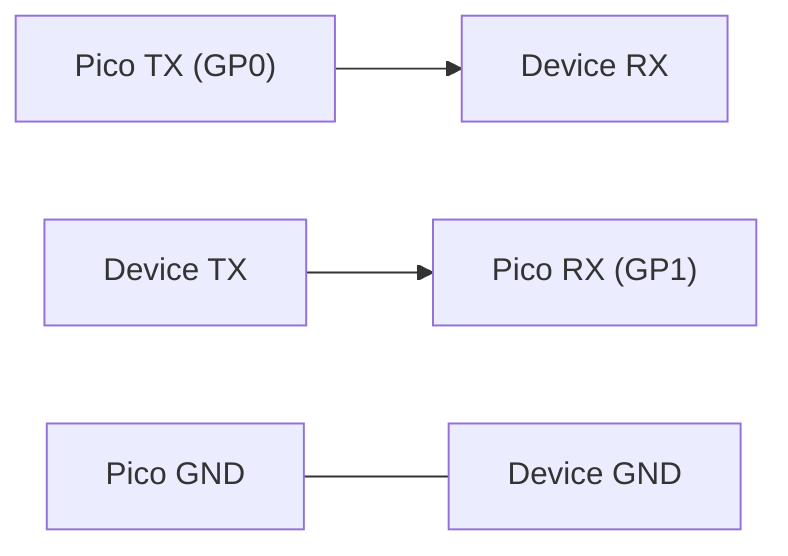

{:class="cover"}

---

By the end of this lesson you will be able to set up a UART on the Pico, send bytes and read replies.

## Overview

In this lesson, you'll learn how to use UART (Universal Asynchronous Receiver/Transmitter) to send data between your Pico and other devices. UART is used by GPS modules, Bluetooth modules like the HC-05, and to link two microcontrollers together.

---

## What is UART?

UART sends data over two wires: `TX` (transmit) and `RX` (receive). It is *asynchronous*, which means there's no shared clock wire. Instead, both devices agree on a speed, called the **baud rate** (for example 9600 or 115200 bits per second).

Wire them crossed over:

* Pico `TX` goes to the other device's `RX`
* Pico `RX` goes to the other device's `TX`
* `GND` goes to `GND`

---

## Configuring UART on the Pico

The Pico has two UARTs, `UART0` and `UART1`, and each can use several pairs of pins (see the pinout). `UART0` on `GP0` (TX) and `GP1` (RX) is the usual choice:

```python
from machine import UART, Pin

uart = UART(0, baudrate=9600, tx=Pin(0), rx=Pin(1))
```

---

## Sending and receiving data

```python
uart.write("Hello, world!\n")
```

```python
if uart.any():               # is there anything waiting?
    data = uart.read()       # read all of it, as bytes
    print(data)
```

`uart.any()` returns how many bytes are waiting, so you only read when there's something there.

---

---

## A complete loopback program

Join `GP0` to `GP1` with a single jumper wire, so what the Pico sends on TX arrives on RX:

```python
from machine import UART, Pin
from time import sleep

uart = UART(0, baudrate=9600, tx=Pin(0), rx=Pin(1))

uart.write("Hello, world!\n")
sleep(0.1)

if uart.any():
    data = uart.read()
    print(data)
```



---

## Try it Yourself

1. Run the loopback program. You should see `b'Hello, world!\n'`.
2. Change the message and run it again.
3. Pull the jumper out and run it again. What do you see, and why?
4. Challenge: send three messages in a loop and print each one as it arrives.

## Common Issues

- **Problem**: `uart.read()` returns `None`.
- **Solution**: Check TX goes to RX and RX to TX, and add a short `sleep()` after writing.
- **Why**: If nothing arrived there are no bytes to read.

- **Problem**: The text arrives as garbage characters.
- **Solution**: Set the same baud rate on both devices.
- **Why**: UART has no clock, so each side times the bits from the agreed speed.

## Check your understanding


? How should TX and RX be wired between two UART devices?
- [ ] TX to TX and RX to RX
- [x] TX to RX and RX to TX
- [ ] Both to GND
> Each device's transmitter needs to talk to the other device's receiver.

? What must both devices agree on for UART to work?
- [x] The baud rate
- [ ] The I2C address
- [ ] The clock pin
> UART has no clock wire, so both sides must use the same baud rate.

? What does `uart.any()` return?
- [ ] The baud rate
- [x] The number of bytes waiting to be read
- [ ] The last byte received
> Checking `any()` first means you only read when there is data.


---
