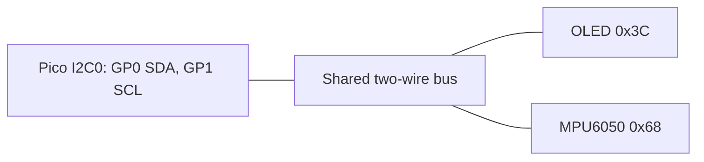

{:class="cover"}

---

By the end of this lesson you will be able to scan an I2C bus and read or write a device's registers.

## Overview

In this lesson, you'll learn about the I2C (Inter-Integrated Circuit) bus. I2C lets the Pico talk to lots of sensors and displays using just two wires, and it's one you'll use constantly in robot projects.

---

## What is I2C?

I2C uses two wires: `SDA` (Serial Data) and `SCL` (Serial Clock). It is *synchronous*: the Pico drives the clock, so the two sides don't need to agree on a baud rate.

Many devices can share the same two wires. Each device has its own **address**, a number like `0x3C` for an OLED display or `0x68` for an MPU6050 motion sensor.

---

## Setting up I2C on the Pico

The Pico has two I2C buses, `I2C0` and `I2C1`. `I2C0` on `GP0` (SDA) and `GP1` (SCL) is a common choice:

```python
from machine import Pin, I2C

i2c = I2C(0, sda=Pin(0), scl=Pin(1), freq=400000)

devices = i2c.scan()
print([hex(d) for d in devices])
```

`scan()` returns the address of every device that answers. It's the first thing to run when you connect something new: if your device doesn't show up, check the wiring before anything else.

---

## Reading and writing registers

Most I2C sensors store their settings and readings in numbered **registers**:

```python
# Read 2 bytes from register 0x0F of the device at address 0x68
data = i2c.readfrom_mem(0x68, 0x0F, 2)
print(data)

# Write the byte 0x01 to register 0x10 of the device at address 0x68
i2c.writeto_mem(0x68, 0x10, b'\x01')
```

In practice you'll usually use a library for your sensor or display, which does these reads and writes for you.

---

---



Most breakout boards include the pull-up resistors the bus needs. If you build a bare circuit, add a 4.7kΩ resistor from each of SDA and SCL to `3V3`.

---

## Try it Yourself

1. Connect any I2C module and run the scan program. Which address does it show?
2. Move the module to I2C1 on `GP6` (SDA) and `GP7` (SCL) using `I2C(1, ...)`. Does it still show up?
3. Challenge: connect two devices and print both addresses.

## Common Issues

- **Problem**: `i2c.scan()` returns `[]`.
- **Solution**: Check SDA and SCL aren't swapped, that the device has power, and that you're using the right bus number for your pins.
- **Why**: The Pico couldn't get any device to answer on that bus.

> **Teachers**: I2C modules vary: a few are 5V parts. Check each module's voltage before a lesson and keep a known-good scan result for the class to compare with.

## Check your understanding


? How does the Pico tell several devices on the same I2C wires apart?
- [ ] Each one is on a different pin
- [x] Each one has its own address
- [ ] They take turns by baud rate
> Every I2C device has an address, and the Pico includes it at the start of each message.

? What's the quickest way to check an I2C device is wired correctly?
- [ ] `i2c.writeto_mem()`
- [x] `i2c.scan()`
- [ ] `i2c.deinit()`
> `scan()` lists every device that answers, so you can see whether yours is there.

? How many wires does I2C use for data and clock?
- [ ] One
- [x] Two
- [ ] Four
> SDA carries data and SCL carries the clock.

? What does `0x3C` usually identify?
- [ ] The baud rate
- [x] A device address, such as an OLED
- [ ] A GPIO pin
> Each device has its own address, such as `0x3C` for an OLED display.


---
