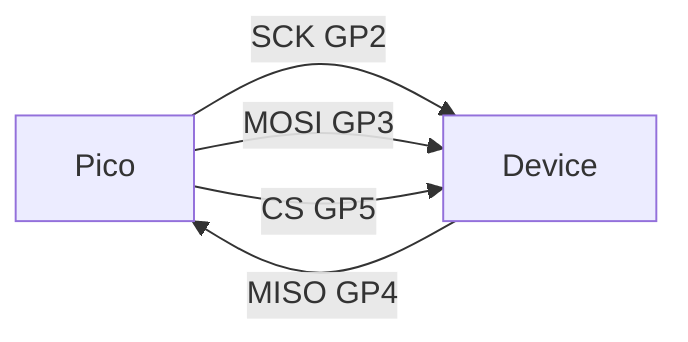

{:class="cover"}

---

By the end of this lesson you will be able to set up an SPI bus with a chip select pin and exchange bytes with a device.

## Overview

In this lesson, you'll learn about the SPI (Serial Peripheral Interface) bus. SPI is faster than I2C and is often used for colour displays and SD cards.

---

## What is SPI?

SPI is a synchronous bus that uses four wires:

* `SCK` - the clock, driven by the Pico
* `MOSI` (also called `TX` or `SDO`) - data from the Pico to the device
* `MISO` (also called `RX` or `SDI`) - data from the device to the Pico
* `CS` (chip select, sometimes `SS`) - set low to tell one device "I'm talking to you"

Several devices can share `SCK`, `MOSI` and `MISO`, but each needs its own `CS` pin.

---

## Setting up SPI on the Pico

The Pico has two SPI buses, `SPI0` and `SPI1`. This example uses `SPI0` on `GP2` (SCK), `GP3` (MOSI) and `GP4` (MISO), with `GP5` as chip select:

```python
from machine import Pin, SPI

spi = SPI(0, baudrate=1_000_000, polarity=0, phase=0,
          sck=Pin(2), mosi=Pin(3), miso=Pin(4))
cs = Pin(5, Pin.OUT, value=1)    # high means "not selected"
```

`polarity` and `phase` describe how the clock behaves. Mode 0 (both `0`) is the most common; your device's datasheet will say which it needs.

---

## Sending and receiving data

```python
cs.value(0)                       # select the device
spi.write(b'\x01\x02\x03')       # send three bytes
data = spi.read(3)                # read three bytes back
cs.value(1)                       # deselect
print(data)
```

SPI sends and receives at the same time. To send and capture the reply in one go, use `write_readinto()`:

```python
reply = bytearray(3)
cs.value(0)
spi.write_readinto(b'\x9f\x00\x00', reply)
cs.value(1)
```

---

---



---

## Try it Yourself

1. Join `GP3` (MOSI) to `GP4` (MISO) with a jumper and run the write and read example. The Pico reads back what it sent.
2. Change `baudrate` to 100_000. Does the loopback still work?
3. Challenge: add a second chip select on `GP6` and write a function that picks a device by number.

## Common Issues

- **Problem**: The data read back is always zeros or `0xFF`.
- **Solution**: Check MISO is wired to the right pin and CS goes low before you read.
- **Why**: A device only drives MISO while it is selected.

- **Problem**: Nothing works with a display or SD card.
- **Solution**: Check the device's polarity and phase in its datasheet.
- **Why**: The wrong clock mode shifts every bit.

## Check your understanding


? What is the chip select (CS) pin for?
- [ ] It carries the clock signal
- [x] It picks which device on the bus is being talked to
- [ ] It carries data back to the Pico
> Each device has its own CS pin. Pulling it low selects that device.

? Which is usually faster?
- [x] SPI
- [ ] I2C
> SPI commonly runs at several MHz, while I2C is usually 100kHz or 400kHz.

? Which wire does the Pico drive to send data to the device?
- [ ] MISO
- [x] MOSI
- [ ] CS
> `MOSI` carries data from the Pico to the device.

? How many devices can share SCK, MOSI and MISO?
- [ ] Only one
- [x] Several, each with its own CS pin
- [ ] None
> Each device needs its own chip select.


---
