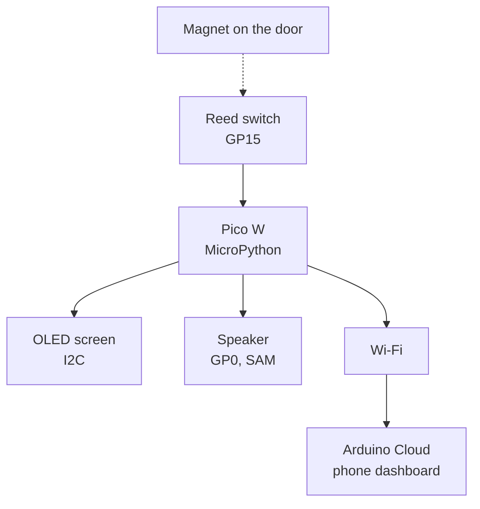

{:class="cover"}

---

Every good project starts with a question. Ours is simple: **is the door open?** In this lesson we look at the gadget we are going to build and at how the pieces talk to each other.

---

## What the buddy does

The status buddy sits on your desk and watches something that opens and closes: a door, a lid, a drawer, the cat flap. When it changes, the buddy:

1. **Senses** the change with a reed switch and a magnet
2. **Shows** "DOOR OPEN" or "DOOR CLOSED" on an OLED screen
3. **Says** it out loud with SAM, the classic speech engine
4. **Reports** it to Arduino Cloud, so your phone can see it from anywhere

You don't need all four to have a useful gadget. Each stage works on its own, and we test it before moving on. That is the best way to build anything with electronics: add one thing, check it works, then add the next.

## How the pieces connect

The Pico sits in the middle and does all the thinking. The reed switch is the only **input**. The screen, speaker and Wi-Fi are **outputs**.

## The four stages

| Stage | Section | What the buddy can do |
|---|---|---|
| 1 | Sense | Print `open` or `closed` and light the onboard LED |
| 2 | Show | Draw the door state on the OLED |
| 3 | Talk | Announce the change out loud |
| 4 | Connect | Push the door state to Arduino Cloud |
{:class="table table-single"}

After that, the **Shrink it** section moves the whole thing onto a tiny XIAO board, and **Putting it together** joins every stage into one `main.py`.

## Why this project?

Because the same pattern turns up everywhere. Read something, show it, say it, send it. Swap the reed switch for a soil moisture probe and you have a talking plant monitor. Swap it for a button and you have a doorbell. Kev's reed switch post suggests a cat flap monitor, a mailbox alert and a garage door checker, and they are all the same code with a different sensor.

> **Tip:** Pick the real thing you want to watch now. A front door, a toy box lid, your fridge. Having a real job in mind makes every later lesson more fun.

## Try it Yourself

1. Write down in one sentence what you want your buddy to watch.
2. Decide what you want it to do when that thing changes: a sound, a message, a notification?
3. Challenge: sketch the flowchart above for your own idea, with your own sensor in the top box.

## Check your understanding


? Which part of the status buddy is the only input?
- [x] The reed switch
- [ ] The OLED screen
- [ ] The speaker
> The reed switch brings information in. The screen, speaker and Wi-Fi all send information out.

? Why do we build the buddy in stages?
- [ ] Because the parts arrive one at a time
- [x] So each part can be tested on its own before the next is added
- [ ] Because MicroPython can only run one thing at once
> Adding one thing at a time means that when something breaks, you know exactly which part to blame.

