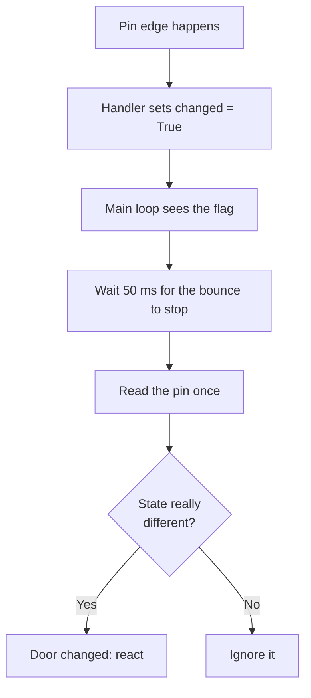

{:class="cover"}

---

Our stage 1 program checks the pin ten times a second. That works, but it has two weaknesses. It spends its whole life asking "has it changed yet?", and later, when the buddy is also drawing on a screen and talking, a busy loop might miss a quick change. The fix is an **interrupt**.

This lesson finishes the **Sense** section.

---

## What is an interrupt?

An interrupt lets the hardware tap the Pico on the shoulder. You say "when this pin changes, run this function", and the Pico gets on with other things until it happens.

```python
reed.irq(trigger=Pin.IRQ_FALLING | Pin.IRQ_RISING, handler=on_edge)
```
{: .no-snakie }

- `IRQ_FALLING` fires when the pin goes from 1 to 0 (the magnet arrives)
- `IRQ_RISING` fires when the pin goes from 0 to 1 (the magnet leaves)
- Joining them with `|` means "either". We want both, because the door both opens and closes

## The golden rule of handlers

A handler can fire at any moment, even in the middle of your other code. So keep it **tiny**. Set a flag and leave. Don't draw on a screen, don't talk, don't print a paragraph. The main loop notices the flag and does the real work.

Kev's reed switch post prints from inside the callback to keep its demo short. For the buddy, which will soon be driving a screen and a speaker, we use the safer flag pattern.

## Contact bounce

When the reeds snap together they don't touch cleanly once. They can touch, spring apart and touch again a few times in a few milliseconds. To a fast microcontroller, that looks like several door movements.

**Debouncing** means ignoring that mess. Our approach is simple: when the flag says "something changed", wait 50 milliseconds for things to settle, then read the pin **once** and compare it with what we already knew.



## Stage 1, the improved version

This is a complete program. Run it and wave the magnet about.

```python
from machine import Pin
import time

DEBOUNCE_MS = 50

# Reed switch on GP15: 0 = magnet near = door closed
reed = Pin(15, Pin.IN, Pin.PULL_UP)
led = Pin("LED", Pin.OUT)

changed = False


def on_edge(pin):
    # Keep interrupt handlers tiny: just raise a flag
    global changed
    changed = True


reed.irq(trigger=Pin.IRQ_FALLING | Pin.IRQ_RISING, handler=on_edge)

door_open = reed.value() == 1
open_count = 0
led.value(1 if door_open else 0)
last_beat = time.ticks_ms()

print("Door is", "open" if door_open else "closed")

while True:
    if changed:
        changed = False
        time.sleep_ms(DEBOUNCE_MS)           # let the contacts settle
        now_open = reed.value() == 1         # read once, after the bounce
        if now_open != door_open:
            door_open = now_open
            led.value(1 if door_open else 0)
            if door_open:
                open_count += 1
            print("Door", "open" if door_open else "closed", "- opened", open_count, "times")

    # The loop is free to do other work. Here, a heartbeat every 5 seconds
    if time.ticks_diff(time.ticks_ms(), last_beat) > 5000:
        print("Still watching...")
        last_beat = time.ticks_ms()

    time.sleep_ms(10)
```

Two details worth noticing:

- `time.sleep_ms()`, `time.ticks_ms()` and `time.ticks_diff()` are the MicroPython way to handle time. There is no `time.monotonic()` here.
- We compare `now_open != door_open`. If the bounce settled back to where it started, nothing changed, so we do nothing.

## Try it Yourself

1. Change `DEBOUNCE_MS` to 5, then 200. What differences do you notice when you tap the magnet quickly?
2. Make the heartbeat message print the current `open_count`.
3. Challenge: record when the door last opened with `time.ticks_ms()`, and print how many seconds ago that was.

## Common Issues

**Problem**: The counter goes up by two or three for one opening.

**Solution**: Raise `DEBOUNCE_MS` to 100.

**Why**: Some switches bounce longer than 50ms, especially with a weak or slow-moving magnet.

**Problem**: Nothing happens when the door changes, but the polling version worked.

**Solution**: Check you used `Pin.IRQ_FALLING | Pin.IRQ_RISING`, with the vertical bar, and that the handler is given as `handler=on_edge` without brackets.

**Why**: `on_edge()` with brackets *calls* the function once instead of handing it to the interrupt.

## Check your understanding


? What should a pin interrupt handler do?
- [ ] Draw the whole status screen
- [x] Do as little as possible, such as set a flag
- [ ] Wait until the contacts stop bouncing
> Handlers can fire at any moment, so keep them tiny and let the main loop do the real work.

? Why do we wait 50 ms before reading the pin?
- [x] To let the contacts stop bouncing so we read the settled state
- [ ] Because the Pico is too slow to read faster
- [ ] To save battery
> Reed contacts can make and break several times in a few milliseconds. Waiting means we read only the final state.

