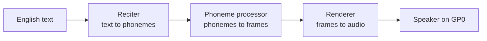

{:class="cover"}

---

The buddy can see and show. Now let's give it a voice, and not just any voice. A voice from **1982**. This begins the **Talk** section.

Kev's video tells the SAM story, including the clever bits under the hood:



---

## What is SAM?

SAM stands for **Software Automatic Mouth**. Mark Barton wrote it in 6502 assembly for the Commodore 64 back in 1982, making it one of the first consumer text-to-speech engines. It appeared around the same time as MacinTalk, the voice used at the 1984 Macintosh launch. Kev's version brings it to MicroPython on the Pico.

SAM turns plain English into speech in three steps:



1. **The Reciter** turns English text into **phonemes**, the basic sounds of speech. It has over 200 context-sensitive rules, because English spelling is chaotic
2. **The Phoneme Processor** turns phonemes into frame data, handling stress and rhythm so the speech sounds more natural
3. **The Renderer** makes the actual audio samples using formant synthesis, which imitates the resonances of a human vocal tract

The whole engine fits in about 22 kilobytes of RAM.

## Why it is fast enough on a Pico

Kev's first pure MicroPython version took **1,900 ms** to render "Hello World". Using `@native` brought that down to about 1,200 ms. Rewriting the hot loop as a native C module, loaded from a `.mpy` file, gets it down to about **17 ms**. That is why the library comes with a `sam_render.mpy` file.

On the playback side, the Pico's **PIO** (Programmable IO) hardware and **DMA** feed audio samples to the pin with perfect timing, with no help from the CPU. So the buddy can keep watching the door while it talks.

## Wiring the speaker

This is the simplest circuit in the course:

1. Connect **GP0** (pin 1) to the **positive** terminal of the speaker, optionally through a **1K resistor**
2. Connect the speaker's **negative** terminal to **GND**

SAM sends sound as PWM on that single pin. No amplifier or DAC is needed. For a cleaner sound, Kev suggests an optional low-pass filter (a 10K resistor and 10nF capacitor) or a PAM8403 or LM386 amplifier module with a small speaker, but the one-resistor setup is perfectly understandable for robot speech.

## Installing SAM

SAM is **not** built into MicroPython. The code lives in Kev's repository: [github.com/kevinmcaleer/sam](https://www.github.com/kevinmcaleer/sam).

1. Clone or download the repository
2. Open **Thonny** (or use `mpremote`) and copy the entire `sam` **folder** to the root of the Pico's filesystem
3. Also copy the `sam_render.mpy` file across
4. That's it

With `mpremote`, from the folder that holds the download, that looks like:

```
mpremote cp -r sam :
mpremote cp sam_render.mpy :
```
{: .no-snakie }

Copy the **whole folder**, not just individual files. And the native `.mpy` module has to match your MicroPython version, so if you update MicroPython later, get a matching `sam_render.mpy` too.

## Your first words

```python
from sam import Sam

sam = Sam(pin=0)
sam.say("Hello World")
```

Three lines. `Sam(pin=0)` says which GPIO pin the speaker is on, and `say()` speaks. To see what SAM is up to underneath:

```python
from sam import Sam

sam = Sam(pin=0)
sam.info()
```

It prints a summary such as the sample rate, which renderer is active (native C), the audio driver (PIO), and the current speed, pitch, mouth and throat settings.

## Try it Yourself

1. Make SAM say your name.
2. Try spelling things the way they sound, such as "Kevin" and "Kev-in". Which sounds better?
3. Challenge: make SAM say a sentence with a question mark. Does the tone change?

## Common Issues

**Problem**: No sound at all.

**Solution**: Check the speaker is on GP0 (the GPIO number, not a physical pin) and GND, and that its polarity is right.

**Why**: SAM drives a single pin, so a wrong pin or reversed connection gives silence.

**Problem**: `ImportError` when loading SAM.

**Solution**: Make sure the whole `sam` folder is on the Pico's root, and that `sam_render.mpy` is there too.

**Why**: The library is a package, not a single file, and the native module must match your MicroPython version.

**Problem**: The sound is garbled or distorted.

**Solution**: Add the 1K resistor between GP0 and the speaker, and check nothing else is using GP0.

**Why**: The resistor softens the PWM signal, and a second user of the pin corrupts it.
