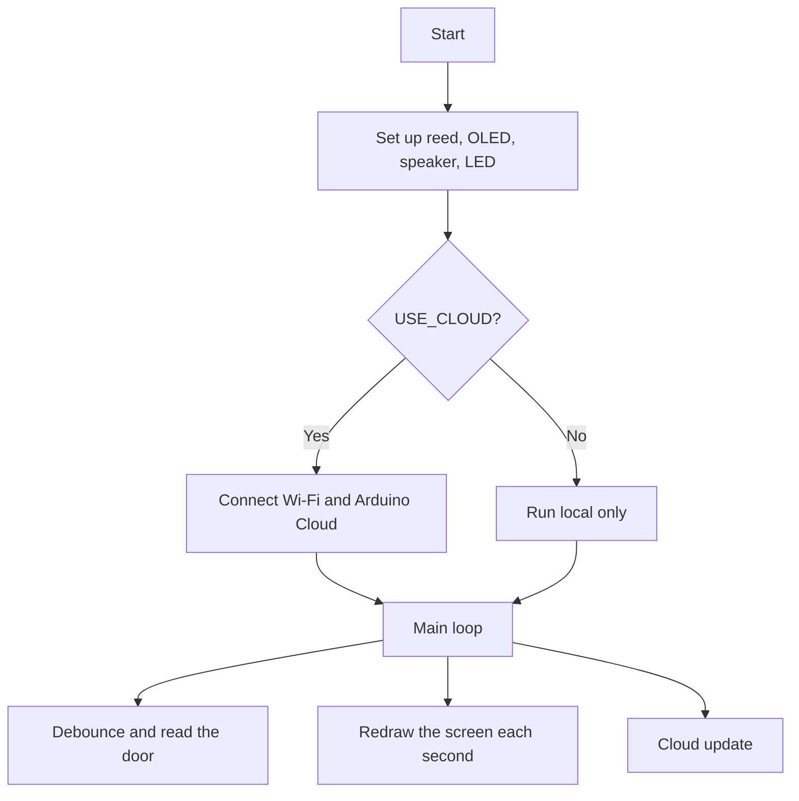

{:class="cover"}

---

This is the payoff. Over the last thirteen lessons we built four stages, and in this lesson they become one program: the finished **status buddy**.

---

## The files on the Pico

The finished buddy needs these files on the Pico:

| File | Where it comes from |
|---|---|
| `main.py` | This lesson |
| `config.py` | Lesson 13 |
| `ssd1306.py` | Lesson 6 |
| `sam/` and `sam_render.mpy` | Lesson 9 |
| `secrets.py` | Lessons 11 and 12, only if `USE_CLOUD = True` |
| `lib/arduino_iot_cloud/` and the MIP packages | Lesson 12, only if `USE_CLOUD = True` |
{:class="table table-single"}

If you only have a plain Pico, set `USE_CLOUD = False` in `config.py`. The buddy then senses, shows and talks, and skips Wi-Fi entirely.

## How the program is organised



Each job in the main loop is short, and none of them wait around. That is how one Pico does four jobs at once.

## main.py

Save this on the Pico as `main.py`. MicroPython runs a file with that name automatically at power-up, so the buddy will start by itself when plugged in.

```python
import time
from machine import Pin, I2C
from ssd1306 import SSD1306_I2C
from sam import Sam
import config

# --- hardware ---------------------------------------------------------
reed = Pin(config.REED_PIN, Pin.IN, Pin.PULL_UP)       # 0 = magnet near = closed
i2c = I2C(config.I2C_ID, scl=Pin(config.SCL_PIN), sda=Pin(config.SDA_PIN), freq=400000)
oled = SSD1306_I2C(128, 64, i2c, addr=config.OLED_ADDR)
sam = Sam(pin=config.SPEAKER_PIN)
led = Pin(config.LED_PIN, Pin.OUT) if config.LED_PIN is not None else None

sam.pitch = 64
sam.mouth = 128
sam.throat = 128

# --- state ------------------------------------------------------------
changed = False
door_open = reed.value() == 1
open_count = 0
changed_at = time.ticks_ms()
client = None


def on_edge(pin):
    # Keep interrupt handlers tiny: just raise a flag
    global changed
    changed = True


reed.irq(trigger=Pin.IRQ_FALLING | Pin.IRQ_RISING, handler=on_edge)


# --- screen -----------------------------------------------------------
def draw_door(x, y, is_open):
    if is_open:
        oled.rect(x, y, 30, 44, 1)
        oled.line(x, y, x + 20, y + 6, 1)
        oled.line(x + 20, y + 6, x + 20, y + 50, 1)
        oled.line(x, y + 44, x + 20, y + 50, 1)
    else:
        oled.fill_rect(x, y, 30, 44, 1)
        oled.ellipse(x + 24, y + 22, 2, 2, 0, True)


def draw_screen():
    secs = time.ticks_diff(time.ticks_ms(), changed_at) // 1000
    oled.fill(0)
    oled.text("Status Buddy", 16, 0)
    oled.hline(0, 10, 128, 1)
    draw_door(4, 16, door_open)
    oled.text("DOOR", 56, 20)
    oled.text("OPEN" if door_open else "CLOSED", 56, 32)
    oled.text("for {}s".format(secs), 56, 44)
    oled.text("Opened: {}".format(open_count), 0, 56)
    oled.text("Cloud" if client else "Local", 88, 56)
    oled.show()


def message(line1, line2=""):
    oled.fill(0)
    oled.text("Status Buddy", 16, 0)
    oled.hline(0, 10, 128, 1)
    oled.text(line1, 0, 24)
    oled.text(line2, 0, 40)
    oled.show()


# --- cloud ------------------------------------------------------------
def read_door_open(c):
    return door_open


def read_open_count(c):
    return open_count


def connect_cloud():
    """Join Wi-Fi and set up Arduino Cloud. Returns the client, or None."""
    import network
    from arduino_iot_cloud import ArduinoCloudClient
    from secrets import WIFI_SSID, WIFI_PASSWORD, DEVICE_ID, SECRET_KEY

    wlan = network.WLAN(network.STA_IF)
    wlan.active(True)
    wlan.connect(WIFI_SSID, WIFI_PASSWORD)

    start = time.ticks_ms()
    while not wlan.isconnected():
        if time.ticks_diff(time.ticks_ms(), start) > 20000:
            return None
        time.sleep(1)

    cloud = ArduinoCloudClient(
        device_id=DEVICE_ID.encode(),
        username=DEVICE_ID.encode(),
        password=SECRET_KEY.encode(),
        sync_mode=True,
    )
    cloud.register("door_open", value=None, on_read=read_door_open, interval=10)
    cloud.register("open_count", value=None, on_read=read_open_count, interval=10)
    cloud.start()  # in sync mode this connects, then returns
    return cloud


# --- start up ---------------------------------------------------------
if led is not None:
    led.value(1 if door_open else 0)

if config.USE_CLOUD:
    message("Connecting...")
    client = connect_cloud()
    if client is None:
        message("No Wi-Fi", "Running local")
        sam.say("No Wi-Fi")
        time.sleep(2)

draw_screen()
last_draw = time.ticks_ms()
sam.say("Status buddy ready")

# --- main loop --------------------------------------------------------
while True:
    # 1. SENSE: has the reed switch changed? Debounce, then compare
    if changed:
        changed = False
        time.sleep_ms(config.DEBOUNCE_MS)
        now_open = reed.value() == 1
        if now_open != door_open:
            door_open = now_open
            changed_at = time.ticks_ms()
            if door_open:
                open_count += 1
            if led is not None:
                led.value(1 if door_open else 0)

            # 2. SHOW first, then 3. TALK
            draw_screen()
            last_draw = time.ticks_ms()
            if door_open:
                sam.say("The door is open")
            else:
                sam.say("The door is closed")

    # Redraw once a second so the timer ticks
    if time.ticks_diff(time.ticks_ms(), last_draw) >= 1000:
        draw_screen()
        last_draw = time.ticks_ms()

    # 4. CONNECT: give the cloud client a turn
    if client is not None:
        try:
            client.update()
        except Exception as e:
            print("Cloud error:", e)
            time.sleep(1)

    time.sleep_ms(10)
```

## Reading it as a story

Read the program top to bottom and you can see all four stages:

- **Hardware and state** set up the reed switch, OLED, speaker and the variables the rest of the program shares
- **Screen** holds the drawing code from lessons 7 and 8
- **Cloud** wraps the Wi-Fi and Arduino Cloud code from lessons 11 and 12 in one function, so the buddy can still run if Wi-Fi fails
- **Start up** connects (if you asked it to) and announces itself
- **Main loop** does one quick pass over each job: sense, show, talk, connect

## Sync mode: why `client.update()`

In lesson 12 we used `client.start()` on its own, which runs the client's own loop and never returns. A buddy that also draws and speaks needs the client to take **one quick turn and hand control back**, so our loop can carry on.

The Arduino Cloud Python client has a mode for exactly that. Pass `sync_mode=True` when you create the client. Then `client.start()` connects and returns, and you call `client.update()` regularly from your own loop. The client's README says `update()` never blocks: it retries dropped connections by itself and only raises an error if the device is set up wrongly in the cloud.

## Try it Yourself

1. Add a second reed switch for a window. What would need to change in `config.py` and the loop?
2. Make the buddy say the number of openings every tenth time the door opens.
3. Challenge: turn the buddy into a real alarm by saying "Close the door please" whenever the door has been open for over 30 seconds.

## Common Issues

**Problem**: The screen says "Local" even though `USE_CLOUD = True`.

**Solution**: Watch the screen at start-up for "No Wi-Fi". Check `secrets.py`, and that the router has 2.4 GHz switched on.

**Why**: If Wi-Fi doesn't connect within 20 seconds, the buddy falls back to running local only.

**Problem**: `OSError: [Errno 19] ENODEV` straight away.

**Solution**: Run the I2C scan from lesson 6, and check `SDA_PIN`, `SCL_PIN` and `OLED_ADDR` in `config.py`.

**Why**: The OLED isn't answering at the address the program expects.

**Problem**: `main.py` runs when I plug the Pico in, but I can't stop it in Thonny.

**Solution**: Press the Stop button in Thonny, or **Ctrl+C** in the shell, then edit the file.

**Why**: `main.py` starts at power-up, and the loop runs for ever until interrupted.
