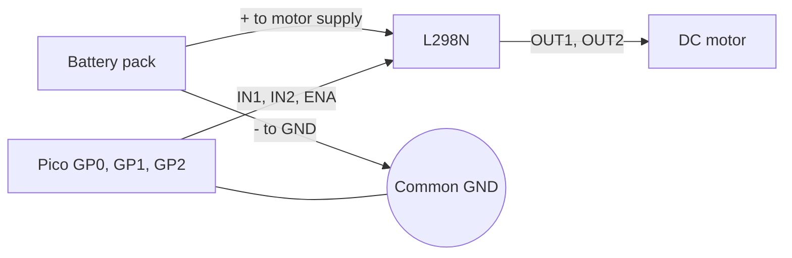

{:class="cover"}

---

By the end of this lesson you will be able to spin one DC motor forwards and backwards at a speed you choose, using an L298N driver and PWM from the Pico.

DC motors are the muscles of most robots: they turn wheels, arms and even propellers. But a Pico pin can only supply a few milliamps, and a small gear motor wants hundreds. So we put a **motor driver** between them: the Pico sends tiny control signals, and the driver switches the big current from a battery.

## What you'll need

| Item | Description | Quantity |
|------|-------------|----------|
| Raspberry Pi Pico | [Pico / Pico 2](https://www.raspberrypi.com/products/raspberry-pi-pico/) or the W versions, running MicroPython | 1 |
| Motor driver | L298N motor driver module | 1 |
| Motor | Small DC gear motor, the yellow TT type or similar | 1 (two from lesson 3) |
| Power | Battery pack for the motor, for example 4x AA | 1 |
| Wires | Jumper wires | As needed |
{:class="table table-single"}

> **Teachers**: Motor batteries can deliver a lot of current if wires touch. Use a battery holder with a switch, never loose cells, and have learners wire with the battery disconnected, then connect it last. Keep Li-ion cells out of the first session. One L298N and motor per pair is plenty, and the motor should be held or fixed down so it cannot run off the desk.

## How the driver is controlled

The L298N has three control inputs for each motor. Two choose the **direction** and one sets the **speed**.

| L298N input | Pico pin | What it does |
|-------------|----------|--------------|
| IN1 | GP0 | Direction, with IN2 |
| IN2 | GP1 | Direction, with IN1 |
| ENA | GP2 | Enable. We feed it PWM to set the speed |
{:class="table table-single"}

IN1 high and IN2 low spins the motor one way. Swap them and it spins the other way. Which way is "forward" depends on how you wired the motor, and we'll fix that in code when we need to.

## Wiring the circuit

| From | To |
|------|----|
| Pico GP0 (pin 1) | L298N IN1 |
| Pico GP1 (pin 2) | L298N IN2 |
| Pico GP2 (pin 4) | L298N ENA |
| Pico GND (pin 3) | L298N GND |
| Motor wire 1 and 2 | L298N OUT1 and OUT2 |
| Battery + | L298N motor supply terminal (marked 12V, VS or VCC) |
| Battery - | L298N GND (the same GND as the Pico) |
{:class="table table-single"}

Three things catch almost everyone out on this module:

1. **Remove the ENA jumper.** Most L298N boards ship with a small jumper over the ENA pins that ties ENA high, so the motor is always at full speed. Pull it off so the Pico can drive ENA.
2. **Share a ground.** The Pico and the driver must share GND, or the signals have nothing to be measured against.
3. **Do not connect the motor supply to the Pico.** The Pico stays powered from USB for now. Leave the L298N 5V pin unconnected.



## How much do we lose?

The L298N is an older design: its output transistors drop roughly 2 V, so a 6 V battery pack gives the motor around 4 V. Small motors still turn, just more slowly, which is one reason we'll prefer a higher voltage pack on the finished robot.

## Writing the code

Speed comes from **PWM** (pulse width modulation): ENA switches on and off 1000 times a second, and the fraction of each cycle it is on sets the average power. In MicroPython, `duty_u16()` takes a number from 0 to 65535, where 65535 means on all the time. To turn a percentage into a duty value, multiply by 65535 and divide by 100:

- 25% is 25 x 65535 / 100 = 16383
- 50% is 32767
- 75% is 49151
- 100% is 65535

```python
from machine import Pin, PWM
from time import sleep

# Motor control pins
in1 = Pin(0, Pin.OUT)
in2 = Pin(1, Pin.OUT)
ena = PWM(Pin(2))
ena.freq(1000)

def percent_to_duty(percent):
    return int(percent * 65535 / 100)

def motor_forward(percent=75):
    in1.value(1)
    in2.value(0)
    ena.duty_u16(percent_to_duty(percent))

def motor_backward(percent=75):
    in1.value(0)
    in2.value(1)
    ena.duty_u16(percent_to_duty(percent))

def motor_stop():
    in1.value(0)
    in2.value(0)
    ena.duty_u16(0)

# Test: forward, backward, then stop
motor_forward()
sleep(2)
motor_backward()
sleep(2)
motor_stop()
print("Done")
```

Save it as `main.py` (or run it from Thonny) with the battery connected. The motor should spin one way for two seconds, the other way for two seconds, then stop.

Small motors have a **dead zone**: below roughly 30 to 40 percent they only hum and do not turn, because the voltage is not enough to overcome friction. That is normal, so start your tests at 60 percent or more.

## Common Issues

- **Problem**: The motor runs flat out all the time and ignores the speed.
- **Solution**: Remove the jumper from the ENA pins on the L298N.
- **Why**: The jumper holds ENA permanently high, so the PWM signal never gets a say.

- **Problem**: Nothing happens, or the motor twitches.
- **Solution**: Check the battery is connected and that its negative lead and the Pico GND both reach the L298N GND.
- **Why**: Without a common ground the driver cannot read the Pico's signals, and a flat battery cannot move the motor.

- **Problem**: The motor hums but does not turn at low speed.
- **Solution**: Raise the percentage until it turns, and note that value for later.
- **Why**: Friction needs a minimum voltage to be overcome, so low duty values do not move the shaft.

## Try it Yourself

1. Swap the two motor wires on OUT1 and OUT2 and run the program again. What changes?
2. Change the default speed to 25 percent, then to 100, and note the lowest value at which your motor turns.
3. Add a `for` loop that ramps the speed from 50 to 100 percent in steps of 10, with a short pause each step.
4. Challenge: use a button on GP15 to start and stop the motor.

## Check your understanding


? Why does the Pico need a motor driver between it and the motor?
- [ ] The Pico cannot output PWM
- [x] A Pico pin supplies far less current than a motor needs, so the driver switches the battery's current instead
- [ ] Motors only work on 3.3 V
> The driver takes small control signals from the Pico and switches the larger current from the battery.

? What duty_u16 value gives about 50 percent speed?
- [ ] 50
- [x] 32767
- [ ] 65535
> duty_u16 runs from 0 to 65535, so half speed is about 32767.

? Your motor always runs at full speed and PWM changes nothing. What should you check first?
- [ ] The motor wires are swapped
- [ ] The Pico is on the wrong USB port
- [x] The jumper still fitted over the ENA pins
> That jumper holds ENA high all the time, so the PWM on GP2 has no effect.

