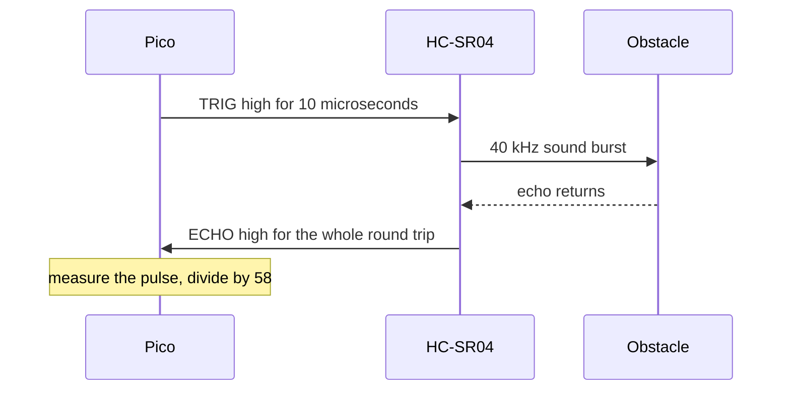
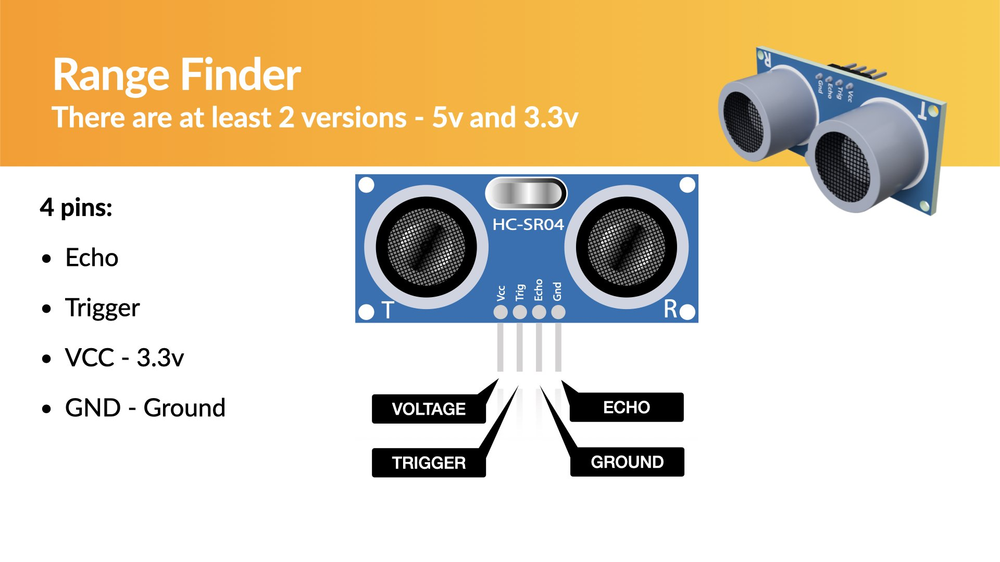

{:class="cover"}

---

By the end of this lesson you will be able to measure distance with an HC-SR04 sensor, protect the Pico from the sensor's 5 V signal, and make the robot back away from obstacles.

Your robot needs to know what is in front of it. An **ultrasonic sensor** like the HC-SR04 works like a bat: it sends out a burst of sound too high to hear, listens for the echo, and times how long it took to come back.

## How the HC-SR04 works

You make the sensor measure by sending a 10 microsecond pulse to **TRIG**. It then fires eight bursts of 40 kHz sound and raises **ECHO** for as long as the sound takes to go out and come back. The longer the ECHO pulse, the farther away the object.



Sound travels about 0.0343 cm per microsecond, and it has to go there **and back**, so distance is half of that. Worked through with real numbers: an echo of 1160 microseconds is 1160 x 0.0343 / 2 = 19.9 cm. The datasheet gives the shortcut: **distance in cm = echo time in microseconds / 58**, and 1160 / 58 = 20 cm. The sensor works from about 2 cm to 400 cm.

{:class="w-100 rounded-3"}

## Wiring: mind the voltage

The standard HC-SR04 runs on **5 V**, and its ECHO pin outputs 5 V. The Pico's pins are only rated for 3.3 V, so ECHO must go through a **voltage divider**: 1k ohm in series, then 2k ohm to ground, with GP9 connected between them. That gives 5 V x 2k / (1k + 2k) = 3.3 V.

| HC-SR04 pin | Connect to |
|-------------|------------|
| VCC | A 5 V source (see below) |
| GND | GND |
| TRIG | Pico GP8 (physical pin 11) |
| ECHO | 1k ohm resistor, then Pico GP9 (pin 12), with a 2k ohm resistor from GP9 to GND |
{:class="table table-single"}

```text
ECHO ---[ 1k ]---+--- Pico GP9
                 |
               [ 2k ]
                 |
                GND
```

For 5 V: while you are on USB, pin 40 (VBUS) carries 5 V. VBUS has no voltage when the Pico runs from a battery on VSYS, so on the finished robot use the 5 V rail from lesson 6. Some sellers offer a 3.3 V variant (the HC-SR04P); that one can use 3.3 V and needs no divider. Check what you bought.

## The sonar module

Let's put the timing in a module the later lessons can reuse. Save this on the Pico as `sonar.py`:

```python
# sonar.py - HC-SR04 distance sensor
from machine import Pin, time_pulse_us
from time import sleep_us


class Sonar:
    def __init__(self, trig=8, echo=9):
        self.trig = Pin(trig, Pin.OUT)
        self.echo = Pin(echo, Pin.IN)
        self.trig.value(0)

    def distance_cm(self):
        """Distance in cm, or None if no echo came back."""
        self.trig.value(0)
        sleep_us(5)
        self.trig.value(1)
        sleep_us(10)          # the 10 microsecond trigger pulse
        self.trig.value(0)
        duration = time_pulse_us(self.echo, 1, 30000)   # give up after 30 ms
        if duration < 0:
            return None       # -1 or -2 means timeout
        return duration / 58
```

`time_pulse_us(pin, 1, 30000)` times how long the pin stays high, and gives up after 30 ms (about 5 m). If it times out it returns a negative number (-2 if the pulse never started, -1 if it never ended). The module turns that into `None` instead of letting a negative "distance" fool the robot into thinking something is right in front of it.

Test it with this complete program:

```python
from time import sleep
from sonar import Sonar

sonar = Sonar()

while True:
    d = sonar.distance_cm()
    if d is None:
        print("No echo")
    else:
        print("Distance: {:.1f} cm".format(d))
    sleep(0.3)
```

Hold your hand 10 cm, 20 cm and 50 cm from the sensor. Soft or angled surfaces like cushions and fur can absorb or bounce the sound away, so test with something flat.

## Avoiding obstacles

Now we combine the sensor with the motors from lesson 3. The robot drives forward until something is within 15 cm, then backs up and turns away:

```python
from time import sleep
from robot import Robot
from sonar import Sonar

bot = Robot()
sonar = Sonar()

STOP_DISTANCE = 15   # cm

while True:
    d = sonar.distance_cm()
    if d is not None and d < STOP_DISTANCE:
        bot.stop()
        sleep(0.2)
        bot.backward(60)
        sleep(0.4)
        bot.spin_right(60)
        sleep(0.4)
        bot.stop()
    else:
        bot.forward(60)
    sleep(0.06)
```

Why wait 60 ms? A new ping sent too soon can pick up the echo from the previous one, so leave a gap between measurements.

## Common Issues

- **Problem**: The distance is always `None` or jumps about wildly.
- **Solution**: Check VCC is 5 V, TRIG and ECHO are not swapped, and ground is shared.
- **Why**: A sensor without 5 V cannot make its sound burst, and swapped pins never start or hear a measurement.

- **Problem**: The Pico resets, or ECHO seems to damage the pin.
- **Solution**: Put the 1k and 2k divider on ECHO and check the resistor values.
- **Why**: Without the divider the Pico's GP9 sees 5 V, above its 3.3 V rating.

- **Problem**: The robot ignores walls approached at an angle.
- **Solution**: Slow down and approach square on, or add a second check from another angle.
- **Why**: Sound bounces away from an angled surface instead of coming straight back.

## Try it Yourself

1. Change `STOP_DISTANCE` to 25 and then 8. How does the behaviour change?
2. Print the raw `duration` and check the distance by hand with the 58 rule.
3. Make the robot turn left or right at random, using `from random import choice`.
4. Challenge: slow the robot as it approaches, for example 60% when over 40 cm and 35% when under it.

## Check your understanding


? An echo pulse lasts 580 microseconds. About how far away is the obstacle?
- [ ] 580 cm
- [x] 10 cm
- [ ] 1 cm
> Distance in cm is the echo time in microseconds divided by 58, and 580 / 58 = 10.

? Why does ECHO go through a 1k and 2k divider?
- [ ] To make the sensor more accurate
- [x] To bring the sensor's 5 V signal down to about 3.3 V for the Pico
- [ ] To slow down the echo
> 5 V x 2k / (1k + 2k) is 3.3 V, which the Pico pin can safely take.

? What does `time_pulse_us` return when the echo times out?
- [ ] 0
- [x] A negative number
- [ ] The maximum distance
> It returns -2 or -1, which is why the sonar module turns negative values into `None`.

