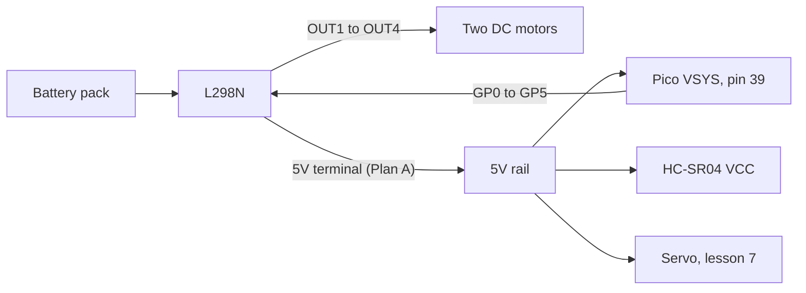

{:class="cover"}

---

By the end of this lesson you will be able to assemble the robot chassis, wire a safe power supply, and run a self-test program that proves the motors and sensors all work before you add any clever behaviour.

So far each part has lived on the desk. Now we put everything on one chassis. This lesson is mostly building, and the most important part is the **power plan**, because power is where robots most often go wrong.

## Components you'll need

- Chassis kit with motor mounts, 2x DC gear motors, 2x wheels and a caster wheel (or ball support)
- L298N motor driver and Raspberry Pi Pico
- 2x IR line sensors and the HC-SR04 ultrasonic sensor
- Battery pack (see the power plan)
- Jumper wires, screws, nuts, double-sided tape or hot glue

## Assembly

1. **Fit the motors.** Secure each motor to its mount, with both shafts pointing outwards on opposite sides.
2. **Add the wheels and caster.** Push the wheels onto the shafts, and fit the caster at the front or back so the chassis sits level.
3. **Mount the electronics.** Use double-sided tape or standoffs for the L298N and the Pico. Keep the Pico where its USB port is reachable.
4. **Wire the motors** to OUT1/OUT2 (left) and OUT3/OUT4 (right). The control wiring is the same table as in lesson 3.
5. **Add the sensors.** The two IR sensors face the floor at the front, about 1 cm up. The ultrasonic sensor faces forward, either fixed or, in lesson 7, on a servo.

## The power plan

A robot has two kinds of load: the motors (noisy and hungry) and the logic (the Pico and sensors, which want a steady 5 V or 3.3 V). The L298N has an onboard 5 V regulator that can feed the logic, but there are rules. Choose **one** of these two plans:

| | Plan A: battery runs everything | Plan B: power bank runs the Pico |
|---|---|---|
| Motor battery | 7 V to 12 V, for example a 2S Li-ion pack or 6x AA | 4x AA is fine |
| 5V-enable jumper on the L298N | Fitted | Fitted or removed, but do not use the 5V pin |
| Pico powered by | L298N 5V terminal to Pico VSYS (pin 39) | USB power bank into the Pico |
| HC-SR04 VCC | L298N 5V terminal | Pico VBUS (pin 40) |
| Disconnect first | The battery, before plugging in USB | Nothing special |
{:class="table table-single"}

The reason for the 7 V minimum in Plan A is that the board's 5 V regulator needs about 2 V of headroom, and a 4x AA pack (about 6 V) is just not enough. The L298N modules usually say their onboard regulator can be used only up to about 12 V, so check the text printed on your board. Whichever plan you pick, **all grounds must join**: battery negative, L298N GND, Pico GND and the sensor grounds.



> **Teachers**: Batteries are the real hazard here. A shorted battery pack gets hot very quickly, so use holders with a switch and keep cells and wire ends apart. Lithium-ion packs must never be shorted, punctured or charged on an unattended charger, so many classes stay with AA cells. Check polarity before every power-up, and check the first power-up yourself. Never leave a pack connected to the robot when it is stored. Wheels spinning in the air are safe, wheels on the desk are not, so lift the robot on a block for first tests.

Do **not** connect the L298N's 5V terminal to the Pico's VBUS pin, and do not feed 5 V into VSYS while the L298N regulator is also connected to another source. Two supplies on one rail fight each other.

## Self-test

Before adding any intelligence, check every part. Save `robot.py` and `sonar.py` on the Pico, then run this program. Put the robot on a block with the wheels off the table:

```python
from machine import Pin
from time import sleep
from robot import Robot
from sonar import Sonar

bot = Robot()
sonar = Sonar()
ir_left = Pin(6, Pin.IN)
ir_right = Pin(7, Pin.IN)

print("1. Motors: both wheels should turn forward for 1 second")
bot.forward(60)
sleep(1)
bot.stop()
sleep(0.5)

print("2. Spin: left wheel back, right wheel forward")
bot.spin_left(60)
sleep(1)
bot.stop()

print("3. Sensors: wave your hand in front, and pass paper under the IR sensors")
for _ in range(20):
    d = sonar.distance_cm()
    print("distance:", d, "left IR:", ir_left.value(), "right IR:", ir_right.value())
    sleep(0.5)

print("Self-test finished")
```

Work through the checklist:

| Check | What you should see | If not |
|-------|---------------------|--------|
| Both wheels turn forward | Wheels turn away from you at the front | Use `Robot(invert_left=True)` or `invert_right=True` |
| Spin left | Left wheel back, right wheel forward | Check the left/right motor wiring |
| Distance | Numbers fall as your hand nears | Check VCC, TRIG, ECHO and the divider |
| IR left and right | The value flips over black tape | Re-tune the potentiometers, see lesson 4 |
{:class="table table-single"}

## Common Issues

- **Problem**: The Pico resets whenever the motors start.
- **Solution**: Power the Pico from a separate power bank (Plan B), or add a 470 microfarad capacitor across the 5 V rail.
- **Why**: Motors pull big surges of current, which makes the shared supply dip below what the Pico needs.

- **Problem**: The L298N gets very hot.
- **Solution**: Use a lower motor voltage and keep the speed from sitting at 100 percent for long.
- **Why**: The L298N wastes about 2 V as heat inside the chip for every motor, so it warms up when pushed.

- **Problem**: The robot veers to one side when told to go straight.
- **Solution**: Lower the faster motor's speed in `drive()`, for example `bot.drive(60, 55)`.
- **Why**: No two motors are identical, so equal duty does not give equal wheel speed.

## Try it Yourself

1. Run the self-test and note any wiring you had to fix.
2. Measure how far the robot travels in two seconds at 60 percent, and write down the result.
3. Find the `drive()` values that make it travel straight on your floor.
4. Challenge: add a power switch between the battery and the L298N.

## Check your understanding


? Why does Plan A need a motor battery of at least 7 V?
- [ ] The motors will not turn below 7 V
- [x] The 5 V regulator on the L298N needs about 2 V of headroom
- [ ] The Pico needs 7 V on VSYS
> A 6 V pack leaves too little margin for the onboard regulator, so use 7 V to 12 V or switch to Plan B.

? Which of these is true on every robot, whichever power plan you pick?
- [ ] The L298N 5V pin goes to the Pico VBUS pin
- [x] All the grounds are joined together
- [ ] The motors run from the Pico 3.3 V pin
> The lesson says battery negative, L298N GND, Pico GND and sensor grounds must all connect.

? The Pico keeps resetting when the motors start. What is the likely cause?
- [x] The motors' current surge pulls the shared supply down
- [ ] The wheels are too big
- [ ] The IR sensors are too close to the floor
> Motor start-up surges cause the supply to dip, so separate or smooth the Pico's supply.

