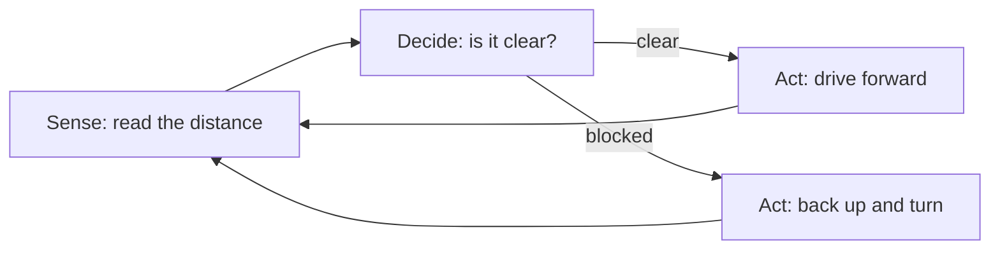

{:class="cover"}

---

By the end of this lesson you will be able to write a sense, decide, act loop, and build an explorer that scans with the servo and turns towards the most open space.

You've driven your robot by hand. Now let's make it think for itself, at least a little. An **autonomous** robot decides what to do from its sensor readings instead of waiting for you. Almost every robot, from a vacuum cleaner to a Mars rover, runs the same three-step loop.

## The sense, decide, act loop



Writing it as a loop makes the robot easy to debug: when something goes wrong you can ask, did it sense wrongly, decide wrongly, or act wrongly?

## Version 1: bump-free wanderer

This robot drives forward while the way is clear. If something is within 20 cm, it stops, backs up for half a second, then spins a random way for a random time, so it does not get stuck in the same corner. It needs `robot.py` and `sonar.py` on the Pico.

```python
from time import sleep
from random import choice, randint
from robot import Robot
from sonar import Sonar

bot = Robot()
sonar = Sonar()

CLEAR_CM = 20
SPEED = 60

while True:
    distance = sonar.distance_cm()          # sense

    if distance is None or distance > CLEAR_CM:
        bot.forward(SPEED)                  # decide: clear, act: go
    else:
        bot.stop()                          # decide: blocked, act: dodge
        sleep(0.2)
        bot.backward(SPEED)
        sleep(0.5)
        turn = choice([bot.spin_left, bot.spin_right])
        turn(SPEED)
        sleep(randint(3, 8) / 10)           # 0.3 to 0.8 seconds
        bot.stop()

    sleep(0.06)
```

A note on `distance is None`: no echo at all usually means nothing is in range, so the way is clear. If your robot drives into soft things like curtains, which can swallow the sound, treat `None` as blocked instead. It is your robot, your decision.

## Version 2: choose the best direction

A random turn is better than nothing, but a robot with a servo can look first. When blocked, it scans left and right and turns towards the larger gap. This needs `servo.py` too, with the servo on GP10:

```python
from time import sleep
from robot import Robot
from sonar import Sonar
from servo import Servo

bot = Robot()
sonar = Sonar()
servo = Servo()

CLEAR_CM = 20
SPEED = 60
servo.angle(90)
sleep(0.5)


def look(angle):
    servo.angle(angle)
    sleep(0.4)                       # let the servo arrive
    d = sonar.distance_cm()
    return 400 if d is None else d   # no echo means lots of room


def choose_direction():
    left_gap = look(150)
    right_gap = look(30)
    servo.angle(90)
    print("left", left_gap, "right", right_gap)
    return "left" if left_gap > right_gap else "right"


while True:
    distance = sonar.distance_cm()
    if distance is None or distance > CLEAR_CM:
        bot.forward(SPEED)
    else:
        bot.stop()
        sleep(0.2)
        side = choose_direction()
        bot.backward(SPEED)
        sleep(0.4)
        if side == "left":
            bot.spin_left(SPEED)
        else:
            bot.spin_right(SPEED)
        sleep(0.5)
        bot.stop()
    sleep(0.06)
```

The angles depend on how you mounted the servo. If the robot turns towards the wall, swap 150 and 30. A spin of 0.5 seconds is about a quarter turn at this speed on a smooth floor, but yours will differ, so adjust the time until it matches.

## Debug by printing

When a robot misbehaves, make it tell you what it is thinking. A `print()` of the distance and the decision in each loop shows you instantly whether it saw the wall. Keep the robot on a block with its USB cable attached for the first tests, then free it once the prints look sensible.

## Common Issues

- **Problem**: The robot hits obstacles before it reacts.
- **Solution**: Raise `CLEAR_CM`, lower `SPEED`, or reduce the `sleep(0.06)` at the end of the loop.
- **Why**: The robot keeps moving while it senses and decides, so it needs room to stop.

- **Problem**: The robot gets stuck wiggling in a corner.
- **Solution**: Make the backing up and turning longer, or use the random turn.
- **Why**: A short dodge can leave the robot still facing the same wall.

- **Problem**: The robot turns towards the wall in version 2.
- **Solution**: Swap the angles used for `left_gap` and `right_gap`.
- **Why**: The servo's 0 to 180 direction depends on how it is mounted.

## Try it Yourself

1. Change `CLEAR_CM` to 10, 20 and 40, and describe how the robot's personality changes.
2. Add a `print()` of every decision and read the output while the robot runs.
3. Make the robot slow down when something is within 40 cm, before it stops.
4. Challenge: combine this with line following: follow the line, but stop and wait when an obstacle blocks it.

## Check your understanding


? What are the three steps of the loop in this lesson?
- [ ] Charge, run, stop
- [x] Sense, decide, act
- [ ] Wire, code, test
> Every autonomous robot reads sensors, makes a decision, then moves.

? Why does the first version turn a random way and for a random time?
- [ ] To use less battery
- [x] So it does not get stuck repeating the same turn in a corner
- [ ] Because the sonar cannot measure left or right
> Randomness breaks the repeating pattern that traps a robot in one spot.

? In version 2, why does `look()` pause after moving the servo?
- [x] The servo needs time to arrive before the sonar measures
- [ ] The motors need to stop first
- [ ] To keep the Pico cool
> A reading taken while the servo is still moving can come from the wrong direction.

