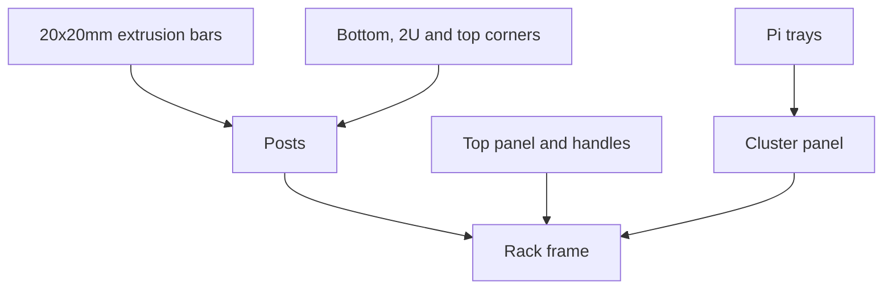

{:class="cover"}

---

By the end of this lesson you will be able to name every part of the mini-rack and say whether it is 3D printed, laser cut or bought.

Ahoy there makers! Before we open Fusion 360, let's look at the whole rack so each part we design later has a place in your head. The picture below is the finished design with every part labelled.

{:class="img-fluid w-100"}

The rack is a simple idea. Four posts hold up a flat top, and a front panel carries the Raspberry Pi trays. The posts use cheap 20x20mm aluminium extrusion, and we design the 3D printed parts that join it together.

## The parts

Each part gets its own lesson, so here is the map:

| Part | How it is made | Lesson |
| --- | --- | --- |
| [2U Corner](02_2u_design) | 3D printed | 2 |
| [Bottom Corner](03_bottom) | 3D printed | 3 |
| [Top Corner](04_top) | 3D printed | 4 |
| [Handle](05_handle) | 3D printed | 5 |
| [Cluster Panel](06_panel) | Flat plate with 4mm thickness | 6 |
| [Pi Tray](07_pi_tray) | 3D printed | 7 |
| [Top Panel](08_top_panel) | Laser cut | 8 |
| [Cluster Panel, laser-cut version](09_cluster_panel) | Laser cut | 9 |
| 20x20mm aluminium extrusion | Bought and cut to length | Not designed here |
{:class="table table-single"}

Notice the pattern. Anything that carries weight or needs a clever shape is printed. Flat sheets are laser cut. The long straight bars are bought, because printing a long bar would be slow and weak.

## How the parts fit together

The corners slot into each other to build a post: a bottom corner at the foot, 2U corners above it, and a top corner under the top panel. In the original project the printed parts are bolted to the extrusion with rack mount nuts and bolts, and the handles are fixed with T-nuts. The project page has the full parts list and the STL files if you would rather print than design: [Mini-Rack project](/projects/mini-rack/).

## Why design the parts yourself?

You can download the STLs, but designing them means you can change them. Want a taller rack, or a different spacing? You will know exactly which sketch to edit. The next lessons walk through each part using only a handful of tools: sketch, extrude, fillet and mirror.

> **Teachers**: Lesson 1 needs no software or hardware, so it works well as a class discussion or a homework read. Show the labelled photo and ask learners to predict which parts will be printed and which cut. It also helps to decide early which parts your school printer or laser cutter can actually make, and who is allowed to run them.

## Try it Yourself

1. Cover the table with your hand. Looking only at the photo, list the labelled parts and guess how each is made. Then check your answers.
2. Open the [Mini-Rack project](/projects/mini-rack/) page and find the STL list. Match every STL name to a lesson in this course. Which STLs have no lesson of their own?
3. Challenge: sketch on paper a rack for your own kit (Pis, a switch, a power strip). Work out how many U of height you need, if 1U is 44.45mm.

## Common Issues

- **Problem**: I cannot tell the corner parts apart.
- **Solution**: Use the colours in the photo: cyan is the top corner, pink the 2U corner and green the bottom corner. Lessons 2 to 4 each show the finished part at the top.
- **Why**: The corners share a similar hole pattern, so they look alike until you see where they sit in a post.

## Check your understanding


? Which parts of the mini-rack are laser cut?
- [ ] The corners and the handle
- [x] The top panel and the laser-cut cluster panel
- [ ] The Pi tray
> The corners, handle and Pi tray are 3D printed. The flat panels are laser cut.

? Which part is bought and cut to length rather than designed?
- [ ] The handle
- [ ] The bottom corner
- [x] The 20x20mm aluminium extrusion
> Long straight bars are cheaper and stronger as extrusion than printed.

? What do the Pi trays attach to?
- [ ] The handle
- [x] The cluster panel
- [ ] The top corner
> The trays sit on the cluster panel at the front of the rack.

