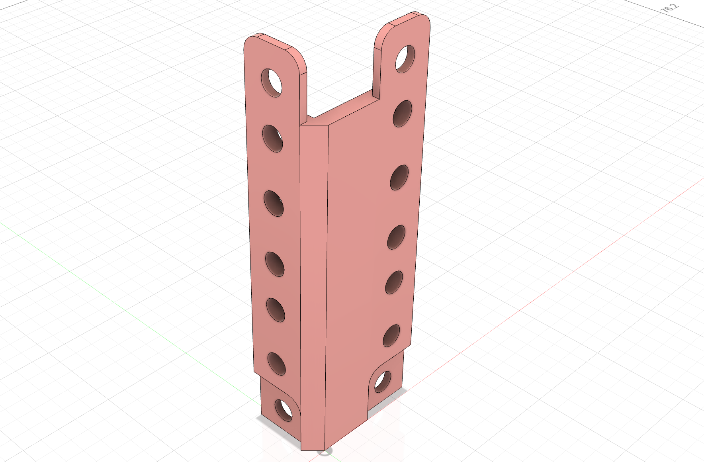

{:class="cover"}

---

By the end of this lesson you will be able to explain how rack unit sizes decide where the holes go, and build the 2U corner in Fusion 360.

Ahoy there makers! The 2U corner is the longest corner part, and it is the one that teaches us rack sizes. Every number in it comes from the rack standard, so take a few minutes over the measurements before you start clicking.

In this lesson we'll create the 2U corner piece for the mini-rack.

> ## What is a U?
>
> In rack units, 1U equals 1.75 inches (44.45 mm). The standard rack unit is a 19-inch (482.6 mm) wide horizontal space. This is the standard width of rack-mountable equipment. The height of a rack is measured in U. A U is 1.75 inches. A 1U rack is 1.75 inches tall, a 2U rack is 3.5 inches tall, and so on.

---

## Common Rack Dimensions

There are a number of key dimensions that are common to this design (and racks in general):

- Hole diameter: `6mm`
- Pitch between holes within a U - `15.875mm`
- 1U Height - `44.5mm` (you can use the `44.45mm` here instead)
- Gap between U's - `12.75mm` (last hole of one U to the first hole of the next)

---

## 2U Corner

{:class="img-fluid w-100"}

1. Create a new file named 2u_corner in Fusion 360
1. Create a new sketch on the XY plane, named `2u_base`

1. Create the following sketch:

    {:class="img-fluid w-100"}

1. Extrude the body profile by `4mm`:

    {:class="img-fluid w-100"}

1. Extrude the top tab profile by `2mm`:

    {:class="img-fluid w-100"}

1. Extrude-cut the bottom tab profile by `2mm`:

    {:class="img-fluid w-100"}

1. Create a new sketch on the top of the new part, named `top_profile`

1. Create the following sketch:

    {:class="img-fluid w-100"}

1. Extrude the top profile to the bottom surface of the main part:
    
    {:class="img-fluid w-100"}

1. Create a new sketch on the top of the body, named `Ribs`

1. Create the following sketch:

    {:class="img-fluid w-100"}

1. Create the following sketch on the left side of the main part:

    {:class="img-fluid w-100"}

1. Extrude-cut the last sketch:

    {:class="img-fluid w-100"}

1. Create the following sketch on the left side of the main part, for the top and bottom tabs:

    {:class="img-fluid w-100"}

1. Extrude-cut the last sketch:

    {:class="img-fluid w-100"}

1. Extrude-cut the last sketch:

    {:class="img-fluid w-100"}

1. Create construction planes for each rib:

1. Create a new construction plane `14mm` from the top:

    {:class="img-fluid w-100"}

1. Create a new construction plane `15.875mm` from the last construction plane:

    {:class="img-fluid w-100"}

1. Create a new construction plane `14.5mm` from the last construction plane:

    {:class="img-fluid w-100"}

1. Create another new construction plane `14.5mm` from the last construction plane:

    {:class="img-fluid w-100"}

1. Extrude the Rib profile created in step 11 to the construction planes just created, Set the start to the construction plane object, set the direction to `symmetric` the measurement to between, and the distance to `3mm`:

    {:class="img-fluid w-100"}

1. Extrude another rib profile to the next construction plane:

    {:class="img-fluid w-100"}

1. Extrude another rib profile to the next construction plane:

    {:class="img-fluid w-100"}

1. Extrude another rib profile to the next construction plane:

    {:class="img-fluid w-100"}

Once the last rib is in, orbit the part and check that it matches the picture at the top of the lesson.

## Where the numbers come from

Look again at the hole measurements. Three holes sit in each U, `15.875mm` apart. Two gaps of 15.875mm make 31.75mm. Subtract that from the height of one U (44.45mm) and 12.7mm is left to reach the first hole of the next U. This course uses 44.5mm for the U height, which is why the gap between U's is written as `12.75mm`. The 0.05mm difference is far too small to matter in a printed part, but now you know where each number comes from.

This is why a rack is so useful. The hole pattern is a standard, so rack parts line up with your frame. A "10 inch" rack is roughly half the width of the standard 19 inch rack, and ten inches is 254mm.

## Try it Yourself

1. Work out how tall a 3U corner would need to be, in millimetres.
2. In the dimensions picture, count how many `6mm` holes sit in the 2U body. Does the count match three holes per U?
3. Challenge: the 2U corner is two U's. Which sketch dimensions would you edit to build a 1U corner?

## Common Issues

- **Problem**: I cannot extrude a profile, because nothing highlights.
- **Solution**: Check the sketch is closed, with no gaps between lines, and that you finished the sketch before extruding.
- **Why**: Fusion 360 can only extrude closed outlines.

- **Problem**: The extrude cut goes into the wrong side of the part.
- **Solution**: Change the direction in the extrude dialogue, or choose symmetric for the ribs.
- **Why**: A cut follows the direction arrow, and that depends on which face you sketched on.

- **Problem**: My sketch lines are blue and move when I drag them.
- **Solution**: Add the missing dimensions until the lines turn black.
- **Why**: Blue lines are not fully constrained, so Fusion 360 does not know exactly where they belong.

> **Teachers**: This is the longest build lesson, so allow a double session. Check before the lesson that learners can sign in to Fusion 360, because it needs an Autodesk account and an internet connection. Pairs work well, with one person following the steps and the other checking each picture. The same shapes can be rebuilt in FreeCAD, see the [FreeCAD course](/learn/freecad/).

## Check your understanding


? How tall is 1U?
- [ ] 15.875mm
- [x] 44.45mm (1.75 inches)
- [ ] 254mm
> A rack unit is 1.75 inches, which is 44.45mm.

? What is the spacing between neighbouring holes inside a U?
- [x] 15.875mm
- [ ] 12.75mm
- [ ] 6mm
> Holes are 15.875mm apart. 12.75mm is the gap between the last hole of one U and the first of the next.

? Why are the ribs extruded to construction planes?
- [ ] To make the part print faster
- [x] To place each rib at an exact distance from the top
- [ ] To round off the edges
> Each construction plane is measured from the one before, so the ribs land in the right positions.

