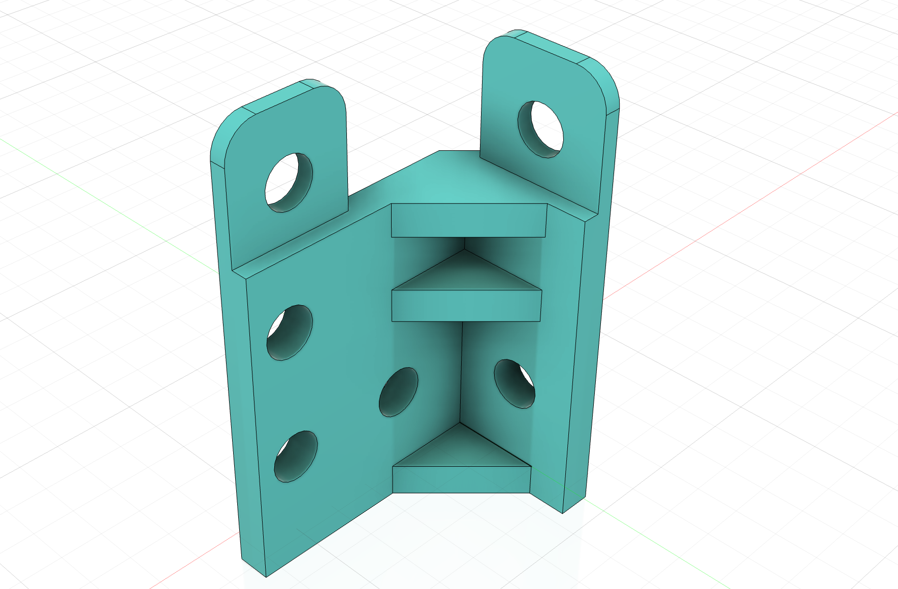

{:class="cover"}

---

By the end of this lesson you will be able to build the bottom corner of the rack post, and explain why it needs ribs and side holes.

Ahoy there makers! The bottom corner is the foot of every post. It takes the weight of the whole rack and everything in it, so it is the part where strength matters most. The steps will feel familiar from the 2U corner: a base plate, a raised profile, then ribs.

The design below is what we are heading for.

{:class="img-fluid w-100"}

1. Create a new file named `bottom_corner` in Fusion 360

1. Create a new sketch on the XY plane, named `bottom_base`

1. Create the following sketch:

    {:class="img-fluid w-100"}

1. Extrude the body profile by `4mm`:

    {:class="img-fluid w-100"}

1. Extrude the top tab profile by `2mm`:

    {:class="img-fluid w-100"}

1. Create a new sketch on the top of the new part, named `top_profile`

    {:class="img-fluid w-100"}

1. Extrude the top profile to the bottom surface of the main part:

    {:class="img-fluid w-100"}

1. Create a new sketch on the top of the body, named `side holes`

    {:class="img-fluid w-100"}

1. Extrude the top tab:

    {:class="img-fluid w-100"}

1. Create a new sketch, name it `ribs`:

    {:class="img-fluid w-100"}

1. Extrude the sketch:

    {:class="img-fluid w-100"}

1. Create a construction plane on the top of the new rib:

    {:class="img-fluid w-100"}  

1. Extrude the `ribs` sketch `20mm` from the construction plane:

    {:class="img-fluid w-100"}

1. Extrude the sketch from the top of the body down by `4mm`:

    {:class="img-fluid w-100"}

1. Extrude the sketch to create the holes:

    {:class="img-fluid w-100"}

1. Extrude the `ribs` sketch `4mm` from the construction plane:

    {:class="img-fluid w-100"}

## Why it is built this way

A flat 4mm plate on its own would flex. The raised profile and the ribs give the plate stiffness in the places where it carries load, in the same way as the ribs on a wall bracket. Because the plate is drawn flat on the XY plane, its back face is a natural face to lay on the print bed.

The `side holes` sketch is where the fixing holes for this part are defined. Name your sketches as the steps do (`bottom_base`, `top_profile`, `side holes`, `ribs`). When you need to go back and change something later, a named sketch is much easier to find than "Sketch14".

## Try it Yourself

1. Hide the `ribs` sketch and show it again. Which steps use it? Count them.
2. Change the body extrude from `4mm` to a different thickness, then look at how the other features follow it.
3. Challenge: compare your bottom corner with the 2U corner from lesson 2. Write down three features they share and one that is different.

## Common Issues

- **Problem**: The ribs extrude in the wrong direction or into the body.
- **Solution**: Check the start plane is the construction plane you made, and flip the direction arrow.
- **Why**: The extrude starts wherever you tell it to, and the default is not always the side you wanted.

- **Problem**: I cannot find the sketch I need to reuse.
- **Solution**: Open the Browser tree on the left and turn the light-bulb icon on for the sketch.
- **Why**: Fusion 360 hides a sketch after it has been used. Turning it back on lets you extrude it again.

## Check your understanding


? How thick is the base plate of the bottom corner?
- [ ] 2mm
- [x] 4mm
- [ ] 20mm
> Step 4 extrudes the body profile by 4mm.

? Why is the `ribs` sketch used more than once?
- [x] Different extrudes use the same outline at different heights
- [ ] It is a mistake in the tutorial
- [ ] Fusion 360 deletes it each time
> The ribs sketch is extruded from the construction plane and again from the top of the body.

? Why do we name sketches?
- [ ] Fusion 360 refuses to save otherwise
- [x] So we can find and reuse them later
- [ ] To make the part stronger
> Clear names make a long timeline easy to follow and edit.

