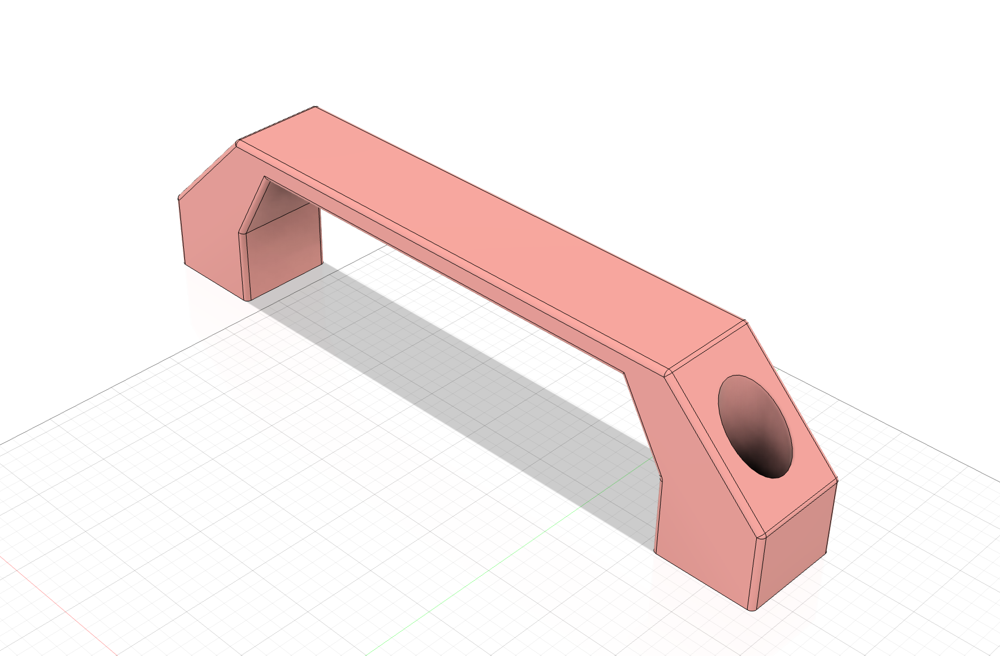

{:class="cover"}

---

By the end of this lesson you will be able to design a handle in Fusion 360 using an extrude-cut and a fillet.

Ahoy there makers! A rack full of Raspberry Pis gets heavy, and a handle makes it much nicer to move around the workbench. This is the shortest build in the course, so it is a good place to practise the "sketch, extrude, cut, fillet" pattern.

Here is the design.

{:class="img-fluid w-100"}

1. Create a new file named `handle` in Fusion 360

1. Create a new sketch on the XY plane, named `handle_base`

    {:class="img-fluid w-100"}

1. Extrude the body profile by `20mm`:

    {:class="img-fluid w-100"}

1. Create a new sketch on the top of the new part, named `top_profile`

    {:class="img-fluid w-100"}

1. Extrude-cut the profile:

    {:class="img-fluid w-100"}

1. Fillet the handle edges:

    {:class="img-fluid w-100"}

1. Create a new sketch on the bottom of the body, named `bottom holes`

    {:class="img-fluid w-100"}

1. Extrude the sketch up by `3mm` to create the platform the screws will sit on:

    {:class="img-fluid w-100"}

## How the handle works

Step 3 builds a solid block, `20mm` thick. Step 5 cuts a profile out of it, leaving the shape of a handle. Step 6 rounds the edges so it is comfortable in the hand. Finally the platform for the screws is built `3mm` thick, so the screw heads have a flat surface to sit on. In the original project the handle is bolted to the top using T-nuts.

Always fillet the handle edges, because a printed handle with sharp edges is unpleasant to hold. Do the fillet before you add the screw platform, as the steps do, so you only round the edges you meant to round.

> **Teachers**: Learners often want to personalise the handle. Fine, but keep it to the shape: the screw platform and holes should not change, or the handle will not fit the top panel. Check the printed handle for sharp edges or stringing before it goes home with a learner.

## Try it Yourself

1. Make the fillet bigger. How does the handle look and feel different?
2. Look at the picture and work out which two faces get the `bottom holes`.
3. Challenge: design a handle that is `10mm` longer, and say which dimensions you changed.

## Common Issues

- **Problem**: The fillet fails or leaves a gap.
- **Solution**: Select all the edges of one loop, and lower the radius.
- **Why**: A fillet that is bigger than the available surface cannot be built.

- **Problem**: The screw platform grows on the wrong side.
- **Solution**: Flip the extrude direction so it goes up into the body.
- **Why**: The sketch is on the bottom of the body, so the default direction can point away from it.

## Check your understanding


? How far is the base extruded in step 3?
- [ ] 3mm
- [ ] 4mm
- [x] 20mm
> The body profile is extruded by 20mm.

? What is the 3mm extrude for?
- [x] The platform the screws sit on
- [ ] The fillet radius
- [ ] The handle grip
> Step 8 creates a platform for the screws.

? What does the extrude-cut in step 5 do?
- [ ] Adds material
- [x] Removes the profile, leaving the handle shape
- [ ] Rounds the edges
> A cut removes material.

