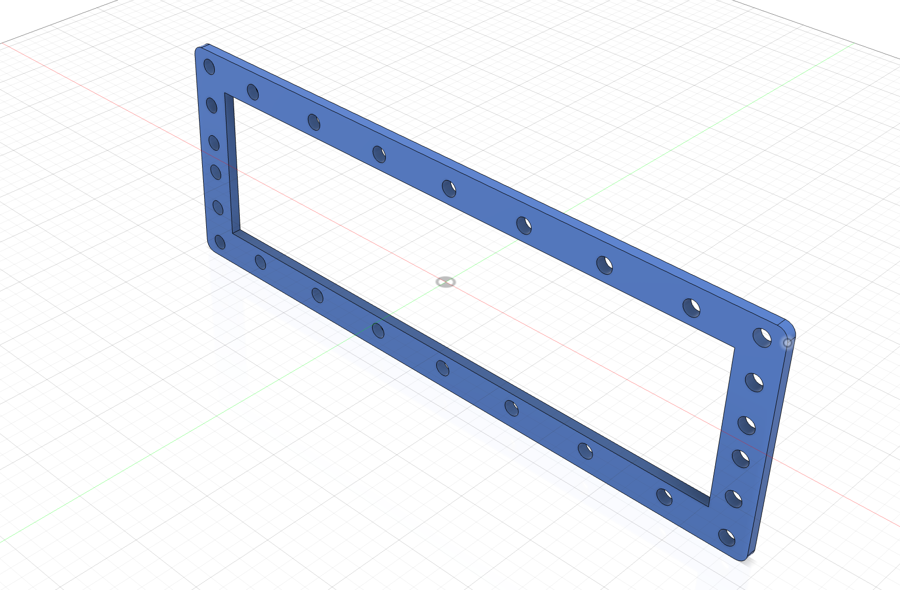

{:class="cover"}

---

By the end of this lesson you will be able to design a flat panel with mounting holes in two columns, and explain how it differs from the laser-cut version in lesson 9.

Ahoy there makers! The cluster panel is the front of the rack. The Pi trays hang from it, so it also keeps the two front posts the right distance apart. This is a short build with only two features, a plate and a pattern of holes, which makes it a good place to see how a sketch with many dimensions turns into a real part.

This lesson builds the panel at `4mm` thick, the same thickness as the corner plates. Lesson 9 builds a version that is meant to be laser cut.

The design is shown below.

{:class="img-fluid w-100"}

1. Create a new file named `cluster_panel` in Fusion 360

1. Create a new sketch on the XY plane, named `panel_base`

    {:class="img-fluid w-100"}

1. Extrude the body profile by `4mm`:

    {:class="img-fluid w-100"}

1. Create a new sketch on the top of the new part, named `holes`

    {:class="img-fluid w-100"}

1. Extrude-Cut the `holes` sketch:

    {:class="img-fluid w-100"}

## What the sketches are doing

The `panel_base` sketch is a rectangle. Its width follows the rack: each end has a `15.875mm` strip holding a column of six holes, with `222.25mm` between the two strips. Add them up (15.875 + 222.25 + 15.875) and you get 254mm, which is exactly ten inches. The holes are `15.875mm` apart, the same pitch we met on the 2U corner. That is the whole point of the rack standard: the panel holes match the corner holes, so the bolts go straight through both.

The `holes` sketch is cut right through the plate. Notice the hole diameter, `6mm`, is the same as on the corners.

## A word on printing a long, flat plate

A flat plate this wide is easy to design, but long thin parts can curl at the edges as they cool. If yours lifts at the corners, try a brim and a clean, warm bed. If your plate is too long for your printer bed, the laser-cut version in lesson 9 is the better route.

## Try it Yourself

1. Count the holes at each end in your sketch. How many are there in each column?
2. Change the plate thickness from `4mm` to `3mm`. What would you have to check about the bolts?
3. Challenge: the plate is 10 inches wide. Using the dimensions in the sketch, work out the width of the plate and show it comes to 254mm.

## Common Issues

- **Problem**: The holes do not line up with the corner parts when I assemble the rack.
- **Solution**: Open the sketch and check the hole spacing and the distance from the ends against the dimensions in the picture.
- **Why**: A hole that is a millimetre out in the design is a millimetre out in the part, and a bolt will not go through.

- **Problem**: The extrude cut leaves a thin skin over the holes.
- **Solution**: Cut with the extent set to "All", or to a distance greater than the plate thickness.
- **Why**: A shallower cut than the plate leaves material behind.

## Check your understanding


? How thick is the cluster panel in this lesson?
- [ ] 2mm
- [x] 4mm
- [ ] 20mm
> Step 3 extrudes the body profile by 4mm.

? What spacing do the panel holes use between rows?
- [x] 15.875mm
- [ ] 3mm
- [ ] 44.45mm
> The same 15.875mm as the corner holes, so the parts line up.

? Which feature makes the holes?
- [ ] A fillet
- [x] An extrude-cut of the `holes` sketch
- [ ] A mirror
> Step 5 extrude-cuts the holes sketch.

