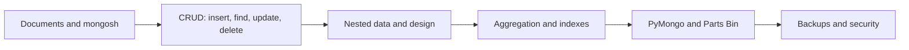

{:class="cover"}

---

By the end of this lesson you will be able to recap what each MongoDB tool does, and choose a next project for your own workshop or robot.

You started this course possibly never having made a database. You are finishing it with a working app, backed by MongoDB, that knows exactly how many SG90 servos you have and which bin they are in. Nicely done.

## Your journey so far

Here is the whole course as a path, from storing a first document to a database you can back up and lock down.



---

## What you built

**Parts Bin** - a Python command line app that keeps track of every part in your workshop:

```bash
python parts_bin.py list --category driver           # what's on the shelves
python parts_bin.py find servo                       # where is it?
python parts_bin.py add "BME280 Sensor" --category sensor --quantity 3 --price 8.50 --shelf B --bin 3
python parts_bin.py use "SG90 Micro Servo" --count 2 # I just used two
python parts_bin.py restock "WS2812B LED Strip 1m" 2 # the post arrived
python parts_bin.py low                              # what to reorder
python parts_bin.py value                            # what it's all worth
```

| Command | MongoDB idea behind it | Lesson |
|---|---|---|
| `list` | `find()` with a filter, sorted | [06](06_finding_documents) |
| `find` | `$regex` and `$or` query operators | [07](07_query_operators) |
| `add` | `insert_one()` plus a unique index | [05](05_inserting_documents), [13](13_indexes) |
| `use` and `restock` | `$inc` updates with a safety filter | [08](08_updating_documents) |
| `low` | comparison operators like `$lt` | [07](07_query_operators) |
| `value` | the aggregation pipeline | [12](12_aggregation_basics) |
{:class="table table-single"}

---

## What you learned

**A database is a program that looks after your data for you.** It stores it safely, lets many programs share it, and answers questions about it quickly - jobs a spreadsheet or a text file struggles with as soon as things grow.

**MongoDB stores documents.** A document is a bundle of labelled fields, much like JSON. Documents live in collections, collections live in databases, and one server can hold many databases.

**The four jobs every database does** are often called CRUD - Create, Read, Update and Delete. You can now do all four, in `mongosh` and in Python.

**Queries are documents too.** A filter like `{ quantity: { $lt: 3 } }` describes the documents you want. Once that clicked, the rest of the query language was just more operators.

**Design follows use.** Things you read together belong together (embed), and things that grow without limit or are shared between many documents belong in their own collection (reference). Validation rules stop typos becoming new fields.

**Aggregation turns data into answers.** A pipeline of small stages - `$match`, `$group`, `$sort`, `$project` - is how you get totals, counts and reports without pulling everything into your own code.

**Indexes make queries fast.** Without one MongoDB reads every document. With the right one it goes straight to the answer, and a unique index stops duplicates for free.

**Back it up and lock it down.** `mongodump` and `mongorestore` are your safety net, and a database should never sit on the internet without a username and password.

---

## Where to take it next

**Add your real parts.** The best way to make this stick is to use it. Empty your own parts drawers into Parts Bin and keep it up to date for a month - you will quickly find the features you actually want.

**Track your projects properly.** In [lesson 11](11_designing_your_data) we sketched a `projects` collection that references parts by `_id`. Add a `project` command that lists every part a build needs and warns you when you are short of something before you start.

**Log data from a robot.** MongoDB is brilliant for sensor readings, because every reading is just a small document with a timestamp. Have a Raspberry Pi read a sensor every few seconds and insert each reading, then use aggregation to work out hourly averages. The [MicroPython](/learn/micropython/) course will get you reading sensors on a Pico, and a small API on a Pi can receive them.

**Put it on the web.** Wrap Parts Bin in a small web API so you can check your stock from your phone in the shop. The [FastAPI](/learn/fastapi/) course shows you how, and the `pymongo` code you have already written drops straight in.

**Run it in the cloud.** If you used Docker locally, try moving your data to a free MongoDB Atlas cluster with `mongodump` and `mongorestore`. Then your parts list goes wherever you go.

---

## Try it Yourself

Pick one and have a go. They use only things you have already learnt.

1. **Count your own drawer.** Add ten real parts from your own workshop with the `add` command, then run `value` and `low`. Is anything on the shopping list that surprises you?
2. **Log a robot.** Write a Python script that inserts one document every two seconds, such as `{"sensor": "distance", "cm": 23.4, "at": datetime.now(timezone.utc)}`. Fake the reading with `random.uniform`, or read a real sensor on a Raspberry Pi. Then use `$group` to work out the average reading per sensor.
3. **Prove the index.** Insert 100,000 readings into a scratch collection, run `explain("executionStats")` on a query, add an index, and compare `totalDocsExamined` before and after.
4. **Lock it down.** Take a backup with `mongodump`, restart your container with `--auth`, and run `parts_bin.py` with a `readWrite` user from a `.env` file.

---

## Common Issues

- **Problem**: Your Parts Bin app works on your laptop but not on another machine.
- **Solution**: Check that the second machine can reach the server and has the right `MONGODB_URI`, and that the port is not bound to `127.0.0.1` only.
- **Why**: Binding to `127.0.0.1` is exactly what keeps the database private, so a remote machine cannot connect unless you deliberately change it, preferably with authentication switched on first.

---

## Check your understanding


? What does CRUD stand for?
- [x] Create, Read, Update, Delete
- [ ] Copy, Run, Undo, Drop
- [ ] Collect, Record, Upload, Download
> They are the four jobs every database does, and you can now do all four in mongosh and Python.

? What is the rule of thumb for designing documents?
- [x] Things you read together belong together
- [ ] Always keep one collection per field
- [ ] Never embed anything
> Design follows use: embed what is read together, reference what is shared or grows without limit.

? Which course helps you put a web API in front of your database?
- [x] FastAPI
- [ ] Docker Swarm
- [ ] Linux intro
> FastAPI is suggested for checking your stock from your phone.


---

## What's Next

If you enjoyed this, these courses make great next steps:

- [Create Databases with Python and SQLite3](/learn/sqlite3/) - the other big family of databases, with tables, rows and SQL. Seeing both makes you much better at choosing between them
- [DuckDB - Fast, free analytics](/learn/duckdb/) - a database built for crunching numbers across big files
- [FastAPI](/learn/fastapi/) - build a web API in front of your database
- [Docker](/learn/docker/) - understand exactly what that `docker run` command in lesson 3 was doing
- [Learn Python](/learn/python/) - sharpen the Python behind your Parts Bin app

Thanks for following along. Now go and count those servos.
