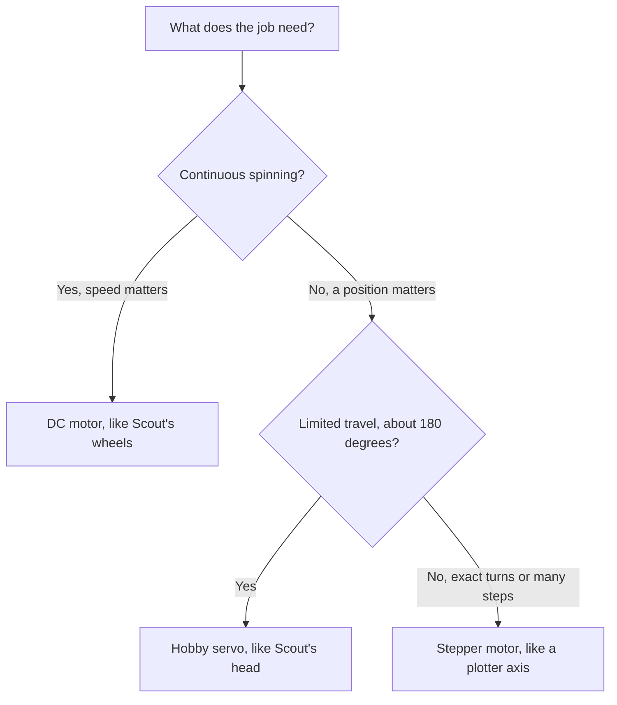

{:class="cover"}

---

By the end of this lesson you will be able to tell a DC motor, a servo and a stepper apart, and choose the right one for a wheel, a head or a plotter axis.

Robots move because something turns electricity into motion. In hobby robotics that something is almost always one of three motors. Picking the right one saves you hours of fiddling, so let's meet them with Scout in mind: two wheels that need to spin, and a head that needs to point.

## The big idea

Every one of these motors works because a current-carrying wire in a magnetic field feels a push. Wrap the wire into coils, put magnets nearby, and keep switching which coil is energised, and the push becomes rotation. The three motor types differ in *who does the switching*.

### DC motor

**What it does:** Spins continuously when you apply voltage. Swap the two wires and it spins the other way. More voltage means more speed.

Inside is a coil on a rotor, and a pair of brushes that flip the current at the right moment as the rotor turns. That is why a simple DC motor needs no electronics to keep spinning. The common yellow TT gear motor is a DC motor with a gearbox bolted on to trade speed for torque.

**Real-world robot example:** Scout's two wheels. We only care about "how fast" and "which way", not "exactly how far".

**Why this matters:** DC motors are cheap, strong and simple, but they give no feedback. You say "go" and the motor spins. Whether it actually moved the robot is up to the floor, the battery and the carpet.

### Servo motor

**What it does:** Moves to a commanded angle and holds it there. A servo is a small DC motor, a gearbox, a position sensor and a control circuit in one box. You send it a pulse, it works out where to go.

**Real-world robot example:** Scout's head. "Look 45 degrees to the left" is exactly what a servo is for.

**Why this matters:** The feedback loop is built in. You only need one signal wire, and the servo does the hard work of getting to the right angle.

### Stepper motor

**What it does:** Moves in small, fixed steps. Energise the coils in the right order and the shaft advances one step at a time, with no sensor needed.

**Real-world robot example:** 3D printers, camera sliders and robot arms use steppers because "turn exactly 90 degrees" really means 90 degrees. The tiny 28BYJ-48 is a stepper with a geared output.

**Why this matters:** Steppers give you accurate positioning without feedback, but they need a driver that sequences the coils, and they are slower than DC motors.

Here is the same decision as a flow you can follow with your finger:

## Choosing a motor

| Motor | Control | Good at | Not so good at |
|---|---|---|---|
| DC motor | Voltage (speed) and polarity (direction) | Wheels, fans, pumps | Knowing its position |
| Hobby servo | Pulse width (angle) | Heads, grippers, arm joints | Spinning continuously, large angles |
| Stepper | A sequence of coil pulses | Exact positions, slow smooth moves | Speed, power use when idle |
{:class="table table-single"}

Notice that none of these three can be wired straight to a Pico and run. The next lesson explains why.

## Try it Yourself

1. Look at your parts. Find the TT motor, the SG90 servo and (if you have it) the 28BYJ-48. How many wires does each have?
2. Gently turn a TT motor's shaft by hand, then the servo's output horn. Which one resists? Why do you think that is?
3. Challenge: for each of these, decide which motor you would use: a robot's wheels, a radar-style rotating sensor that sweeps 180 degrees, a pen plotter axis, a toy fan.

## Common Issues

- **Problem**: I tried to turn a servo all the way round and it clicked or buzzed.
- **Solution**: Stop and move it back by sending a valid angle. Standard servos only travel about 180 degrees.
- **Why**: There is a mechanical stop inside the gearbox. Forcing it past that, by hand or by command, can strip gear teeth.

## Check your understanding


? Which motor has a position sensor and control circuit built into its case?
- [ ] DC motor
- [x] Hobby servo
- [ ] Stepper motor
> A servo packs a small DC motor, gearbox, position sensor and control circuit together, so you only send it a pulse.

? What does a plain DC motor tell you about how far it has turned?
- [x] Nothing, you set voltage and polarity and the floor decides the rest
- [ ] Its exact angle
- [ ] How many steps it has taken
> DC motors give no feedback. That is why Scout's wheels are good for 'how fast' but not 'exactly how far'.

? Which motor moves in small fixed steps and can turn an exact angle with no sensor?
- [ ] Hobby servo
- [ ] DC motor
- [x] Stepper motor
> Energising the coils in sequence advances a stepper one step at a time, so counting steps counts degrees.

