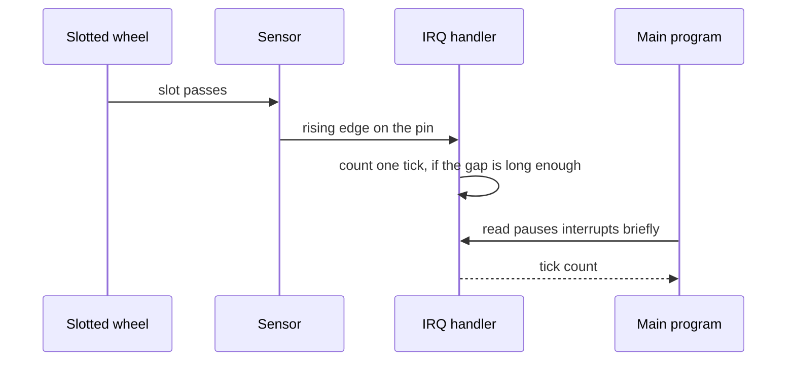

{:class="cover"}

---

By the end of this lesson you will be able to count wheel ticks with an interrupt and turn them into distance and speed.

A DC motor is blind. You ask for speed 60, and it gives you whatever it can, depending on the battery, the floor and the weather. An **encoder** gives Scout a sense of how far each wheel has actually turned. This is a short lesson to show the idea, and you can skip the hardware and still finish the course.

## How an encoder works

The cheap, popular version is a slotted disc on the wheel (or motor shaft) that passes through an optical sensor, the small U-shaped "speed sensor" module with an LM393 chip. Each time a slot passes, the output toggles. Hall-effect sensors with magnets on the wheel work the same way. Count the pulses, and you know how far the wheel turned.

| Sensor pin | Pico pin |
|---|---|
| VCC | 3V3 |
| GND | GND |
| D0 (digital out) | GP14 for the left wheel, GP15 for the right |
{:class="table table-single"}

## Ticks to millimetres

Say the disc has 20 slots and the wheel is 65 mm across. One revolution rolls the wheel one circumference, so each tick is a fixed distance:

```python
import math


def ticks_to_mm(ticks, slots=20, wheel_mm=65):
    """Distance travelled for a number of encoder ticks."""
    circumference = math.pi * wheel_mm     # 204.2 mm per revolution
    return ticks * circumference / slots   # 10.21 mm per tick


def speed_mm_s(ticks, ms, slots=20, wheel_mm=65):
    """Average speed over a time window."""
    return ticks_to_mm(ticks, slots, wheel_mm) * 1000 / ms


print(round(ticks_to_mm(1), 2))        # 10.21 mm per tick
print(round(ticks_to_mm(20), 1))       # 204.2 mm, one full revolution
print(round(speed_mm_s(7, 500), 1))    # 142.9 mm/s
```

Seven ticks in half a second works out at about 143 mm/s. Calibrate to your own wheel and slot count.

## Counting with an interrupt

We could keep checking the pin in a loop, but while Scout does other things we would miss ticks. An **interrupt** (IRQ) makes the Pico run a tiny function the instant the pin rises, whatever else it is doing.

```python
# encoder.py - count ticks from a slotted-wheel sensor
import math
import time
from machine import Pin, disable_irq, enable_irq


def ticks_to_mm(ticks, slots=20, wheel_mm=65):
    return ticks * math.pi * wheel_mm / slots


class Encoder:
    def __init__(self, pin, slots=20, wheel_mm=65, min_gap_us=500):
        self.slots = slots
        self.wheel_mm = wheel_mm
        self.min_gap_us = min_gap_us
        self._count = 0
        self._last = time.ticks_us()
        self.pin = Pin(pin, Pin.IN, Pin.PULL_UP)
        self.pin.irq(trigger=Pin.IRQ_RISING, handler=self._tick)

    def _tick(self, pin):
        # Keep interrupt handlers short: no printing, no maths
        now = time.ticks_us()
        if time.ticks_diff(now, self._last) > self.min_gap_us:
            self._count += 1
            self._last = now

    def read(self):
        """Ticks counted so far, read safely."""
        state = disable_irq()
        count = self._count
        enable_irq(state)
        return count

    def reset(self):
        state = disable_irq()
        self._count = 0
        enable_irq(state)

    def distance_mm(self):
        return ticks_to_mm(self.read(), self.slots, self.wheel_mm)
```

Two details worth understanding:

- **Debounce:** an edge can flicker for a few microseconds. `min_gap_us` ignores any tick that arrives too soon after the last one, which kills false counts.
- **Safe reads:** `read()` pauses interrupts for a moment so a tick cannot sneak in half way through reading the count.

Here is what happens each time a slot passes the sensor:



## Measuring a motor

Spin the left wheel and watch the encoder:

```python
import time
from motor import Motor
from encoder import Encoder

left = Motor(0, 1, 2, deadzone=30)
encoder = Encoder(14)

try:
    left.speed(60)
    last = encoder.read()
    for _ in range(10):
        time.sleep_ms(500)
        now = encoder.read()
        ticks = now - last
        last = now
        print("ticks", ticks, "total mm", round(encoder.distance_mm()))
finally:
    left.coast()
```

An encoder counts ticks but knows nothing about direction, so when Scout reverses you must subtract ticks yourself, using the direction you commanded. For a full two-wheel version you could create `Encoder(14)` and `Encoder(15)` and compare their counts to correct drift, which is exactly what a PID controller does later on.

In the project, we will use this measuring idea by hand: a tape measure and a stopwatch turn out to give the same calibration numbers.

## Try it Yourself

1. Find the number of slots on your disc and measure your wheel's diameter. Work out the millimetres per tick.
2. Push a wheel by hand a known distance, such as 200 mm, and check `distance_mm()` agrees.
3. Challenge: measure the left and right wheel speeds at the same speed setting. Which is faster, and by how much?

## Common Issues

- **Problem**: The count rises by far too many ticks.
- **Solution**: Raise `min_gap_us`, add a pull-up, and keep the sensor wires away from the motor wires.
- **Why**: Electrical noise and flickering edges make false ticks.

- **Problem**: The count never changes.
- **Solution**: Check the sensor has power, the LED on the module blinks as a slot passes, and the pin number is right.
- **Why**: An interrupt only fires on a real rising edge on that exact pin.

- **Problem**: The Pico locks up or behaves strangely.
- **Solution**: Remove any `print()` or slow work from the handler.
- **Why**: Interrupts must finish in microseconds, or the rest of the program is starved.

## Check your understanding


? A disc has 20 slots and the wheel is 65 mm across. About how far is each tick?
- [x] 10.21 mm
- [ ] 65 mm
- [ ] 204 mm
> One revolution is pi x 65 = 204.2 mm, shared across 20 ticks.

? Why count ticks with an interrupt rather than checking the pin in a loop?
- [x] A loop doing other things would miss ticks
- [ ] Interrupts use less power
- [ ] Loops cannot read pins
> An IRQ runs a tiny function the instant the pin rises, whatever else the Pico is doing.

? What does a single-channel encoder not know?
- [x] The direction the wheel is turning
- [ ] That the wheel is turning
- [ ] The slot count
> It only counts ticks, so you subtract them yourself when you commanded reverse.

