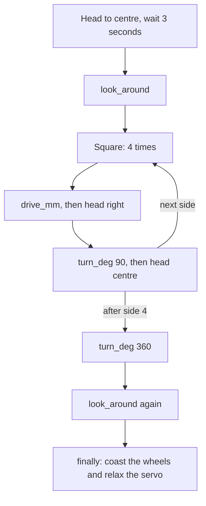

{:class="cover"}

---

By the end of this lesson you will be able to combine Motor, DriveBase, ramp_to and Servo into one program, and calibrate Scout so it drives a square that closes.

This is the moment the whole course has been heading towards. Scout, our two-wheeled drive base with a servo head, is going to do three things in a row:

1. Look left and right with its head
2. Drive a square, glancing right before each corner
3. Spin on the spot, a full 360 degrees

Everything uses code you have already written: `Motor`, `DriveBase`, `ramp_to` and `Servo`. The new part is the project logic, and a calibration routine that turns "run for a while" into "drive 300 mm".

## What you need ready

Check the files on your Pico, and the wiring against the tables from earlier lessons:

| File on the Pico | From lesson | Job |
|---|---|---|
| `motor.py` | 7 | `Motor` and `DRV8833Motor` |
| `drive.py` | 8 | `DriveBase` and `mix` |
| `ramp.py` | 9 | `ramp_to` for smooth speed changes |
| `servo.py` | 11 | `Servo` with `smooth()` and `off()` |
| `main.py` | this lesson | The Scout program |
{:class="table table-single"}

| Part | Pico pins |
|---|---|
| Left motor via L298N | GP0 (IN1), GP1 (IN2), GP2 (ENA) |
| Right motor via L298N | GP3 (IN3), GP4 (IN4), GP5 (ENB) |
| Servo head signal | GP10 |
{:class="table table-single"}

Power the motors and the servo from the battery pack, keep the Pico on USB for now, and join every ground. Hold Scout off the floor for the first run.

## Distance and angle from time

Without encoders, Scout estimates how far it has gone from how long it has driven, a technique called **dead reckoning**. If you know the speed, then time is distance:

```python
MM_PER_S = 150      # measured: mm travelled per second at DRIVE_SPEED
DEG_PER_S = 180     # measured: degrees turned per second at SPIN_SPEED


def ms_for_distance(mm):
    return int(mm / MM_PER_S * 1000)    # 300 mm at 150 mm/s -> 2000 ms


def ms_for_angle(deg):
    return int(abs(deg) / DEG_PER_S * 1000)  # 90 degrees at 180 deg/s -> 500 ms
```

Those two constants are placeholders. Yours will differ, and the calibration step below measures them properly.

Here is the whole program as a flow, so you can see the shape before you read the code:



## The complete main.py

Save this as `main.py` on the Pico. Reading it from the top: constants to tune, small helper functions for a move or a turn, a square, a look-around, and `main()` that sets everything up and guarantees the motors are switched off at the end.

```python
# main.py - Scout: a two-wheel drive base with a servo head
from time import sleep_ms

from motor import Motor
from drive import DriveBase
from ramp import ramp_to
from servo import Servo

# ---- Tuning: measure these on your own Scout ----
DRIVE_SPEED = 70        # wheel speed for straight moves
SPIN_SPEED = 60         # wheel speed for spins
DEADZONE = 30           # duty percent where your wheels first turn (lesson 6)
MM_PER_S = 150          # mm travelled per second at DRIVE_SPEED
DEG_PER_S = 180         # degrees turned per second at SPIN_SPEED
SIDE_MM = 300           # length of each side of the square
RAMP_MS = 200           # time to ease up to speed
PAUSE_MS = 400          # settle time after each move

# ---- Head positions (swap LEFT and RIGHT if yours looks the wrong way) ----
CENTRE_ANGLE = 90
LEFT_ANGLE = 135
RIGHT_ANGLE = 45


def ms_for_distance(mm):
    return int(mm / MM_PER_S * 1000)


def ms_for_angle(deg):
    return int(abs(deg) / DEG_PER_S * 1000)


def drive_mm(base, mm):
    """Drive straight for a distance. Negative distances reverse."""
    speed = DRIVE_SPEED if mm >= 0 else -DRIVE_SPEED
    ramp_to(base, speed, speed, RAMP_MS)
    sleep_ms(ms_for_distance(abs(mm)))
    base.stop()
    sleep_ms(PAUSE_MS)


def turn_deg(base, deg):
    """Spin on the spot. Positive is clockwise (right), negative is left."""
    speed = SPIN_SPEED if deg >= 0 else -SPIN_SPEED
    ramp_to(base, speed, -speed, RAMP_MS)
    sleep_ms(ms_for_angle(deg))
    base.stop()
    sleep_ms(PAUSE_MS)


def look_around(head):
    """Head sweeps left, right, then back to centre."""
    head.smooth(LEFT_ANGLE, 600)
    sleep_ms(300)
    head.smooth(RIGHT_ANGLE, 1000)
    sleep_ms(300)
    head.smooth(CENTRE_ANGLE, 600)
    sleep_ms(300)


def drive_square(base, head, side_mm=SIDE_MM):
    """Four sides and four right turns, glancing right before each corner."""
    for side in range(4):
        print("side", side + 1)
        drive_mm(base, side_mm)
        head.smooth(RIGHT_ANGLE, 300)
        turn_deg(base, 90)
        head.smooth(CENTRE_ANGLE, 300)


def main():
    left = Motor(0, 1, 2, deadzone=DEADZONE)
    right = Motor(3, 4, 5, deadzone=DEADZONE)
    base = DriveBase(left, right)
    head = Servo(10, min_us=600, max_us=2400)

    try:
        head.angle(CENTRE_ANGLE)
        print("Scout starts in 3 seconds")
        sleep_ms(3000)

        print("look around")
        look_around(head)

        print("drive a square")
        drive_square(base, head)

        print("spin on the spot")
        turn_deg(base, 360)

        print("look around again")
        look_around(head)
        print("done")
    finally:
        base.coast()    # no matter what, release the wheels...
        head.off()      # ...and relax the servo


main()
```

Using a DRV8833? Change just two things. The import and the two motor lines:

```python
from motor import DRV8833Motor

left = DRV8833Motor(0, 1, deadzone=20)
right = DRV8833Motor(3, 4, deadzone=20)
```

### Why it is built this way

- **Constants at the top.** You will tune these more than anything else, so they live where you can find them.
- **`ramp_to` then `stop()`.** A gentle start prevents wheel slip, and braking at the end of each move keeps the corners square.
- **`try` and `finally`.** If anything goes wrong, or you press Ctrl+C, the wheels are released and the servo relaxed.
- **A 3 second delay.** Gives you time to unplug the USB cable (if you are running from a battery) and set Scout down.

## Calibrate until the square closes

Your first square will not be a square. That is normal and part of the fun. Tune in this order, one thing at a time. Use a tape measure, a protractor or a printed square on the floor.

**1. Straight lines.** Ask for a 300 mm move and measure what you get. If Scout travelled 270 mm, scale the constant:

```python
# New MM_PER_S = old value x (actual distance / requested distance)
MM_PER_S = 150
requested_mm = 300
actual_mm = 270
print(MM_PER_S * actual_mm / requested_mm)    # 135.0
```

Then put 135 into the constants. Run it again, and repeat until it lands within a few millimetres.

**2. Spins.** Ask for `turn_deg(base, 360)`. If Scout turned only 330 degrees, the same scaling gives a new `DEG_PER_S`:

```python
DEG_PER_S = 180
requested_deg = 360
actual_deg = 330
print(DEG_PER_S * actual_deg / requested_deg)   # 165.0
```

Check the single 90 degree turn after the 360, since a short turn has proportionally more ramp time in it. A touch of adjustment is fine.

**3. Veering.** If a straight line bends, one motor is stronger. Lower its speed a little by passing different left and right speeds to `ramp_to`, or tweak its `deadzone`.

**4. Battery.** As the batteries run down, everything slows. Calibrate on fresh or fully charged cells, and recalibrate when Scout starts falling short. That is exactly the problem encoders from lesson 14 solve.

## Try it Yourself

1. Make the square 500 mm, then 150 mm. Does the closing error get bigger or smaller?
2. Change the corners so the head looks left and Scout drives a square anticlockwise (use `turn_deg(base, -90)`).
3. Add a triangle: three sides, and three turns of 120 degrees.
4. Challenge: have Scout drive a square, then return along the same path in reverse. Does it end up where it began?
5. Bigger challenge: replace the time-based moves with encoders (lesson 14), driving until `encoder.distance_mm()` reaches the target.

## Common Issues

- **Problem**: Scout does not move at all, but the code runs.
- **Solution**: Check the battery pack is switched on and connected to the driver, the ENA jumpers are removed, and your `DEADZONE` is not too low.
- **Why**: Speeds below the dead zone produce no motion, and without motor power, the driver does nothing.

- **Problem**: The square drifts further out on each lap.
- **Solution**: Recalibrate `MM_PER_S` and `DEG_PER_S`, then check the wheels are not slipping on the floor.
- **Why**: Dead reckoning accumulates small errors with each move, so tiny mistakes add up.

- **Problem**: The Pico resets when Scout starts moving.
- **Solution**: Use a separate battery for the motors, lengthen `RAMP_MS`, and add a 100 uF capacitor on the motor supply.
- **Why**: A sudden surge makes the shared supply dip, which browns out the Pico.

- **Problem**: The head turns the wrong way for "left".
- **Solution**: Swap the values of `LEFT_ANGLE` and `RIGHT_ANGLE`.
- **Why**: The servo's direction depends on how the horn was mounted.

- **Problem**: The head buzzes against its end stops.
- **Solution**: Reduce the limits in `Servo(10, min_us=..., max_us=...)`.
- **Why**: Asking for a pulse beyond the servo's real travel makes it strain.

Congratulations. You have built a real robot platform from the ground up, and you know exactly why every wire is where it is.

> **Teachers**: allow two sessions, one to run and one to calibrate. Groups of two or three work well, with one robot each and a marked square of floor. Keep robots off desks, use the 3 second delay to set the robot down, and run a first test with the wheels in the air. Fresh batteries matter for calibration, so label cells with the date and swap them between sessions.

## Check your understanding


? What is dead reckoning?
- [x] Estimating distance from how long and how fast you drove
- [ ] Measuring distance with a laser
- [ ] Counting encoder ticks
> With no encoders, Scout multiplies speed by time. Small errors add up with each move.

? Scout was asked for 300 mm but travelled 270 mm with MM_PER_S at 150. What is the new MM_PER_S?
- [x] 135
- [ ] 165
- [ ] 150
> New value = old x (actual / requested) = 150 x 270 / 300 = 135.

? What does the try and finally in main() guarantee?
- [x] The wheels are released and the servo relaxed, even after an error or Ctrl+C
- [ ] The square closes
- [ ] The program runs faster
> base.coast() and head.off() always run, whatever happened.

? Why recalibrate as the batteries run down?
- [x] Everything slows, so the measured speeds are no longer true
- [ ] The servo changes its pulse width
- [ ] The Pico forgets the constants
> That is exactly the problem encoders from lesson 14 solve.

