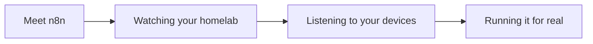

{:class="cover"}

---

Ahoy there makers! Your homelab is full of little jobs that nobody wants to do by hand: checking that a service is still alive, catching a reading from a sensor, sending yourself a message when something breaks. In this course we hand all of that to one helper, a **robot butler** that lives on a Raspberry Pi and runs on **n8n**.

Watch this first, then come back and let's build.



---

## Overview

**n8n** (say it "nodemation") is a free workflow automation tool you host yourself. You build automations by joining boxes called **nodes** on a canvas: a trigger starts the workflow, and the nodes after it fetch, test, reshape and send data. You can do a lot without writing code, and when you do want code, there is a node for that too.

We run n8n in Docker on a Raspberry Pi, so everything stays on your own network. The butler grows a skill in every lesson.

## Course Content

- **Meet n8n**: what it is, installing it with Docker Compose, the editor, and a first workflow
- **Watching your homelab**: a scheduled health check with the HTTP Request node, then the IF node and an email alert
- **Listening to your devices**: a Webhook node, a Pico W that posts its readings, and the Code node
- **Running it for real**: credentials and secrets, executions and debugging, updates and backups, troubleshooting

## Key Results

After completing this course, you will:

- Run n8n on a Raspberry Pi with Docker Compose
- Build, test and publish a workflow
- Check a service on a schedule and be told when it fails
- Receive sensor readings from a Pico W through a webhook
- Reshape data with a little JavaScript
- Keep secrets out of your workflows, and keep n8n updated and backed up

## What you'll need

- A Raspberry Pi 4 or newer. A Pi 5 or Pi 500 gives you more room to grow
- Docker and Docker Compose installed on the Pi
- A computer on the same network, with a web browser
- A Raspberry Pi Pico W, for lessons 6 and 7
- Somewhere to send email from (SMTP details), for lesson 5

## Before you start

This course assumes you can use a terminal and run a container. If either feels new, take these first:

- [Docker](/learn/docker/)
- [Introduction to the Linux Command Line on Raspberry Pi OS](/learn/linux_intro/)

## How the course works

**The butler grows.** Each lesson adds one skill to the same set of workflows, and says which stage you have reached.

**Commands run on the Pi.** Shell blocks are for the Pi's terminal, over SSH or at the desk. Paste your own values wherever you see a placeholder such as `YOUR_PI_IP`.

**Check the docs for menu names.** n8n updates often and buttons get renamed. This course was checked against the official n8n docs at [docs.n8n.io](https://docs.n8n.io) in November 2026. If a label differs on your screen, the docs show the current one.

**Security first.** n8n can reach into everything on your network. Keep it on your home network, and never put it on the internet without a login and HTTPS. We repeat this where it matters.

**Quizzes.** Three lessons end with a short quiz, and your score shows in the sidebar.

**Mistakes are normal.** Every lesson has a Common Issues list, and lesson 12 collects the big ones.

Ready? Let's find out what n8n is.
