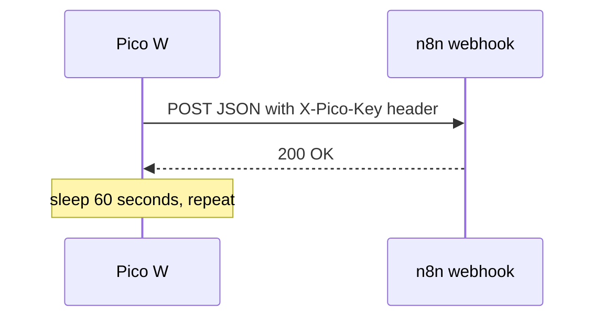

{:class="cover"}

---

Stage 4, part two: the butler hears from a device. We'll make a Pico W read its on-board temperature sensor and POST it to the webhook every minute.

New to the Pico? [Learn MicroPython GPIO](/learn/micropython_gpio/) covers the basics.

---

## The plan



## What goes in the code

- `network.WLAN` joins your Wi-Fi.
- `machine.ADC(4)` reads the chip's internal temperature sensor. Use `read_u16()`, which returns 0 to 65535.
- `requests.post()` sends the JSON. Pass the `json=` argument and it encodes the body and sets the content type for you.
- Always `close()` the response, or you leak sockets and the Pico eventually stops being able to connect.

The temperature maths comes from the RP2040 datasheet: the sensor voltage is `reading * 3.3 / 65535`, and `27 - (voltage - 0.706) / 0.001721` gives degrees Celsius. The internal sensor reads a bit warm because it sits on the chip, so treat it as a rough value.

## The full program

Save this on the Pico as `main.py`. Replace every `YOUR_...` placeholder, paste the **Production URL** from n8n, and use the header value you chose in lesson 6.

```python
import time
import machine
import network

try:
    import urequests as requests
except ImportError:
    import requests

# Placeholders: replace all of these with your own values
SSID = "YOUR_WIFI_NAME"
PASSWORD = "YOUR_WIFI_PASSWORD"
WEBHOOK_URL = "http://YOUR_PI_IP:5678/PASTE_THE_PRODUCTION_PATH_HERE"
API_KEY = "YOUR_SHARED_SECRET"
DEVICE = "pico-lounge"

sensor = machine.ADC(4)  # the on-board temperature sensor


def connect_wifi():
    wlan = network.WLAN(network.STA_IF)
    wlan.active(True)
    if not wlan.isconnected():
        wlan.connect(SSID, PASSWORD)
        for _ in range(20):
            if wlan.isconnected():
                break
            time.sleep(1)
    return wlan.isconnected()


def read_temperature():
    voltage = sensor.read_u16() * 3.3 / 65535
    return 27 - (voltage - 0.706) / 0.001721


def send_reading(temperature):
    payload = {"device": DEVICE, "temperature_c": round(temperature, 1)}
    headers = {"X-Pico-Key": API_KEY}
    response = requests.post(WEBHOOK_URL, json=payload, headers=headers)
    status = response.status_code
    response.close()
    return status


while True:
    if connect_wifi():
        try:
            status = send_reading(read_temperature())
            print("Sent reading, n8n replied", status)
        except OSError as error:
            print("Could not reach n8n:", error)
    else:
        print("Wi-Fi not connected, will try again")
    time.sleep(60)
```

**Why the `try`:** if the Pi reboots or Wi-Fi drops, the POST raises an `OSError`. Catching it keeps the Pico running and trying again a minute later.

**Timestamps:** the Pico has no battery-backed clock, so it doesn't send a time. n8n records when each request arrived, which is what we will use.

**Which library?** Older Pico W firmware has `urequests`, and newer firmware has `requests`. The two lines at the top try one, then the other. They work the same way for what we do here.

## Watch it arrive

Publish the sensor inbox workflow, then run the Pico. In n8n, open the workflow's **Executions** tab: each reading appears as a production execution. Click one and find `body.temperature_c`.

Treat the shared key like a password: don't commit this file to Git with the real value in it.

## Try it Yourself

1. Change `DEVICE` and the sleep time, then watch the executions change.
2. Wrong key on purpose. What does the Pico print, and does n8n record an execution?
3. Challenge: add a second field to the payload, such as the Wi-Fi signal strength, and find it in the n8n output.

## Common Issues

**Problem**: `OSError: -2` or "could not reach n8n".
**Solution**: Check the Pi's IP, that port 5678 is reachable from the Pico's network, and that you pasted the **Production** URL.
**Why**: The Pico needs a route to the Pi, and the Test URL only works while n8n is listening.

**Problem**: n8n replies `403`.
**Solution**: The header name and value in the Pico code must match the n8n credential exactly.
**Why**: The Header auth check is an exact string match.

**Problem**: The reading shows 30 degrees or more in a cool room.
**Solution**: Expect a few degrees of error from the internal sensor, or fit an external one.
**Why**: The sensor is on the chip, which warms itself as it works.
