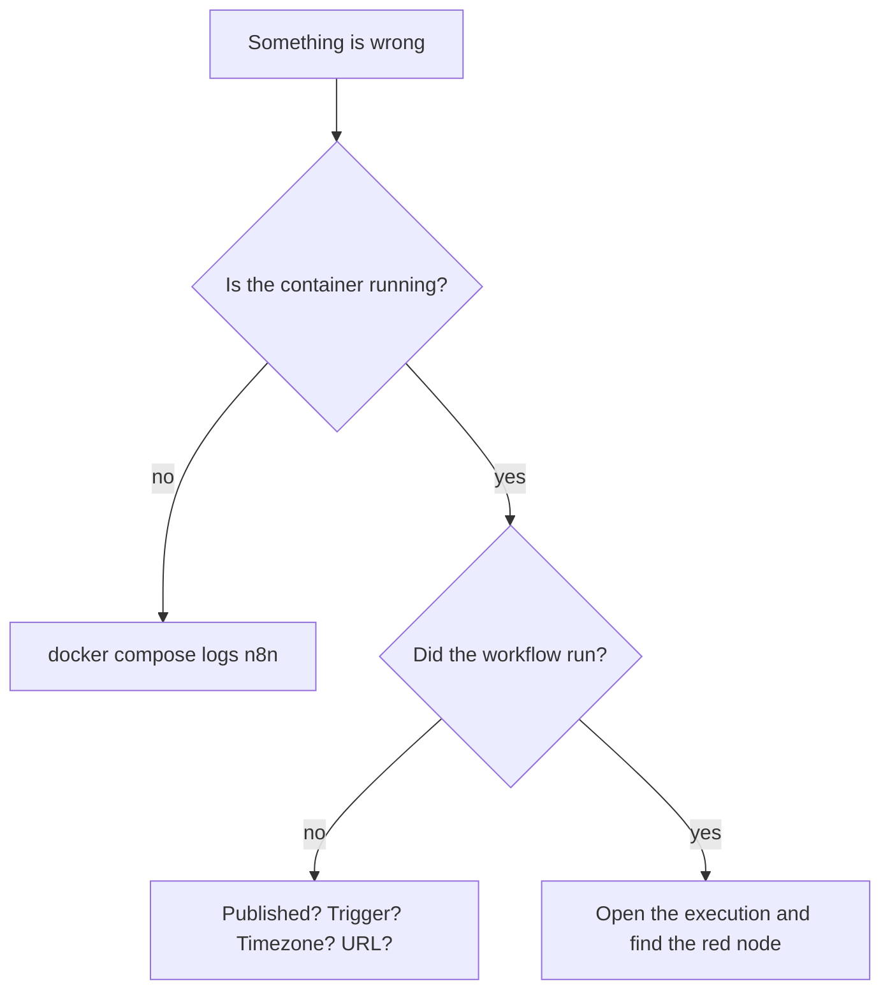

{:class="cover"}

---

Things will go wrong, and that's normal. This lesson is a field guide: find your symptom, try the fix, and understand why.

---

## A debugging routine



Three commands start almost every investigation:

```bash
docker compose ps
docker compose logs --tail 50 n8n
df -h
```

The last one checks free disk space, which quietly causes odd failures on a small SD card.

## Problem, Solution, Why

| Problem | Solution | Why |
|---|---|---|
| n8n won't start, and the logs mention permissions | With a bind-mounted folder, run `sudo chown -R 1000:1000 YOUR_FOLDER`, or use a named volume | The container's `node` user is user 1000 |
| Port 5678 is already in use | Find the user with `sudo ss -ltnp \| grep 5678`, or change the left side of `5678:5678` | Only one program can listen on a port |
| The editor won't load from another computer | Use the Pi's IP, not `localhost`, and check the firewall | `localhost` is the machine you're typing on |
| Scheduled workflow never fires | Publish it, and check `GENERIC_TIMEZONE` | Schedules only run for published workflows, and the default timezone is America/New_York |
| Schedule fires at the wrong hour | Set `GENERIC_TIMEZONE` and `TZ` in `compose.yml`, then recreate the container | The trigger uses the instance timezone unless the workflow sets its own |
| Webhook works in testing but not from the Pico | Use the Production URL, and publish the workflow | The Test URL only listens for 120 seconds after you ask it to |
| Webhook data isn't visible in the editor | Look in the **Executions** tab | Editor display is for test calls only |
| Pico gets a refusal from the webhook | Match the header name and value to the Header auth credential exactly | The check is an exact string match |
| HTTP Request can't reach a service on the Pi | Use the Pi's LAN IP, not `localhost` | Inside the container `localhost` is the container |
| IF node says a field is missing | Run the previous node, then pick the field from the input panel | n8n needs real data to build the path |
| Code node: "Code doesn't return items properly" | Return an array of `{ json: {...} }` objects | Items must have that shape |
| Credentials can't be decrypted after a restore | Restore the original encryption key | Credentials are encrypted with it |
| The Pi is running slowly | Check `docker stats` and `free -h` | Too many containers or runs can exhaust memory |
{:class="table table-single"}

## When n8n is behind a reverse proxy

If you later put n8n behind a reverse proxy with HTTPS (a sensible way to reach it from outside), n8n would show the wrong webhook address, because it builds the address from its own host and port. n8n's docs say to set `N8N_WEBHOOK_URL` to the public address and `N8N_PROXY_HOPS=1` when there is one proxy in front. Your proxy must also forward the `X-Forwarded-For`, `X-Forwarded-Host` and `X-Forwarded-Proto` headers. Keep authentication on, always.

## When you're stuck

- Read the execution, not just the error
- Search [docs.n8n.io](https://docs.n8n.io) and the [n8n community forum](https://community.n8n.io/)
- Ask in the comments under the video, with your logs and what you tried

## Try it Yourself

1. Break each of these on purpose and fix it: wrong webhook header, unpublished workflow, wrong URL.
2. Write your own three-line "when it breaks" checklist and keep it with your Pi.
3. Challenge: use `docker compose logs` to find the line where n8n finishes starting up.

## Common Issues

**Problem**: I fixed `compose.yml` but nothing changed.
**Solution**: Run `docker compose up -d` again so the container is recreated.
**Why**: A running container keeps the settings it started with.
