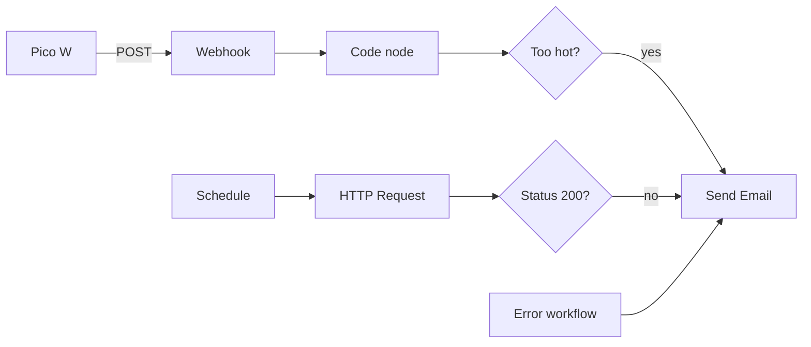

{:class="cover"}

---

Your Raspberry Pi now has a butler. It checks your services, listens to a Pico W, tidies the data, tells you when something is wrong, and you know how to debug, update and back it up. That's a real automation platform, built from one container.

---

## What you built

| Stage | Lesson | What was added |
|---|---|---|
| 1 | 3 | A workflow you run on demand |
| 2 | 4 | A scheduled health check |
| 3 | 5 | An IF branch and an email alert |
| 4 | 6 and 7 | A webhook and a Pico W that posts readings |
| 5 | 8 | A Code node that tidies the data and flags a hot room |
| 6 | 9 to 11 | Credentials, debugging, updates and backups |
{:class="table table-single"}

## The ideas to keep

- **Trigger, nodes, items.** Everything is a trigger that starts a chain of nodes passing items.
- **Look at the output of every node.** It is the fastest way to learn and to debug.
- **Test URL while building, Production URL when published.**
- **A schedule or webhook only runs by itself once the workflow is published.**
- **Never expose n8n to the internet without authentication and HTTPS.**
- **Secrets belong in credentials.** Back up the encryption key with your data.
- **Update monthly, back up first.**

## What's next

You've got the platform. Now give it more to do.

- [Docker](/learn/docker/) goes deeper into containers, networks and volumes, which is what n8n runs on
- [Docker Swarm](/learn/docker_swarm/) spreads containers over several Pis
- [K3s](/learn/k3s/) runs a lightweight Kubernetes cluster on your Pis
- [MicroPython GPIO](/learn/micropython_gpio/) gives the Pico W more sensors to report

Kev's blog post on this topic also shows how to add a local AI model with Ollama and call it from an HTTP Request node, which makes a fine next step for the butler.

Happy automating!
