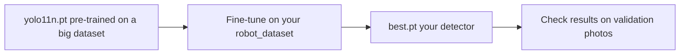

{:class="cover"}

---

By the end of this lesson you will be able to fine-tune a pre-trained YOLO model on your dataset, find the trained weights, and read the training results to judge whether the model learned.

## Why transfer learning?

Training a detector from nothing needs enormous numbers of images. **Transfer learning** starts from a model that has already learned edges, shapes and textures from a huge dataset, and only teaches it your classes.

**Real-world analogy:** you do not teach a new robot builder what a screw is. You hand them a screwdriver and show them your particular robot.

For this course we start from `yolo11n.pt`, the smallest "nano" YOLO11 model. We choose it deliberately. The Raspberry Pi AI Camera runs a model on a small neural processor inside the sensor, so the model must be small. Big detectors such as Faster R-CNN with a ResNet-50 backbone are great on a desktop but are far too large for this camera, and you cannot simply convert them later. At the time of writing, the Ultralytics export for the IMX500 supports the **YOLOv8n and YOLO11n** detection models, so start there.



## Train it

Save this as `train.py` next to your `robot_dataset` folder. The `if __name__` line matters on Windows and macOS, where training starts helper processes that re-import your script.

```python
from ultralytics import YOLO


def main():
    model = YOLO("yolo11n.pt")  # downloads the pre-trained weights the first time
    model.train(
        data="robot_dataset/data.yaml",
        epochs=50,   # passes over the whole training set
        imgsz=640,   # images are resized to 640 by 640 pixels
        batch=16,    # photos per step; lower it if you run out of memory
    )


if __name__ == "__main__":
    main()
```
{: .no-snakie }

Run it with `python train.py`. Each epoch prints a line of losses and scores. When it finishes, Ultralytics prints where it saved things, normally under `runs/detect/train/`. If you train again it makes `train2`, `train3` and so on, so read the path it prints rather than assuming.

Inside that folder:

- `weights/best.pt` is the checkpoint with the best validation score. **This is the one you keep.**
- `weights/last.pt` is the most recent checkpoint.
- `results.csv` has the numbers for every epoch.
- `results.png` plots them, and there are confusion matrix and prediction images too.

Rough timings: a modern laptop with no GPU can take an hour or more for a small dataset, and a decent GPU a few minutes. Start small with `epochs=10` for a test run.

## Read the results

Two kinds of number matter. **Losses** should fall as the model learns. **mAP50** is a score from 0 to 1 for how well predicted boxes overlap real ones (a prediction counts as correct when its box overlaps the true box by at least 50%). Higher is better.

This complete program reads a `results.csv` and tells you what happened. It uses a sample so you can run it right now, and the last line shows how to point it at your own file:

```python
import csv
import io

SAMPLE = """epoch,train/box_loss,metrics/precision(B),metrics/recall(B),metrics/mAP50(B)
1,1.90,0.20,0.15,0.12
2,1.50,0.45,0.40,0.38
3,1.20,0.62,0.55,0.60
4,1.05,0.70,0.66,0.71
5,0.98,0.74,0.69,0.74
"""


def summarise(csv_text):
    rows = list(csv.DictReader(io.StringIO(csv_text)))
    # older versions pad column names with spaces, so strip them
    rows = [{k.strip(): float(v) for k, v in row.items()} for row in rows]
    first, last = rows[0], rows[-1]
    best = max(rows, key=lambda r: r["metrics/mAP50(B)"])
    print(f"Epochs run: {len(rows)}")
    print(f"Box loss: {first['train/box_loss']:.2f} -> {last['train/box_loss']:.2f}")
    print(f"Best mAP50: {best['metrics/mAP50(B)']:.2f} at epoch {int(best['epoch'])}")
    if last["metrics/mAP50(B)"] < best["metrics/mAP50(B)"] - 0.05:
        print("Score has dropped from its best: the model may be overfitting.")
    elif last["metrics/mAP50(B)"] < 0.5:
        print("Low score: add more varied photos or train for longer.")
    else:
        print("Looks healthy. Now test on photos it has never seen.")


summarise(SAMPLE)
# For your own run: summarise(open("runs/detect/train/results.csv").read())
```

Output:

```text
Epochs run: 5
Box loss: 1.90 -> 0.98
Best mAP50: 0.74 at epoch 5
Looks healthy. Now test on photos it has never seen.
```

**Overfitting** means the model memorises your training photos. Training loss keeps falling but the validation score stops improving or drops. More varied photos fix it better than more epochs.

## Test on a new photo

Take a photo that is in neither set and run the trained weights on it:

```python
from ultralytics import YOLO

model = YOLO("runs/detect/train/weights/best.pt")
results = model.predict("new_photo.jpg", conf=0.5)

for box in results[0].boxes:
    name = results[0].names[int(box.cls)]
    print(f"{name}: {float(box.conf):.2f} at {box.xyxy[0].tolist()}")
```
{: .no-snakie }

`conf=0.5` hides anything the model is less than 50% sure of. `box.xyxy` gives the corners as pixels: left, top, right, bottom.

> **Teachers**: Training on school laptops without a GPU can take an hour or more, which will not fit one lesson. Run a 10 epoch test in class, then let one shared machine or an overnight run do the full 50 epochs, and give every group the resulting `best.pt`. A shared GPU machine for the class is much better value than a GPU in every laptop.

## Try it Yourself

1. Train for `epochs=10`, then for `epochs=50`, and compare `mAP50` in each `results.csv`.
2. Change `imgsz` to 320 and see how the training time and score change.
3. Run `model.predict` on five new photos and count how many detections are correct.
4. Challenge: take photos in a lighting condition you did not train on, and note which class fails first. This tells you what photos to add.

## Common Issues

- **Problem**: "CUDA out of memory" during training.
- **Solution**: Lower `batch`, for example to 4 or 2, or train on CPU with `device="cpu"`.
- **Why**: Each photo in a batch uses graphics memory.

- **Problem**: Training on Windows fails with a multiprocessing or "bootstrapping" error.
- **Solution**: Make sure your code is inside `main()` with the `if __name__ == "__main__":` guard.
- **Why**: Helper processes import your script again, which would restart training forever.

- **Problem**: mAP50 stays near zero.
- **Solution**: Check your labels with a few photos opened by hand, and confirm `data.yaml` paths and class names.
- **Why**: Wrong paths or shifted boxes mean the model has nothing real to learn from.

## Check your understanding


? Why do we fine-tune `yolo11n.pt` instead of training from scratch?
- [ ] Scratch training is not allowed
- [x] The pre-trained model already knows general shapes, so far fewer photos and less time are needed
- [ ] It makes the model larger and more accurate
> Transfer learning reuses what a big dataset already taught the model.

? Which saved file should you keep and export?
- [ ] `last.pt`
- [x] `best.pt`
- [ ] `results.png`
> `best.pt` is the checkpoint with the best validation score.

? Training loss keeps falling but the validation score drops. What is likely happening?
- [ ] The camera is broken
- [x] The model is overfitting to the training photos
- [ ] The learning rate is zero
> Overfitting is memorising the training set while getting worse on photos it has not seen.

