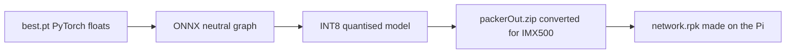

{:class="cover"}

---

By the end of this lesson you will be able to explain why the IMX500 needs a quantised model, and export `best.pt` into a `packerOut.zip` ready to package for the camera.

## Why you cannot just copy best.pt across

`best.pt` is a PyTorch file full of 32-bit floating point numbers. The IMX500's neural processor works with small **8-bit integers**, and it does not run PyTorch at all. So the model has to be converted in several steps:



- **ONNX** (Open Neural Network Exchange) is a neutral file format that describes the maths of a model, so different tools can read it. It is the stepping stone between PyTorch and the camera tools.
- **Quantisation** squeezes each float into one of 256 integer steps. The file shrinks to about a quarter and the integer maths is far faster and cheaper in power.
- **`packerOut.zip`** is the converted model that Sony's tools produce. A last tool on the Pi turns it into `network.rpk`, the file the camera loads.

## See quantisation happen

This complete program quantises a thousand pretend weights and shows what you gain and lose. Run it, then read the output.

```python
import numpy as np

rng = np.random.default_rng(1)
weights = rng.normal(0, 0.1, size=1000).astype(np.float32)   # pretend layer weights


def quantise_int8(values):
    """Map floats onto the 256 integer steps from -127 to 127."""
    scale = np.abs(values).max() / 127
    q = np.clip(np.round(values / scale), -127, 127).astype(np.int8)
    return q, scale


q, scale = quantise_int8(weights)
restored = q.astype(np.float32) * scale
error = np.abs(weights - restored)

print(f"float32 size: {weights.nbytes} bytes")
print(f"int8 size:    {q.nbytes} bytes")
print(f"Step size:    {scale:.5f}")
print(f"Mean error:   {error.mean():.5f}")
print(f"Worst error:  {error.max():.5f}")

# One huge outlier stretches the steps and hurts every other weight
with_outlier = weights.copy()
with_outlier[0] = 5.0
q2, scale2 = quantise_int8(with_outlier)
restored2 = q2.astype(np.float32) * scale2
print(f"Mean error with one outlier: {np.abs(with_outlier - restored2).mean():.5f}")
```

Output:

```text
float32 size: 4000 bytes
int8 size:    1000 bytes
Step size:    0.00295
Mean error:   0.00073
Worst error:  0.00147
Mean error with one outlier: 0.01010
```

Four times smaller, with a tiny error. But one outlier made the error about fourteen times worse, because the steps had to stretch to cover it. Real quantisation tools avoid that by looking at **real photos** to choose good step sizes. That is called **calibration**, and it is why the export asks for your `data.yaml`.

## Run the export

The Ultralytics export for the IMX500 only runs on **Linux with Python 3.10 to 3.12 and Java 17 or later**, which is why lesson 01 checked those. It also only supports the YOLOv8n and YOLO11n models at the time of writing. Check the [Ultralytics Sony IMX500 guide](https://docs.ultralytics.com/integrations/sony-imx500/) if it has changed.

Install Java if you need it. On Debian or Ubuntu that is usually a package such as `openjdk-17-jre`, but the name varies, so check your distribution.

```python
from ultralytics import YOLO

model = YOLO("runs/detect/train/weights/best.pt")
model.export(format="imx", data="robot_dataset/data.yaml")
```
{: .no-snakie }

Notes on what it does:

- It quantises to INT8 using your photos for calibration. The exporter requires 8-bit; you cannot ask for 16 or 32-bit.
- Its first run installs extra export packages, and Ultralytics warns you may need to restart your terminal afterwards. If the first attempt stops after installing things, simply run it again.
- You can calibrate with a smaller slice of photos using the `fraction` argument if it is slow.

When it finishes you get a folder named after your weights, for example `best_imx_model`, next to `best.pt`. Inside are:

| File | What it is |
| --- | --- |
| `packerOut.zip` | The converted model, the file you take to the Pi |
| `labels.txt` | Your class names, in order |
| `model_imx.onnx` | An ONNX copy used to check the quantised model |
| `dnnParams.xml`, `model_imx_MemoryReport.json` | Technical details about the converted network |
{:class="table table-single"}

The memory report tells you how much of the camera's limited on-chip memory the model uses. If a model is too big it will not load, which is the other reason we start from the nano model.

> **Teachers**: The export needs Linux and Java, which many school Windows laptops lack. Do this step once on a shared Linux machine or Raspberry Pi 5 per class, collect each group's `best.pt`, and hand back the `best_imx_model` folders. Learners still learn the whole pipeline without installing Java on every device.

## Try it Yourself

1. Change the outlier in the quantisation program from 5.0 to 1.0 and watch the error. What happens?
2. Print `restored[:5]` next to `weights[:5]` so you can see the rounding by eye.
3. Run the export on a model trained for only 10 epochs, then open `labels.txt` and check the names match your classes.
4. Challenge: change the program to quantise to 4 bits (steps from -7 to 7). How big does the error get?

## Common Issues

- **Problem**: The export fails complaining about Java.
- **Solution**: Install Java 17 or newer, then open a new terminal and run the export again.
- **Why**: The Ultralytics guide lists Java 17 or later as a requirement for the IMX export.

- **Problem**: The export says the format or model is unsupported.
- **Solution**: Train from `yolo11n.pt` or a YOLOv8n model, and check the Ultralytics IMX500 guide for the current list.
- **Why**: Only a few small model families are supported at the time of writing.

- **Problem**: Detections are much worse after export than in your training results.
- **Solution**: Calibrate with `data=` pointing at photos that look like what the camera will see, and compare the quantised model with the original in lesson 07.
- **Why**: Quantisation is lossy and calibration picks the step sizes from real data.

## Check your understanding


? What does quantising to INT8 do?
- [ ] Makes the model more accurate
- [x] Stores numbers as 8-bit integers, making the model smaller and faster at a small cost in accuracy
- [ ] Converts the model to Python code
> INT8 uses 256 integer steps instead of 32-bit floats.

? Why does the export need your `data.yaml`?
- [ ] To rename the classes
- [x] It uses your photos to calibrate the quantisation
- [ ] To download more photos
> Calibration with real images chooses good step sizes.

? Which file do you take to the Raspberry Pi?
- [ ] `best.pt`
- [x] `packerOut.zip`
- [ ] `results.csv`
> The Pi tool packages `packerOut.zip` into `network.rpk`.

