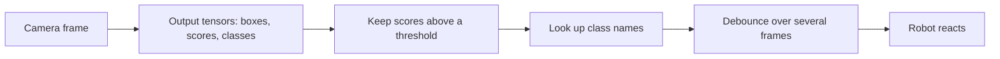

{:class="cover"}

---

By the end of this lesson you will be able to turn the camera's output tensors into named detections, draw them on a live preview, and make a robot react steadily instead of flickering.

## From tensors to decisions

In lesson 05 the camera handed you a few NumPy arrays. For a detector exported with on-chip non-maximum suppression (NMS, the step that removes duplicate boxes), these are usually **boxes**, **scores** and **class numbers**, one row per detection. Your job in code is three small steps:



**Real robot example:** a robot that should stop when a mug is in front of it. If it reacted to every single frame it would stutter, because a detector will miss the mug for a frame or two now and then. So we filter by confidence and require the answer to hold for a few frames.

## The logic you can test anywhere

This complete program has the two pieces of logic and a simulation, so you can run it on your computer before going near the Pi.

```python
import numpy as np

LABELS = ["mug", "laptop", "keyboard"]


def keep_confident(boxes, scores, classes, labels, threshold=0.5):
    """Return (name, score, box) for every detection at or above the threshold."""
    found = []
    for box, score, cls in zip(boxes, scores, classes):
        if score >= threshold:
            found.append((labels[int(cls)], float(score), box))
    return found


class Debouncer:
    """Only change state once the new reading has lasted a few frames in a row."""

    def __init__(self, frames_needed=3):
        self.frames_needed = frames_needed
        self.state = False
        self.disagree = 0

    def update(self, seen_now):
        if seen_now == self.state:
            self.disagree = 0
        else:
            self.disagree += 1
            if self.disagree >= self.frames_needed:
                self.state = seen_now
                self.disagree = 0
        return self.state


# Pretend the camera sent these for one frame: three boxes, one weak guess.
boxes = np.array([[120, 80, 340, 420], [0, 240, 320, 480], [400, 300, 450, 360]])
scores = np.array([0.92, 0.71, 0.30])
classes = np.array([0, 1, 2])

for name, score, box in keep_confident(boxes, scores, classes, LABELS, threshold=0.5):
    print(f"Saw {name} ({score:.2f}) at {box.tolist()}")

# A flickery mug: one missed frame is ignored, three in a row means it has gone.
readings = [True, True, True, False, True, True, False, False, False, True]
mug_seen = Debouncer(frames_needed=3)
for frame, reading in enumerate(readings, start=1):
    state = mug_seen.update(reading)
    print(f"frame {frame:2d}: raw={'mug' if reading else '---'}  steady={'MUG' if state else '---'}")
```

Output:

```text
Saw mug (0.92) at [120, 80, 340, 420]
Saw laptop (0.71) at [0, 240, 320, 480]
frame  1: raw=mug  steady=---
frame  2: raw=mug  steady=---
frame  3: raw=mug  steady=MUG
frame  4: raw=---  steady=MUG
frame  5: raw=mug  steady=MUG
frame  6: raw=mug  steady=MUG
frame  7: raw=---  steady=MUG
frame  8: raw=---  steady=MUG
frame  9: raw=---  steady=---
frame 10: raw=mug  steady=---
```

The weak 0.30 guess was dropped, and the single missed frame at frame 4 did not make the robot forget the mug. Three misses in a row at frames 7 to 9 did.

## The live program on the Pi

Now we put the same logic on the camera. This is the real-time loop: Picamera2 gives every frame to a function that reads the detections, draws boxes on the preview and updates the debouncer. Save it as `mug_watcher.py`. You need OpenCV, which comes with Raspberry Pi OS as `python3-opencv`, and you run it on the Pi with a monitor attached.

```python
import os
import time

import cv2
import numpy as np
from picamera2 import MappedArray, Picamera2
from picamera2.devices.imx500 import IMX500

MODEL = os.path.expanduser("~/models/robot_package/network.rpk")
LABELS = ["mug", "laptop", "keyboard"]   # same order as your classes.txt
THRESHOLD = 0.5

# These two depend on how your model was exported. If the boxes look wrong
# on screen, change them (see Common Issues).
NORMALISE_BOXES = True    # boxes arrive in input-image pixels, so divide by the input size
BOXES_ARE_XY = True       # boxes arrive as x1, y1, x2, y2 rather than y1, x1, y2, x2


class Debouncer:
    def __init__(self, frames_needed=3):
        self.frames_needed = frames_needed
        self.state = False
        self.disagree = 0

    def update(self, seen_now):
        if seen_now == self.state:
            self.disagree = 0
        else:
            self.disagree += 1
            if self.disagree >= self.frames_needed:
                self.state = seen_now
                self.disagree = 0
        return self.state


imx500 = IMX500(MODEL)                  # create before Picamera2
picam2 = Picamera2(imx500.camera_num)
mug_seen = Debouncer(frames_needed=3)
was_seen = False
last_print = time.time()


def read_detections(metadata):
    outputs = imx500.get_outputs(metadata, add_batch=True)
    if outputs is None:
        return []
    boxes, scores, classes = outputs[0][0], outputs[1][0], outputs[2][0]
    if NORMALISE_BOXES:
        input_w, input_h = imx500.get_input_size()
        boxes = boxes / np.array([input_w, input_h, input_w, input_h])
    if BOXES_ARE_XY:
        boxes = boxes[:, [1, 0, 3, 2]]   # reorder to y1, x1, y2, x2
    found = []
    for box, score, cls in zip(boxes, scores, classes):
        if score >= THRESHOLD:
            found.append((LABELS[int(cls)], float(score), box))
    return found


def on_frame(request):
    global was_seen, last_print
    detections = read_detections(request.get_metadata())
    with MappedArray(request, "main") as m:
        for name, score, box in detections:
            x, y, w, h = imx500.convert_inference_coords(box, request.get_metadata(), picam2)
            cv2.rectangle(m.array, (x, y), (x + w, y + h), (0, 255, 0), 2)
            cv2.putText(m.array, f"{name} {score:.2f}", (x + 5, y + 20),
                        cv2.FONT_HERSHEY_SIMPLEX, 0.6, (0, 255, 0), 2)
    steady = mug_seen.update(any(name == "mug" for name, _, _ in detections))
    if steady != was_seen:
        print("Mug in view: robot should STOP" if steady else "Mug gone: robot can GO")
        was_seen = steady


config = picam2.create_preview_configuration(buffer_count=12)
imx500.show_network_fw_progress_bar()
picam2.pre_callback = on_frame
picam2.start(config, show_preview=True)

try:
    while True:
        time.sleep(1)
except KeyboardInterrupt:
    pass
picam2.stop()
```
{: .no-snakie }

How it works: `pre_callback` runs once per frame, before the frame is shown, so anything you draw on `m.array` appears on screen. `convert_inference_coords` maps the box from the network's view of the image to the preview's pixels, because the camera shrinks and crops the picture for the network. Where it prints "STOP", you would call your motor code. Press Ctrl+C to quit.

> **Teachers**: This lesson needs a display attached to each Pi, because the live preview needs a screen. Over SSH there is no preview window. Allow time for learners to swap the print lines for something visible such as an LED or buzzer, which makes the idea land far better than text in a terminal. Keep the camera pointing away from other learners, since it is always watching.

## Try it Yourself

1. Run the simulation and change `frames_needed` to 1, then to 5. When is it twitchy, and when is it slow to react?
2. Change `THRESHOLD` to 0.3, then 0.8, and note what appears or disappears on the preview.
3. Make the program print how many mugs are in view each second.
4. Challenge: switch an LED on a GPIO pin when the steady state changes, using the `gpiozero` library on the Pi.

## Common Issues

- **Problem**: Boxes are drawn in the wrong place, squashed or swapped.
- **Solution**: Flip `NORMALISE_BOXES` and `BOXES_ARE_XY` one at a time until boxes sit on the objects.
- **Why**: Models export boxes in different orders and units. Print the output shapes and a few raw numbers, as in lesson 05, to see which yours uses.

- **Problem**: The preview is very slow or stutters.
- **Solution**: Do less work in `on_frame`. Avoid printing every frame and keep drawing to a few boxes.
- **Why**: The callback blocks the camera pipeline until it returns.

- **Problem**: A mug appears and disappears every few frames.
- **Solution**: Raise `frames_needed` and the threshold, and add photos of that situation when you retrain.
- **Why**: Borderline detections hover around the threshold, and a debouncer smooths those flickers.

## Check your understanding


? Why use a debouncer on detections?
- [ ] To make the camera faster
- [x] A detector can miss an object for a frame or two, and the debouncer stops the robot flickering between states
- [ ] To draw boxes more neatly
> The state only changes after the new reading lasts several frames in a row.

? What does raising the confidence threshold do?
- [ ] Finds more objects
- [x] Drops weak detections, giving fewer false alarms but possibly missing real objects
- [ ] Makes the model smaller
> Higher thresholds trade missed objects for fewer false positives.

? Why call `convert_inference_coords` before drawing a box?
- [ ] To change the colour of the box
- [x] The network sees a resized and cropped image, so box coordinates must be mapped to the preview image
- [ ] To load the labels
> Network coordinates are not the same as the preview's pixels.

