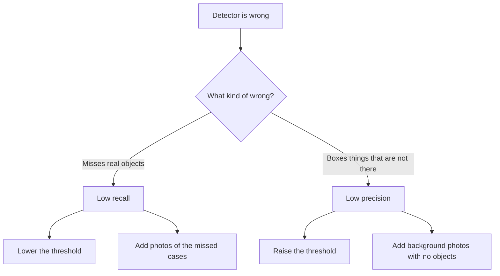

{:class="cover"}

---

By the end of this lesson you will be able to measure whether a detector misses objects or invents them, and choose the right fix for each.

## Two different kinds of wrong

"The model is bad" is not a diagnosis. A detector can go wrong in two opposite ways, and the cures differ.

- A **miss** (false negative): a real mug was there and the model said nothing.
- A **false alarm** (false positive): the model boxed a mug that was not there.

Two numbers describe them. **Recall** asks "of the real objects, how many did it find?" **Precision** asks "when it said mug, how often was it right?"



## Measure it

To count hits, you need to decide when a predicted box matches a real one. The standard test is **IoU** (intersection over union): the overlap area divided by the combined area. An IoU of 0.5 or more with the right class counts as a hit. This complete program scores three test images:

```python
def iou(a, b):
    """Overlap of two boxes given as (x1, y1, x2, y2): 0 is none, 1 is identical."""
    ix1, iy1 = max(a[0], b[0]), max(a[1], b[1])
    ix2, iy2 = min(a[2], b[2]), min(a[3], b[3])
    inter = max(0, ix2 - ix1) * max(0, iy2 - iy1)
    area_a = (a[2] - a[0]) * (a[3] - a[1])
    area_b = (b[2] - b[0]) * (b[3] - b[1])
    return inter / (area_a + area_b - inter)


def score_image(truths, predictions, min_iou=0.5):
    """Count hits, false alarms and misses for one image."""
    unmatched = list(truths)
    hits = false_alarms = 0
    for name, _score, box in sorted(predictions, key=lambda p: -p[1]):
        best = None
        for truth in unmatched:
            if truth[0] == name and iou(box, truth[1]) >= min_iou:
                best = truth
                break
        if best:
            unmatched.remove(best)
            hits += 1
        else:
            false_alarms += 1
    return hits, false_alarms, len(unmatched)


# (class, box) for what is really there, (class, score, box) for what the model said.
images = [
    ([("mug", (100, 80, 340, 420))], [("mug", 0.90, (110, 90, 335, 410))]),
    ([("mug", (50, 50, 150, 150)), ("laptop", (200, 200, 500, 450))],
     [("laptop", 0.80, (210, 190, 490, 440))]),
    ([], [("mug", 0.60, (300, 300, 380, 380))]),
]

total_hits = total_fa = total_miss = 0
for truths, predictions in images:
    hits, fa, miss = score_image(truths, predictions)
    total_hits += hits
    total_fa += fa
    total_miss += miss

precision = total_hits / (total_hits + total_fa)
recall = total_hits / (total_hits + total_miss)
print(f"Hits: {total_hits}, false alarms: {total_fa}, misses: {total_miss}")
print(f"Precision: {precision:.2f} (when it speaks, how often is it right?)")
print(f"Recall:    {recall:.2f} (of the real objects, how many did it find?)")
```

Output:

```text
Hits: 2, false alarms: 1, misses: 1
Precision: 0.67 (when it speaks, how often is it right?)
Recall:    0.67 (of the real objects, how many did it find?)
```

Image 1 is a hit. Image 2 found the laptop but missed the mug. Image 3 boxed a mug in an empty scene. Ultralytics reports the same ideas for you: `model.val()` on your PyTorch weights prints precision, recall and mAP per class.

## Choose the fix to match the problem

| Symptom | Likely cause | Fix |
| --- | --- | --- |
| Misses objects in dim light or odd angles | Training photos did not cover that case | Photograph those cases, label them, retrain |
| Boxes the wrong object (mug vs cup) | Similar looking classes, or inconsistent labels | Fix label spellings and add contrasting examples |
| Sees mugs on empty desks | No background examples | Add photos with no objects, with empty label files |
| Works well in training scores but badly on the camera | Phone photos differ from the AI Camera | Add photos taken with the AI Camera itself |
| Good on your PyTorch model, worse after export | Quantisation loss | Recalibrate with photos from the real scene, compare `model.val()` before and after |
{:class="table table-single"}

Change **one** thing at a time, and test on the same fixed set of photos each time. If you change the data and the threshold together, you will not know which helped.

## Pi-side problems

If the model works on your computer but not on the camera, work from the outside in:

1. Does the stock MobileNet SSD demo still run? If not, it is hardware or software.
2. Does your `first_inference.py` receive output tensors? If not, the `.rpk` did not load.
3. Do the numbers look sensible? Print one frame's outputs and compare them to the PyTorch model on the same photo.

**Fast and honest tip:** a detector running on a live camera sees blur, glare and changing exposure that a still-photo dataset never showed it. Take 50 photos of real use on the AI Camera, add them to the dataset, and retrain. This single step fixes more problems than any setting.

> **Teachers**: This is a good lesson for pairs. One learner plays the camera, holding objects at awkward angles and in different light, while the other records hits, misses and false alarms in a table. Comparing tables between groups makes precision and recall concrete. Keep a shared folder of "hard photos" the whole class adds to, and retrain once together.

## Try it Yourself

1. Change the third image in the program so the false alarm overlaps nothing, then work out what the new precision should be before running it.
2. Add a fourth image that the model gets completely right and see how precision and recall move.
3. Run `model.val()` with your `best.pt` and match its precision and recall numbers to what you have just learned.
4. Challenge: record 20 real frames from the AI Camera, label which are hits, misses and false alarms by hand, and compute your real-world precision and recall.

## Common Issues

- **Problem**: Everything is detected as one class.
- **Solution**: Check `classes.txt` order against the numbers in your label files, and check class balance in the dataset.
- **Why**: If one class has most of the examples, or numbers are mixed up, the model learns to guess it.

- **Problem**: The camera shows no detections but the PyTorch model works on the same photo.
- **Solution**: Check that your confidence threshold and label order match, and look at the raw output scores before you filter them.
- **Why**: A wrong threshold or box format can hide valid detections.

- **Problem**: Recall improves but precision collapses when you lower the threshold.
- **Solution**: Pick the threshold your robot can live with, for example a higher one if a false alarm makes it stop for no reason.
- **Why**: Precision and recall trade against each other, so the right balance depends on the job.

## Check your understanding


? A detector boxes a mug on an empty desk. What is that called?
- [ ] A miss
- [x] A false alarm (false positive)
- [ ] A hit
> A false positive is a detection of something that is not there.

? Which change would most help a model that misses objects in dim light?
- [ ] Raising the confidence threshold
- [x] Adding labelled photos taken in dim light and retraining
- [ ] Deleting the validation set
> Data from the missing condition teaches the model what it does not yet know.

? What does IoU measure?
- [ ] How fast the model runs
- [x] How much a predicted box overlaps a real box, as overlap divided by combined area
- [ ] The number of classes
> IoU is intersection over union, and a hit usually needs 0.5 or more.

