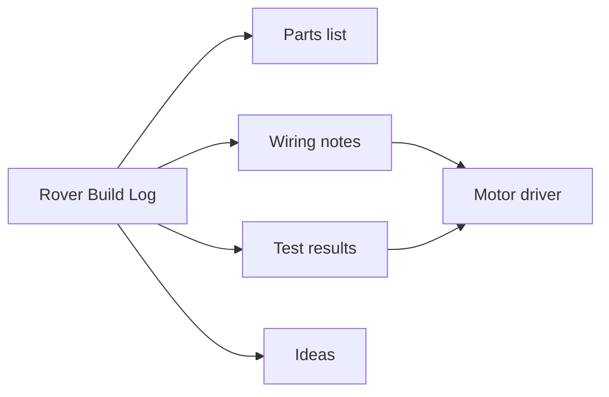

{:class="cover"}

---

By the end of this lesson you will know what Obsidian is, what we will build with it, and what you need to get started.



Ahoy there makers! Every robot project makes a mountain of little facts: which servo went on which pin, what the battery voltage dropped to under load, the idea you had in the bath for a better gripper. Scattered across paper, photos and half a dozen files, they get lost. Obsidian is a note-taking app that keeps all of it in one place, and lets you link the notes together so you can find things again.

## Overview

Obsidian works on a **vault**, which is just a folder of plain Markdown (`.md`) files on your own computer. Because the notes are ordinary text files, you are never locked in: any text editor can open them. On top of that, Obsidian adds links between notes, tags, properties, a graph of connections, checklists, a visual Canvas and database-style tables.

Throughout the course we build one running example: a **robot build log** vault with notes for parts, wiring, test results and ideas. By the end it will be a real, useful vault you can carry on using for your own builds.

## Course Content

- Installing Obsidian on a computer or a Raspberry Pi
- Creating a vault and your first notes
- Tags, links and backlinks
- Canvas, tasks, properties and Bases
- The graph view
- Markdown in Obsidian, and where to learn more

## Key Results

After completing this course, you will:

- Create a vault and fill it with linked notes
- Organise a project using tags and properties
- Track jobs with checkboxes and plan visually with a Canvas
- Build a Base that shows all your test results in one table
- Explore your notes in the graph view

## What you'll need

- A computer (Windows, macOS or Linux), or a Raspberry Pi with a desktop
- An internet connection to download Obsidian
- A project to write about, or just use our made-up Rover robot

## How the course works

Each lesson teaches one idea, uses the Rover build log as its example, and ends with a **Try it Yourself** section and a short quiz. The code-style blocks in this course are Markdown, YAML or query text that you type into your notes, not programs. Menu names and settings in Obsidian change a little between versions, so where we can, we describe what to look for. If something looks different on your screen, the [official Obsidian help](https://help.obsidian.md/) is the place to check.

## Before you start

This course needs no prior experience. It pairs nicely with these:

- [Mastering Markdown for Documentation with Jekyll](/learn/markdown/) goes deeper on Markdown itself
- [Build a RAG for Your Obsidian Vault](/learn/obsidian_rag/) is the follow-on for Python makers who want to ask questions of their notes

> **Teachers**: this course suits learners aged about 11 and up, and adults. Allow 30 to 45 minutes per lesson. Each learner needs a computer where they are allowed to install software, so check with your IT team first, because Obsidian is a desktop app and some school machines block installs. Notes stay on the learner's own device, so no account is needed, but shared or locked-down machines may wipe the vault when someone logs out, so save vaults to a USB stick or the learner's own storage. No lesson needs robot hardware: the example project can simply be made up.

---
