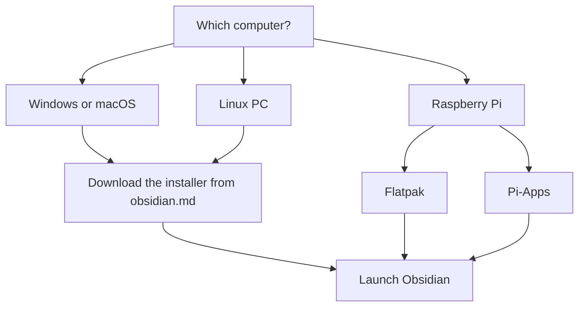

{:class="cover"}

---

By the end of this lesson you will be able to install Obsidian on your computer or Raspberry Pi and launch it for the first time.

Let's get Obsidian onto your machine so we can start the Rover build log. Obsidian is a desktop app, and it runs on Windows, macOS and Linux, including a Raspberry Pi running the desktop version of Raspberry Pi OS.

---

## Choose your route



---

## Windows, macOS and most Linux PCs

Visit the official website <https://obsidian.md/>, find the download page and pick the installer for your operating system. Run it and follow the prompts like any other app. Downloading from the official site matters, because it means you get the genuine app and not a lookalike.

Once it is installed, launch Obsidian. You will be greeted with the option to create your first vault, which is what we do in the next lesson.

---

## Installing Obsidian on a Raspberry Pi

A Pi is a great place to keep a build log, because it sits right next to your robot. There are two main routes. Both need the full desktop version of Raspberry Pi OS, as Obsidian is a graphical app.

### Installing via Flatpak

Flatpak is a way of installing desktop apps along with everything they need. These commands are typed into a terminal on the Pi.

1. Install Flatpak if you haven't already:

```sh
sudo apt install flatpak
```

2. Add the Flathub repository, which is the shop that hosts the Obsidian package:

```sh
flatpak remote-add --if-not-exists flathub https://flathub.org/repo/flathub.flatpakrepo
```

3. Install Obsidian:

```sh
flatpak install flathub md.obsidian.Obsidian
```

4. Start it from the application menu. You may need to log out and back in once after installing Flatpak for the menu entry to appear. You can also start it from the terminal:

```sh
flatpak run md.obsidian.Obsidian
```

### Installing via Pi-Apps

Pi-Apps is a friendly app store for the Raspberry Pi.

1. Install and open [Pi-Apps](/blog/install_pi_apps.html) on your Raspberry Pi.
2. Search for "Obsidian" in the store.
3. Click "Install" and follow the prompts.

Which should you choose? Pi-Apps is the point-and-click route. Flatpak is better if you like the terminal, or if Pi-Apps does not list Obsidian on your version of the OS.

---

## Try it Yourself

1. Install Obsidian and launch it. Take a note of which version you have, because menu names can differ between versions.
2. Find the "Create new vault" option on the welcome screen, but do not click it yet.
3. Challenge: on a Pi, install it both ways on different days (uninstalling the first), and decide which you prefer.

---

## Common Issues

- **Problem**: `flatpak: command not found`, or Obsidian is missing from the menu after installing.
- **Solution**: Make sure the `sudo apt install flatpak` step finished with no errors, then log out and back in, or reboot.
- **Why**: Flatpak adds its app entries to the menu when you log in, so a session that was already running does not see them yet.

- **Problem**: Obsidian will not start on a Raspberry Pi running only the Lite (no desktop) OS.
- **Solution**: Use the full Raspberry Pi OS with desktop.
- **Why**: Obsidian is a graphical app and needs a screen and a desktop to draw its window on.

> **Teachers**: school computers often block installing software. Ask your IT team to install Obsidian in advance, or to allow it to run for learners. Downloading the installer from the official site needs the site to be reachable on your school network.

---

## Check your understanding


? Which Raspberry Pi OS do you need to run Obsidian?
- [ ] Raspberry Pi OS Lite, with no desktop
- [x] Raspberry Pi OS with the desktop
- [ ] Any microcontroller running MicroPython
> Obsidian is a graphical desktop app, so it needs the desktop version of the OS.

? What is the Flatpak package name for Obsidian used in this lesson?
- [ ] obsidian-pi
- [x] md.obsidian.Obsidian
- [ ] flathub.obsidian
> The install command is `flatpak install flathub md.obsidian.Obsidian`.

? Where should you download the installer for Windows or macOS from?
- [ ] Any website that lists free software
- [x] The official website at obsidian.md
- [ ] A link sent by email
> The official site gives you the genuine app.

