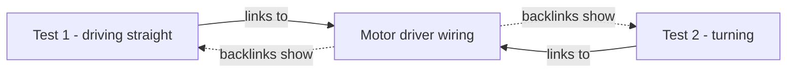

{:class="cover"}

---

By the end of this lesson you will be able to link notes with `[[wikilinks]]`, link to a heading, embed one note inside another, and use backlinks to see which notes point to the one you are reading.

Linking is what makes Obsidian more than a folder of text files. In the Rover Build Log, your `Test 1` note can link to `Motor driver wiring`, and the wiring note will know it has been mentioned, without you doing anything extra.

---

## How to link notes

Wrap a note's name in double square brackets:

```markdown
The left wheel spun the wrong way. I checked [[Motor driver wiring]] and
swapped the two motor leads.
```

As you type `[[`, Obsidian suggests existing notes. Pick one and press Enter. If you type a name that does not exist yet, the link still works, and clicking it creates the note. That is handy for writing down "I should look at [[Battery sag]]" and filling it in later.

---

## Other kinds of link

```markdown
[[Motor driver wiring|the driver wiring]]
[[Motor driver wiring#Pin table]]
![[Parts list]]
```

- `[[Note|Custom text]]` shows different words for the link, so the sentence reads naturally.
- `[[Note#Heading]]` jumps straight to a heading inside a note.
- `![[Note]]` with a leading `!` is an **embed**: it shows the content of that note right here in the page instead of a link.
- Links to a specific block of text also exist, using `[[Note#^block-id]]`, but headings are the easiest place to start.

---

## Backlinks

When `Test 1` links to `Motor driver wiring`, then `Motor driver wiring` has a **backlink** from `Test 1`. Open the backlinks pane for a note and you will see every note that links to it. It also shows **unlinked mentions**, which are notes that contain the text but do not link yet.



Backlinks are why you do not need to maintain an index by hand. Write the link once, and the other end finds out.

---

## The links that build a graph

All those links are what the [graph view](/learn/obsidian/12_graph_view.html) draws.



---

## Try it Yourself

1. Link your `Test 1` note to `Motor driver wiring` and open the backlinks for the wiring note.
2. Write a link to a note that does not exist yet, then click it to create it.
3. Add a heading `## Pin table` to your wiring note and link to it from another note using `#`.
4. Challenge: embed your `Parts list` note inside a new `Project overview` note.

---

## Common Issues

- **Problem**: My link text is shown with square brackets and does not click.
- **Solution**: Check you used two opening and two closing square brackets, with no space between them.
- **Why**: Only the exact `[[ ]]` form is a wikilink.

- **Problem**: I renamed a note in my file manager and the links broke.
- **Solution**: Rename it back, then rename inside Obsidian so it can update links.
- **Why**: Links store the note name, and Obsidian only knows to update them when it does the rename.

---

## Check your understanding


? What does a leading `!` do in `![[Parts list]]`?
- [ ] Deletes the note
- [x] Embeds the note's content in the current note
- [ ] Marks the note as important
> A wikilink with `!` in front is an embed.

? What is a backlink?
- [ ] A link to the previous page of the course
- [x] A link from another note that points to the current note
- [ ] A broken link
> Backlinks list the notes that link to the one you are viewing.

? How do you link to a heading called Pin table in the note Motor driver wiring?
- [ ] `[[Motor driver wiring/Pin table]]`
- [x] `[[Motor driver wiring#Pin table]]`
- [ ] `[Pin table](Motor driver wiring)`
> A hash after the note name points at a heading.

