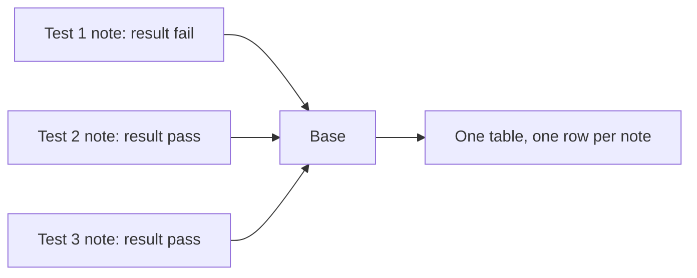

{:class="cover"}

---

By the end of this lesson you will be able to build a Base that lists your robot test notes as a table, and explain how it differs from a Dataview query.

After a few weeks your build log will hold dozens of test notes. Opening each one to see which passed is slow. What you want is a table: one row per test, with columns for the result and the date. Obsidian can build that for you from the **properties** at the top of each note, using a built-in feature called **Bases**. A community plugin called **Dataview** does a similar job with queries.



---

## Bases

A Base is a database view of your notes. It reads the properties of your notes and shows them as a table or cards, which you can filter, sort and group. Bases are built in, so no plugin is needed.



### Create a Base

Any of these works:

- Open the command palette and run **Bases: Create new base**, which makes one in the same folder as the open note.
- Right-click a folder in the file explorer and choose **New base**.
- Run **Bases: Insert new base** to create one and embed it in the current note.

A Base is saved as a `.base` file. It stores the *view*, and the data still lives in the properties of your notes.

### What a Base file looks like

You normally build a Base by clicking, but the file is just YAML, so you can read it. Here is one that shows every note tagged `test`:

```yaml
filters:
  and:
    - file.hasTag("test")
properties:
  note.result:
    displayName: Result
views:
  - type: table
    name: Test results
    order:
      - file.name
      - note.result
      - note.date
    groupBy:
      property: note.result
      direction: ASC
```

The pieces are:

- `filters` decide which notes are included. Here, notes with the tag `test`.
- `properties` can give columns friendlier names.
- `views` describe the table: which columns to show (`order`) and how to group.

For this to work, each test note needs properties at the top such as:

```yaml
---
tags:
  - test
result: pass
date: 2026-11-24
---
```

We look at properties properly in the next lesson.

### Embedding a Base

Put `![[Test results.base]]` in a note to show the Base inside it. You can also write the YAML straight into a code block with the language `base`.

---

## Dataview

Dataview is a **community plugin**, so it is off until you install and enable it. It lets you write queries in a code block:

````markdown
```dataview
TABLE file.mtime AS "Last modified"
FROM #test
SORT file.mtime DESC
```
````

This lists every note tagged `test`, newest edit first. Dataview is more powerful for complicated queries, but you have to learn its query language, and it depends on a plugin kept up to date by someone else. Its documentation is at <https://blacksmithgu.github.io/obsidian-dataview/>.

**Which should you use?** Start with Bases. It is built in, you can build it with the mouse, and it is enough for most build logs. Reach for Dataview if you hit something Bases cannot do.

---

## Try it Yourself

1. Add `tags: test`, `result` and `date` properties to three test notes.
2. Create a Base, filter it to the `test` tag and show the `result` and `date` columns.
3. Group the Base by `result`, so passes and fails sit together.
4. Challenge: embed your Base in a `Dashboard` note next to your open tasks.

---

## Common Issues

- **Problem**: My Base is empty.
- **Solution**: Check the filter. Make sure the notes really have the tag, and that you wrote it the same way, such as `test` and not `tests`.
- **Why**: A Base only shows notes that match its filters exactly.

- **Problem**: A column is blank for some notes.
- **Solution**: Open those notes and add the missing property.
- **Why**: Bases read properties from each note, so a note without the property has nothing to show.

- **Problem**: My Dataview code block just shows the text of the query.
- **Solution**: Install and enable the Dataview community plugin.
- **Why**: The block is only run by the plugin.

> **Teachers**: Bases is part of Obsidian, so it works without installing anything. Prefer it over plugins for class use, and check the version your learners have, because a Base needs a version of Obsidian that includes the feature.

---

## Check your understanding


? Where does the data in a Base come from?
- [ ] A separate database file
- [x] The properties in your notes
- [ ] The internet
> Bases read the properties at the top of each note.

? What is the difference between Bases and Dataview?
- [ ] Bases need a plugin, Dataview is built in
- [x] Bases are built in, Dataview is a community plugin
- [ ] They are the same thing
> Dataview is a community plugin and must be turned on.

? What file type does a Base use?
- [ ] `.md`
- [x] `.base`
- [ ] `.json`
> Bases are saved as `.base` files.

